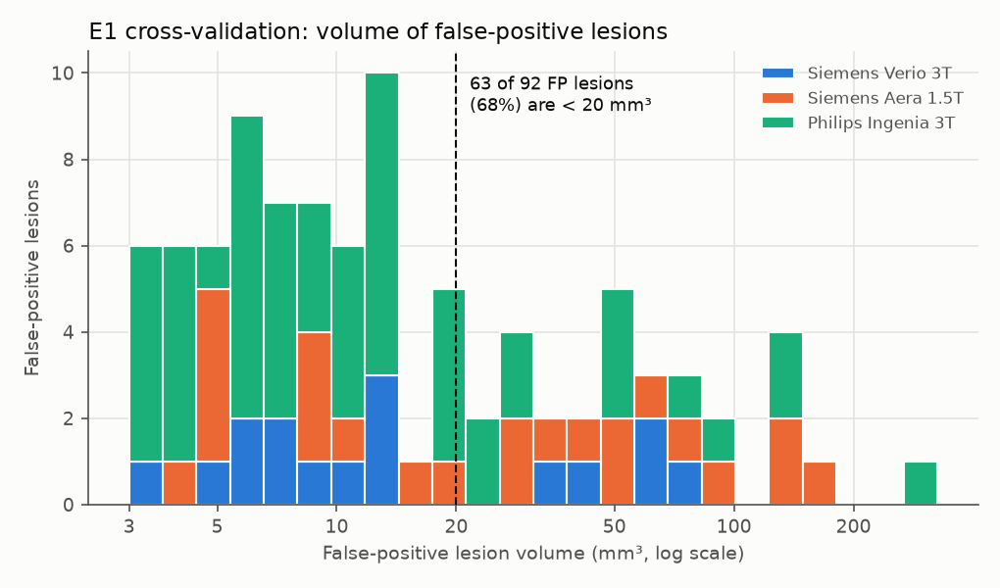
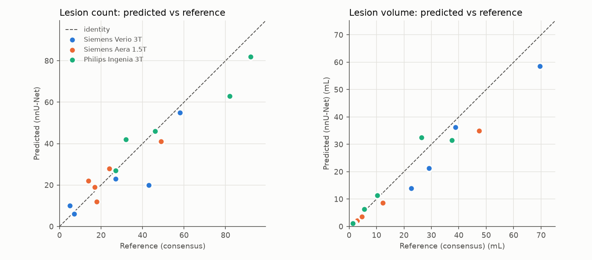

# E1 cross-validation summary — nnU-Net v2 3d_fullres, MSSEG-2016

Generated 2026-11-17 18:28 from commit `b7d6001` by `scripts/e1_summary.py`.

> **Complete: all 5 folds evaluated, 15 of 15 patients**, each scored once by the model that did not train on it.

Trainer `nnUNetTrainer`, 1000 epochs in every fold; patient-level folds stratified by scanner (one patient per scanner per fold), seed 20261011. Lesion rule: 26-connected components ≥ 3.0 mm³, α = 0.1, γ = 0.65 (pending check against animaSegPerfAnalyzer). Size bins (from MSSEG training counts): <20, 20-100, >=100 mm³. Reference: MSSEG consensus. **No test case is used here.**

## Folds

| fold | status | epochs | wall time (h) | train time (h) | s / epoch | nnU-Net val Dice | evaluated | validation patients |
|---|---|---|---|---|---|---|---|---|
| 0 | finished | 1000 / 1000 | 9.20 | 8.99 | 32.36 | 0.75 | yes | c01_p05, c07_p03, c08_p01 |
| 1 | finished | 1000 / 1000 | 9.17 | 8.97 | 32.31 | 0.76 | yes | c01_p04, c07_p05, c08_p05 |
| 2 | finished | 1000 / 1000 | 9.18 | 8.99 | 32.35 | 0.84 | yes | c01_p01, c07_p02, c08_p03 |
| 3 | finished | 1000 / 1000 | 9.17 | 8.98 | 32.32 | 0.78 | yes | c01_p03, c07_p01, c08_p04 |
| 4 | finished | 1000 / 1000 | 9.18 | 8.97 | 32.31 | 0.70 | yes | c01_p02, c07_p04, c08_p02 |

Wall time = nnU-Net run incl. final validation (from `logs/E1/fold<k>.log`); train time = sum of per-epoch times. nnU-Net val Dice = nnU-Net's own validation summary (foreground mean), for cross-checking our Dice. Background job not running. Training curves: `figures/fold<k>_progress.png`.

## Pooled cross-validation metrics (15 patients, one value per patient)

Mean ± SD, median and percentile-bootstrap 95% CI of the mean over patients (10,000 resamples). `fp_lesions` = false-positive lesions per scan. `recall_<bin>` only counts patients with at least one reference lesion in that bin; `f1_<bin>` also counts patients who have only false-positive lesions in that bin (F1 = 0) and leaves out patients with no lesion of that size in either mask, so n can differ (`msbench.reporting.mask_empty_bins`).

| metric | n | mean ± SD | median | 95% CI |
|---|---|---|---|---|
| dice | 15 | 0.767 ± 0.082 | 0.785 | [0.728, 0.807] |
| lesion_precision | 15 | 0.806 ± 0.098 | 0.829 | [0.755, 0.851] |
| lesion_recall | 15 | 0.683 ± 0.185 | 0.717 | [0.590, 0.770] |
| lesion_f1 | 15 | 0.721 ± 0.128 | 0.706 | [0.657, 0.783] |
| fp_lesions | 15 | 6.133 ± 4.565 | 5.000 | [4.000, 8.467] |
| recall_<20 | 12 | 0.293 ± 0.252 | 0.267 | [0.158, 0.428] |
| recall_20-100 | 15 | 0.700 ± 0.233 | 0.750 | [0.585, 0.810] |
| recall_>=100 | 15 | 0.862 ± 0.158 | 0.909 | [0.781, 0.934] |
| f1_<20 | 15 | 0.261 ± 0.272 | 0.182 | [0.134, 0.399] |
| f1_20-100 | 15 | 0.737 ± 0.182 | 0.750 | [0.647, 0.822] |
| f1_>=100 | 15 | 0.892 ± 0.112 | 0.923 | [0.835, 0.943] |

Per-fold means (fold-to-fold spread; each fold has 3 patients, one per scanner):

| metric | fold 0 | fold 1 | fold 2 | fold 3 | fold 4 |
|---|---|---|---|---|---|
| dice | 0.753 | 0.762 | 0.838 | 0.783 | 0.700 |
| lesion_precision | 0.776 | 0.831 | 0.822 | 0.807 | 0.793 |
| lesion_recall | 0.659 | 0.792 | 0.559 | 0.664 | 0.739 |
| lesion_f1 | 0.682 | 0.810 | 0.629 | 0.720 | 0.761 |
| fp_lesions | 5.000 | 6.333 | 6.667 | 7.333 | 5.333 |

## Metrics per scanner

Mean ± SD over the patients of each scanner, with the bootstrap 95% CI of the mean below (n = 5 per scanner when complete: indicative only).

| metric | Siemens Verio 3T (n=5) | Siemens Aera 1.5T (n=5) | Philips Ingenia 3T (n=5) |
|---|---|---|---|
| dice | 0.796 ± 0.101 [0.716, 0.875] | 0.718 ± 0.070 [0.662, 0.772] | 0.788 ± 0.062 [0.735, 0.827] |
| lesion_precision | 0.841 ± 0.053 [0.800, 0.883] | 0.805 ± 0.126 [0.689, 0.890] | 0.771 ± 0.109 [0.693, 0.864] |
| lesion_recall | 0.557 ± 0.202 [0.399, 0.715] | 0.734 ± 0.206 [0.577, 0.891] | 0.757 ± 0.079 [0.698, 0.817] |
| lesion_f1 | 0.652 ± 0.158 [0.529, 0.774] | 0.750 ± 0.135 [0.649, 0.857] | 0.760 ± 0.070 [0.704, 0.814] |
| fp_lesions | 3.200 ± 2.168 [1.600, 5.000] | 4.600 ± 3.209 [2.200, 7.200] | 10.600 ± 4.393 [7.000, 13.800] |

## Lesion-level recall by size bin (pooled lesions)

Detected / reference lesions summed over patients, with a cluster bootstrap 95% CI that resamples whole patients. The per-patient mean recall per bin is in the pooled table above (`recall_<bin>`).

| bin_mm3 | patients | patients_with_lesions_in_bin | detected | reference_lesions | recall | 95% CI |
|---|---|---|---|---|---|---|
| <20 | 15 | 12 | 58 | 127 | 0.457 | [0.264, 0.569] |
| 20-100 | 15 | 15 | 174 | 243 | 0.716 | [0.597, 0.807] |
| >=100 | 15 | 15 | 147 | 171 | 0.860 | [0.768, 0.936] |

Per scanner (detected / reference, recall, 95% CI):

| scanner | <20 | 20-100 | >=100 |
|---|---|---|---|
| Siemens Verio 3T | 9 / 36 (0.25) [0.050, 0.447] | 43 / 64 (0.67) [0.421, 0.846] | 29 / 40 (0.72) [0.550, 0.950] |
| Siemens Aera 1.5T | 1 / 7 (0.14) [0.000, 0.167] | 28 / 51 (0.55) [0.417, 0.867] | 55 / 64 (0.86) [0.762, 0.955] |
| Philips Ingenia 3T | 48 / 84 (0.57) [0.451, 0.627] | 103 / 128 (0.80) [0.726, 0.878] | 63 / 67 (0.94) [0.860, 0.989] |

## Error analysis

### Missed lesions (162 of 541 reference lesions)

Cell = missed / reference (% missed). A missed lesion either has no predicted voxel on it at all, or is partly covered but fails the rule (covered < α = 0.1 by components that are not too large, γ = 0.65).

| scanner | <20 | 20-100 | >=100 |
|---|---|---|---|
| Siemens Verio 3T | 27 / 36 (75%) | 21 / 64 (33%) | 11 / 40 (28%) |
| Siemens Aera 1.5T | 6 / 7 (86%) | 23 / 51 (45%) | 9 / 64 (14%) |
| Philips Ingenia 3T | 36 / 84 (43%) | 25 / 128 (20%) | 4 / 67 (6%) |
| **all** | 69 / 127 (54%) | 69 / 243 (28%) | 24 / 171 (14%) |

Missed lesions by kind (all scanners):

| bin (mm³) | missed | no predicted voxel | partly covered |
|---|---|---|---|
| <20 | 69 | 64 | 5 |
| 20-100 | 69 | 66 | 3 |
| >=100 | 24 | 18 | 6 |

### False-positive lesions (92 over 15 scans)

**63 of 92 false-positive lesions (68%) are smaller than 20 mm³.** Median FP volume 11.2 mm³ (IQR 6.1–29.5); 0 FP lesions touch a reference lesion but have < α = 0.1 of their volume inside it; the other 92 lie entirely outside the consensus. Minimum component size is 3.0 mm³ (smaller components are discarded in both masks).

| scanner | scans | FP lesions | FP / scan | <20 mm³ | 20-100 mm³ | >=100 mm³ | median volume (mm³) | touching reference |
|---|---|---|---|---|---|---|---|---|
| Siemens Verio 3T | 5 | 16 | 3.2 | 11 | 5 | 0 | 11.0 | 0 |
| Siemens Aera 1.5T | 5 | 23 | 4.6 | 11 | 9 | 3 | 26.8 | 0 |
| Philips Ingenia 3T | 5 | 53 | 10.6 | 41 | 9 | 3 | 10.1 | 0 |
| **all** | 15 | 92 | 6.1 | 63 | 23 | 6 | 11.2 | 0 |

## Lesion count and volume agreement

| quantity | unit | n | bias (pred − ref) | MAE | LoA low | LoA high |
|---|---|---|---|---|---|---|
| lesion count | lesions | 15 | -3.000 | 6.867 | -21.070 | 15.070 |
| lesion volume | mL | 15 | -3.134 | 4.194 | -13.096 | 6.828 |

Bias and 95% limits of agreement (Bland–Altman, bias ± 1.96 SD of the differences).

## Out-of-fold predictions (input for E2b)

15 of 15 training patients have an out-of-fold mask (predicted by the fold model that did not train on them), 15 with nnU-Net probabilities (`.npz`). Originals: `$nnUNet_results/<nnunet_prediction>` (relative paths below); copies in `results/E1/oof_predictions/` (not committed); list in `tables/oof_predictions.csv`.

| case_id | fold | scanner | nnunet_prediction | exists | probabilities_npz |
|---|---|---|---|---|---|
| msseg_train_c01_p01 | 2 | siemens_verio_3t | Dataset501_MSSEG2016/nnUNetTrainer__nnUNetPlans__3d_fullres/fold_2/validation/msseg_train_c01_p01.nii.gz | True | True |
| msseg_train_c01_p02 | 4 | siemens_verio_3t | Dataset501_MSSEG2016/nnUNetTrainer__nnUNetPlans__3d_fullres/fold_4/validation/msseg_train_c01_p02.nii.gz | True | True |
| msseg_train_c01_p03 | 3 | siemens_verio_3t | Dataset501_MSSEG2016/nnUNetTrainer__nnUNetPlans__3d_fullres/fold_3/validation/msseg_train_c01_p03.nii.gz | True | True |
| msseg_train_c01_p04 | 1 | siemens_verio_3t | Dataset501_MSSEG2016/nnUNetTrainer__nnUNetPlans__3d_fullres/fold_1/validation/msseg_train_c01_p04.nii.gz | True | True |
| msseg_train_c01_p05 | 0 | siemens_verio_3t | Dataset501_MSSEG2016/nnUNetTrainer__nnUNetPlans__3d_fullres/fold_0/validation/msseg_train_c01_p05.nii.gz | True | True |
| msseg_train_c07_p01 | 3 | siemens_aera_1p5t | Dataset501_MSSEG2016/nnUNetTrainer__nnUNetPlans__3d_fullres/fold_3/validation/msseg_train_c07_p01.nii.gz | True | True |
| msseg_train_c07_p02 | 2 | siemens_aera_1p5t | Dataset501_MSSEG2016/nnUNetTrainer__nnUNetPlans__3d_fullres/fold_2/validation/msseg_train_c07_p02.nii.gz | True | True |
| msseg_train_c07_p03 | 0 | siemens_aera_1p5t | Dataset501_MSSEG2016/nnUNetTrainer__nnUNetPlans__3d_fullres/fold_0/validation/msseg_train_c07_p03.nii.gz | True | True |
| msseg_train_c07_p04 | 4 | siemens_aera_1p5t | Dataset501_MSSEG2016/nnUNetTrainer__nnUNetPlans__3d_fullres/fold_4/validation/msseg_train_c07_p04.nii.gz | True | True |
| msseg_train_c07_p05 | 1 | siemens_aera_1p5t | Dataset501_MSSEG2016/nnUNetTrainer__nnUNetPlans__3d_fullres/fold_1/validation/msseg_train_c07_p05.nii.gz | True | True |
| msseg_train_c08_p01 | 0 | philips_ingenia_3t | Dataset501_MSSEG2016/nnUNetTrainer__nnUNetPlans__3d_fullres/fold_0/validation/msseg_train_c08_p01.nii.gz | True | True |
| msseg_train_c08_p02 | 4 | philips_ingenia_3t | Dataset501_MSSEG2016/nnUNetTrainer__nnUNetPlans__3d_fullres/fold_4/validation/msseg_train_c08_p02.nii.gz | True | True |
| msseg_train_c08_p03 | 2 | philips_ingenia_3t | Dataset501_MSSEG2016/nnUNetTrainer__nnUNetPlans__3d_fullres/fold_2/validation/msseg_train_c08_p03.nii.gz | True | True |
| msseg_train_c08_p04 | 3 | philips_ingenia_3t | Dataset501_MSSEG2016/nnUNetTrainer__nnUNetPlans__3d_fullres/fold_3/validation/msseg_train_c08_p04.nii.gz | True | True |
| msseg_train_c08_p05 | 1 | philips_ingenia_3t | Dataset501_MSSEG2016/nnUNetTrainer__nnUNetPlans__3d_fullres/fold_1/validation/msseg_train_c08_p05.nii.gz | True | True |

## Per-patient results

| fold | case_id | scanner | dice | lesion_precision | lesion_recall | lesion_f1 | fp_lesions | n_ref_lesions | n_pred_lesions | ref_volume_ml | pred_volume_ml | recall_<20 | recall_20-100 | recall_>=100 |
|---|---|---|---|---|---|---|---|---|---|---|---|---|---|---|
| 0 | msseg_train_c01_p05 | siemens_verio_3t | 0.810 | 0.800 | 0.400 | 0.533 | 2 | 5 | 10 | 29.112 | 21.318 | 0.000 | 0.333 | 1.000 |
| 0 | msseg_train_c07_p03 | siemens_aera_1p5t | 0.662 | 0.591 | 0.857 | 0.700 | 9 | 14 | 22 | 2.986 | 2.167 | 0.000 | 0.800 | 1.000 |
| 0 | msseg_train_c08_p01 | philips_ingenia_3t | 0.785 | 0.937 | 0.720 | 0.814 | 4 | 82 | 63 | 10.335 | 11.367 | 0.655 | 0.694 | 0.882 |
| 1 | msseg_train_c01_p04 | siemens_verio_3t | 0.710 | 0.833 | 0.714 | 0.769 | 1 | 7 | 6 | 0.912 | 0.749 | 0.333 | 1.000 | 1.000 |
| 1 | msseg_train_c07_p05 | siemens_aera_1p5t | 0.770 | 0.842 | 0.824 | 0.833 | 3 | 17 | 19 | 12.276 | 8.668 | – | 0.667 | 0.909 |
| 1 | msseg_train_c08_p05 | philips_ingenia_3t | 0.805 | 0.817 | 0.837 | 0.827 | 15 | 92 | 82 | 26.432 | 32.555 | 0.579 | 0.854 | 1.000 |
| 2 | msseg_train_c01_p01 | siemens_verio_3t | 0.884 | 0.900 | 0.302 | 0.453 | 2 | 43 | 20 | 69.614 | 58.587 | 0.062 | 0.400 | 0.500 |
| 2 | msseg_train_c07_p02 | siemens_aera_1p5t | 0.788 | 0.829 | 0.531 | 0.647 | 7 | 49 | 41 | 47.458 | 35.004 | 0.167 | 0.429 | 0.727 |
| 2 | msseg_train_c08_p03 | philips_ingenia_3t | 0.842 | 0.738 | 0.844 | 0.787 | 11 | 32 | 42 | 37.531 | 31.541 | 0.200 | 0.933 | 1.000 |
| 3 | msseg_train_c01_p03 | siemens_verio_3t | 0.900 | 0.891 | 0.776 | 0.829 | 6 | 58 | 55 | 38.747 | 36.304 | 0.467 | 0.862 | 0.929 |
| 3 | msseg_train_c07_p01 | siemens_aera_1p5t | 0.626 | 0.833 | 0.500 | 0.625 | 2 | 18 | 12 | 1.806 | 1.144 | – | 0.333 | 0.833 |
| 3 | msseg_train_c08_p04 | philips_ingenia_3t | 0.824 | 0.696 | 0.717 | 0.706 | 14 | 46 | 46 | 5.505 | 6.307 | 0.600 | 0.750 | 0.900 |
| 4 | msseg_train_c01_p02 | siemens_verio_3t | 0.675 | 0.783 | 0.593 | 0.674 | 5 | 27 | 23 | 22.627 | 13.958 | 0.000 | 0.600 | 0.636 |
| 4 | msseg_train_c07_p04 | siemens_aera_1p5t | 0.743 | 0.929 | 0.958 | 0.943 | 2 | 24 | 28 | 4.675 | 3.640 | – | 1.000 | 0.941 |
| 4 | msseg_train_c08_p02 | philips_ingenia_3t | 0.683 | 0.667 | 0.667 | 0.667 | 9 | 27 | 27 | 1.423 | 1.129 | 0.455 | 0.846 | 0.667 |
