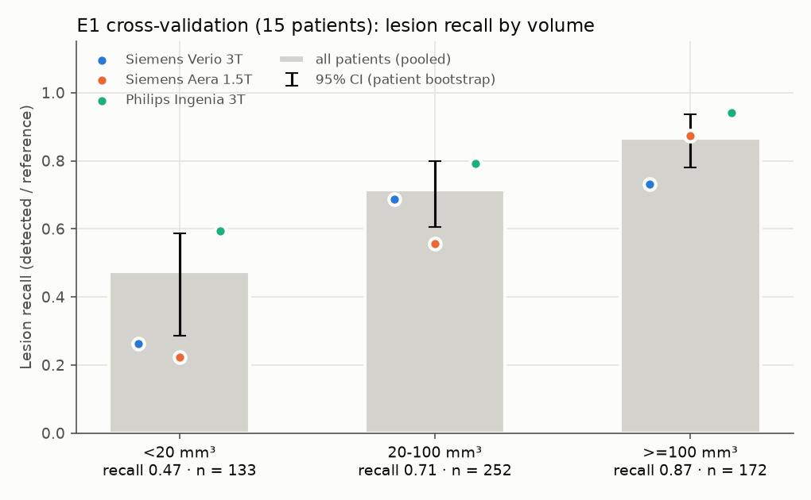
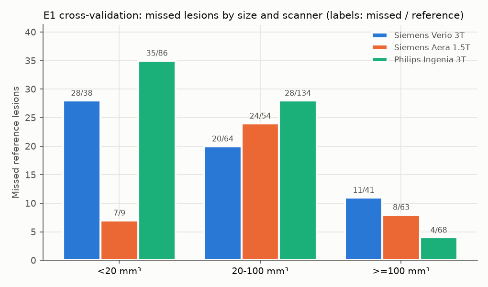
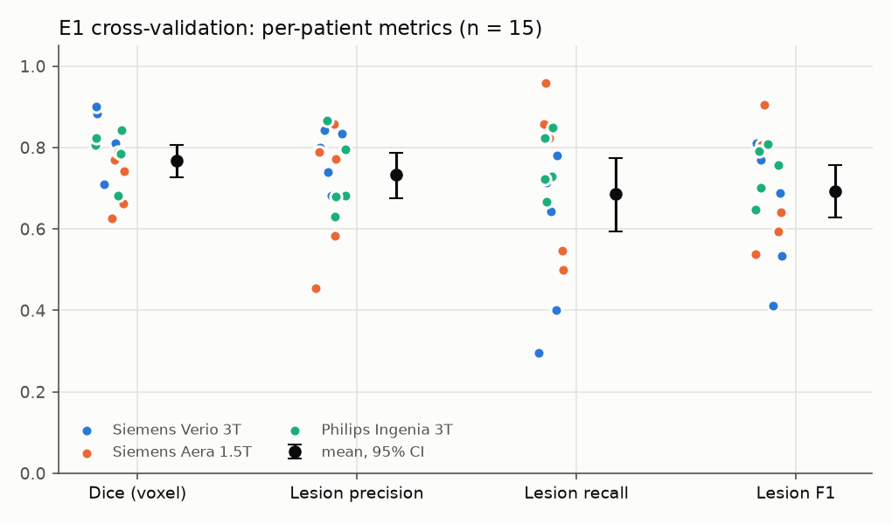

# E1 cross-validation summary — nnU-Net v2 3d_fullres, MSSEG-2016

Generated 2026-11-17 19:09 from commit `540f710` by `scripts/e1_summary.py`.

> **Complete: all 5 folds evaluated, 15 of 15 patients**, each scored once by the model that did not train on it.

Trainer `nnUNetTrainer`, 1000 epochs in every fold; patient-level folds stratified by scanner (one patient per scanner per fold), seed 20261011. Lesion rule: 6-connected components > 3.0 mm³, α = 0.1, β = 0.7, γ = 0.65 (port of animaSegPerfAnalyzer 4.2, verified on all 15 training patients). Size bins (from MSSEG training counts): <20, 20-100, >=100 mm³. Reference: MSSEG consensus. **No test case is used here.**

## Folds

| fold | status | epochs | wall time (h) | train time (h) | s / epoch | nnU-Net val Dice | evaluated | validation patients |
|---|---|---|---|---|---|---|---|---|
| 0 | finished | 1000 / 1000 | 9.20 | 8.99 | 32.36 | 0.75 | yes | c01_p05, c07_p03, c08_p01 |
| 1 | finished | 1000 / 1000 | 9.17 | 8.97 | 32.31 | 0.76 | yes | c01_p04, c07_p05, c08_p05 |
| 2 | finished | 1000 / 1000 | 9.18 | 8.99 | 32.35 | 0.84 | yes | c01_p01, c07_p02, c08_p03 |
| 3 | finished | 1000 / 1000 | 9.17 | 8.98 | 32.32 | 0.78 | yes | c01_p03, c07_p01, c08_p04 |
| 4 | finished | 1000 / 1000 | 9.18 | 8.97 | 32.31 | 0.70 | yes | c01_p02, c07_p04, c08_p02 |

Wall time = nnU-Net run incl. final validation (from `logs/E1/fold<k>.log`); train time = sum of per-epoch times. nnU-Net val Dice = nnU-Net's own validation summary (foreground mean), for cross-checking our Dice. Background job not running. Training curves: `figures/fold<k>_progress.png`.

## Pooled cross-validation metrics (15 patients, one value per patient)

Mean ± SD, median and percentile-bootstrap 95% CI of the mean over patients (10,000 resamples). `fp_lesions` = false-positive lesions per scan. `recall_<bin>` only counts patients with at least one reference lesion in that bin; `f1_<bin>` also counts patients who have only false-positive lesions in that bin (F1 = 0) and leaves out patients with no lesion of that size in either mask, so n can differ (`msbench.reporting.mask_empty_bins`).

| metric | n | mean ± SD | median | 95% CI |
|---|---|---|---|---|
| dice | 15 | 0.767 ± 0.082 | 0.785 | [0.728, 0.807] |
| lesion_precision | 15 | 0.734 ± 0.115 | 0.773 | [0.675, 0.787] |
| lesion_recall | 15 | 0.687 ± 0.183 | 0.723 | [0.594, 0.774] |
| lesion_f1 | 15 | 0.693 ± 0.133 | 0.701 | [0.629, 0.758] |
| fp_lesions | 15 | 8.333 ± 4.791 | 9.000 | [6.067, 10.667] |
| recall_<20 | 12 | 0.322 ± 0.255 | 0.367 | [0.183, 0.457] |
| recall_20-100 | 15 | 0.702 ± 0.224 | 0.750 | [0.591, 0.806] |
| recall_>=100 | 15 | 0.867 ± 0.153 | 0.909 | [0.788, 0.936] |
| f1_<20 | 15 | 0.261 ± 0.258 | 0.286 | [0.140, 0.389] |
| f1_20-100 | 15 | 0.708 ± 0.181 | 0.750 | [0.618, 0.794] |
| f1_>=100 | 15 | 0.886 ± 0.112 | 0.909 | [0.827, 0.936] |

Per-fold means (fold-to-fold spread; each fold has 3 patients, one per scanner):

| metric | fold 0 | fold 1 | fold 2 | fold 3 | fold 4 |
|---|---|---|---|---|---|
| dice | 0.753 | 0.762 | 0.838 | 0.783 | 0.700 |
| lesion_precision | 0.707 | 0.806 | 0.712 | 0.702 | 0.742 |
| lesion_recall | 0.662 | 0.787 | 0.564 | 0.668 | 0.756 |
| lesion_f1 | 0.640 | 0.795 | 0.603 | 0.683 | 0.747 |
| fp_lesions | 7.667 | 7.333 | 10.333 | 9.667 | 6.667 |

## Metrics per scanner

Mean ± SD over the patients of each scanner, with the bootstrap 95% CI of the mean below (n = 5 per scanner when complete: indicative only).

| metric | Siemens Verio 3T (n=5) | Siemens Aera 1.5T (n=5) | Philips Ingenia 3T (n=5) |
|---|---|---|---|
| dice | 0.796 ± 0.101 [0.716, 0.875] | 0.718 ± 0.070 [0.662, 0.772] | 0.788 ± 0.062 [0.735, 0.827] |
| lesion_precision | 0.779 ± 0.068 [0.724, 0.830] | 0.691 ± 0.167 [0.547, 0.813] | 0.731 ± 0.097 [0.661, 0.815] |
| lesion_recall | 0.566 ± 0.209 [0.400, 0.726] | 0.737 ± 0.202 [0.581, 0.891] | 0.758 ± 0.075 [0.702, 0.818] |
| lesion_f1 | 0.642 ± 0.167 [0.508, 0.769] | 0.697 ± 0.153 [0.581, 0.823] | 0.741 ± 0.066 [0.691, 0.791] |
| fp_lesions | 5.000 ± 3.391 [2.400, 7.600] | 7.000 ± 3.742 [4.200, 10.000] | 13.000 ± 3.391 [10.400, 15.600] |

## Lesion-level recall by size bin (pooled lesions)

Detected / reference lesions summed over patients, with a cluster bootstrap 95% CI that resamples whole patients. The per-patient mean recall per bin is in the pooled table above (`recall_<bin>`).

| bin_mm3 | patients | patients_with_lesions_in_bin | detected | reference_lesions | recall | 95% CI |
|---|---|---|---|---|---|---|
| <20 | 15 | 12 | 63 | 133 | 0.474 | [0.287, 0.586] |
| 20-100 | 15 | 15 | 180 | 252 | 0.714 | [0.604, 0.798] |
| >=100 | 15 | 15 | 149 | 172 | 0.866 | [0.779, 0.938] |

Per scanner (detected / reference, recall, 95% CI):

| scanner | <20 | 20-100 | >=100 |
|---|---|---|---|
| Siemens Verio 3T | 10 / 38 (0.26) [0.048, 0.480] | 44 / 64 (0.69) [0.421, 0.846] | 30 / 41 (0.73) [0.551, 0.950] |
| Siemens Aera 1.5T | 2 / 9 (0.22) [0.000, 0.250] | 30 / 54 (0.56) [0.418, 0.867] | 55 / 63 (0.87) [0.792, 0.955] |
| Philips Ingenia 3T | 51 / 86 (0.59) [0.500, 0.643] | 106 / 134 (0.79) [0.733, 0.844] | 64 / 68 (0.94) [0.863, 0.989] |

## Error analysis

### Missed lesions (165 of 557 reference lesions)

Cell = missed / reference (% missed). A missed lesion either has no predicted voxel on it at all, or is partly covered but fails the rule (covered fraction ≤ α = 0.1, or one of the predicted components making up the first γ = 0.65 of the overlap lies more than β = 0.7 outside the consensus).

| scanner | <20 | 20-100 | >=100 |
|---|---|---|---|
| Siemens Verio 3T | 28 / 38 (74%) | 20 / 64 (31%) | 11 / 41 (27%) |
| Siemens Aera 1.5T | 7 / 9 (78%) | 24 / 54 (44%) | 8 / 63 (13%) |
| Philips Ingenia 3T | 35 / 86 (41%) | 28 / 134 (21%) | 4 / 68 (6%) |
| **all** | 70 / 133 (53%) | 72 / 252 (29%) | 23 / 172 (13%) |

Missed lesions by kind (all scanners):

| bin (mm³) | missed | no predicted voxel | partly covered |
|---|---|---|---|
| <20 | 70 | 67 | 3 |
| 20-100 | 72 | 69 | 3 |
| >=100 | 23 | 17 | 6 |

### False-positive lesions (125 over 15 scans)

**83 of 125 false-positive lesions (66%) are smaller than 20 mm³.** Median FP volume 11.6 mm³ (IQR 6.2–32.1); 93 lie entirely outside the consensus; 1 touch a reference lesion with ≤ α = 0.1 of their volume inside; 31 lie mostly inside a reference lesion that is more than β = 0.7 uncovered by the prediction (Anima counts a small prediction inside a large, mostly missed lesion as a false positive). Components ≤ 3.0 mm³ are discarded in both masks.

| scanner | scans | FP lesions | FP / scan | <20 mm³ | 20-100 mm³ | >=100 mm³ | median volume (mm³) | touching reference |
|---|---|---|---|---|---|---|---|---|
| Siemens Verio 3T | 5 | 25 | 5.0 | 18 | 6 | 1 | 10.7 | 9 |
| Siemens Aera 1.5T | 5 | 35 | 7.0 | 16 | 16 | 3 | 25.4 | 12 |
| Philips Ingenia 3T | 5 | 65 | 13.0 | 49 | 10 | 6 | 9.7 | 11 |
| **all** | 15 | 125 | 8.3 | 83 | 32 | 10 | 11.6 | 32 |

## Lesion count and volume agreement

| quantity | unit | n | bias (pred − ref) | MAE | LoA low | LoA high |
|---|---|---|---|---|---|---|
| lesion count | lesions | 15 | -3.067 | 7.067 | -21.310 | 15.177 |
| lesion volume | mL | 15 | -3.128 | 4.190 | -13.084 | 6.828 |

Bias and 95% limits of agreement (Bland–Altman, bias ± 1.96 SD of the differences).

## Out-of-fold predictions (input for E2b)

15 of 15 training patients have an out-of-fold mask (predicted by the fold model that did not train on them), 15 with nnU-Net probabilities (`.npz`). Originals: `$nnUNet_results/<nnunet_prediction>` (relative paths below); copies in `results/E1/oof_predictions/` (not committed); list in `tables/oof_predictions.csv`.

| case_id | fold | scanner | nnunet_prediction | exists | probabilities_npz |
|---|---|---|---|---|---|
| msseg_train_c01_p01 | 2 | siemens_verio_3t | Dataset501_MSSEG2016/nnUNetTrainer__nnUNetPlans__3d_fullres/fold_2/validation/msseg_train_c01_p01.nii.gz | True | True |
| msseg_train_c01_p02 | 4 | siemens_verio_3t | Dataset501_MSSEG2016/nnUNetTrainer__nnUNetPlans__3d_fullres/fold_4/validation/msseg_train_c01_p02.nii.gz | True | True |
| msseg_train_c01_p03 | 3 | siemens_verio_3t | Dataset501_MSSEG2016/nnUNetTrainer__nnUNetPlans__3d_fullres/fold_3/validation/msseg_train_c01_p03.nii.gz | True | True |
| msseg_train_c01_p04 | 1 | siemens_verio_3t | Dataset501_MSSEG2016/nnUNetTrainer__nnUNetPlans__3d_fullres/fold_1/validation/msseg_train_c01_p04.nii.gz | True | True |
| msseg_train_c01_p05 | 0 | siemens_verio_3t | Dataset501_MSSEG2016/nnUNetTrainer__nnUNetPlans__3d_fullres/fold_0/validation/msseg_train_c01_p05.nii.gz | True | True |
| msseg_train_c07_p01 | 3 | siemens_aera_1p5t | Dataset501_MSSEG2016/nnUNetTrainer__nnUNetPlans__3d_fullres/fold_3/validation/msseg_train_c07_p01.nii.gz | True | True |
| msseg_train_c07_p02 | 2 | siemens_aera_1p5t | Dataset501_MSSEG2016/nnUNetTrainer__nnUNetPlans__3d_fullres/fold_2/validation/msseg_train_c07_p02.nii.gz | True | True |
| msseg_train_c07_p03 | 0 | siemens_aera_1p5t | Dataset501_MSSEG2016/nnUNetTrainer__nnUNetPlans__3d_fullres/fold_0/validation/msseg_train_c07_p03.nii.gz | True | True |
| msseg_train_c07_p04 | 4 | siemens_aera_1p5t | Dataset501_MSSEG2016/nnUNetTrainer__nnUNetPlans__3d_fullres/fold_4/validation/msseg_train_c07_p04.nii.gz | True | True |
| msseg_train_c07_p05 | 1 | siemens_aera_1p5t | Dataset501_MSSEG2016/nnUNetTrainer__nnUNetPlans__3d_fullres/fold_1/validation/msseg_train_c07_p05.nii.gz | True | True |
| msseg_train_c08_p01 | 0 | philips_ingenia_3t | Dataset501_MSSEG2016/nnUNetTrainer__nnUNetPlans__3d_fullres/fold_0/validation/msseg_train_c08_p01.nii.gz | True | True |
| msseg_train_c08_p02 | 4 | philips_ingenia_3t | Dataset501_MSSEG2016/nnUNetTrainer__nnUNetPlans__3d_fullres/fold_4/validation/msseg_train_c08_p02.nii.gz | True | True |
| msseg_train_c08_p03 | 2 | philips_ingenia_3t | Dataset501_MSSEG2016/nnUNetTrainer__nnUNetPlans__3d_fullres/fold_2/validation/msseg_train_c08_p03.nii.gz | True | True |
| msseg_train_c08_p04 | 3 | philips_ingenia_3t | Dataset501_MSSEG2016/nnUNetTrainer__nnUNetPlans__3d_fullres/fold_3/validation/msseg_train_c08_p04.nii.gz | True | True |
| msseg_train_c08_p05 | 1 | philips_ingenia_3t | Dataset501_MSSEG2016/nnUNetTrainer__nnUNetPlans__3d_fullres/fold_1/validation/msseg_train_c08_p05.nii.gz | True | True |

## Per-patient results

| fold | case_id | scanner | dice | lesion_precision | lesion_recall | lesion_f1 | fp_lesions | n_ref_lesions | n_pred_lesions | ref_volume_ml | pred_volume_ml | recall_<20 | recall_20-100 | recall_>=100 |
|---|---|---|---|---|---|---|---|---|---|---|---|---|---|---|
| 0 | msseg_train_c01_p05 | siemens_verio_3t | 0.810 | 0.800 | 0.400 | 0.533 | 2 | 5 | 10 | 29.108 | 21.317 | 0.000 | 0.333 | 1.000 |
| 0 | msseg_train_c07_p03 | siemens_aera_1p5t | 0.662 | 0.455 | 0.857 | 0.594 | 12 | 14 | 22 | 2.984 | 2.167 | 0.000 | 0.800 | 1.000 |
| 0 | msseg_train_c08_p01 | philips_ingenia_3t | 0.785 | 0.866 | 0.729 | 0.792 | 9 | 85 | 67 | 10.333 | 11.364 | 0.667 | 0.711 | 0.882 |
| 1 | msseg_train_c01_p04 | siemens_verio_3t | 0.710 | 0.833 | 0.714 | 0.769 | 1 | 7 | 6 | 0.911 | 0.749 | 0.333 | 1.000 | 1.000 |
| 1 | msseg_train_c07_p05 | siemens_aera_1p5t | 0.770 | 0.789 | 0.824 | 0.806 | 4 | 17 | 19 | 12.270 | 8.668 | – | 0.667 | 0.909 |
| 1 | msseg_train_c08_p05 | philips_ingenia_3t | 0.805 | 0.795 | 0.823 | 0.809 | 17 | 96 | 83 | 26.419 | 32.550 | 0.600 | 0.824 | 1.000 |
| 2 | msseg_train_c01_p01 | siemens_verio_3t | 0.884 | 0.682 | 0.295 | 0.412 | 7 | 44 | 22 | 69.603 | 58.587 | 0.059 | 0.400 | 0.500 |
| 2 | msseg_train_c07_p02 | siemens_aera_1p5t | 0.788 | 0.773 | 0.547 | 0.641 | 10 | 53 | 44 | 47.440 | 35.004 | 0.250 | 0.458 | 0.762 |
| 2 | msseg_train_c08_p03 | philips_ingenia_3t | 0.842 | 0.682 | 0.848 | 0.756 | 14 | 33 | 44 | 37.514 | 31.540 | 0.400 | 0.875 | 1.000 |
| 3 | msseg_train_c01_p03 | siemens_verio_3t | 0.900 | 0.842 | 0.780 | 0.810 | 9 | 59 | 57 | 38.739 | 36.303 | 0.500 | 0.862 | 0.929 |
| 3 | msseg_train_c07_p01 | siemens_aera_1p5t | 0.626 | 0.583 | 0.500 | 0.538 | 5 | 18 | 12 | 1.806 | 1.144 | – | 0.333 | 0.833 |
| 3 | msseg_train_c08_p04 | philips_ingenia_3t | 0.824 | 0.681 | 0.723 | 0.701 | 15 | 47 | 47 | 5.500 | 6.302 | 0.600 | 0.750 | 0.909 |
| 4 | msseg_train_c01_p02 | siemens_verio_3t | 0.675 | 0.739 | 0.643 | 0.688 | 6 | 28 | 23 | 22.625 | 13.957 | 0.000 | 0.667 | 0.667 |
| 4 | msseg_train_c07_p04 | siemens_aera_1p5t | 0.743 | 0.857 | 0.958 | 0.905 | 4 | 24 | 28 | 4.673 | 3.640 | – | 1.000 | 0.941 |
| 4 | msseg_train_c08_p02 | philips_ingenia_3t | 0.683 | 0.630 | 0.667 | 0.648 | 10 | 27 | 27 | 1.423 | 1.129 | 0.455 | 0.846 | 0.667 |
