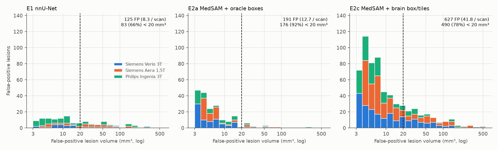
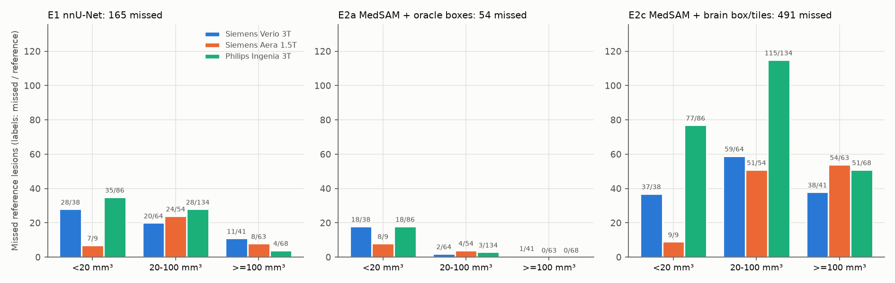

# E2 cross-validation comparison — E1 nnU-Net vs MedSAM (E2a oracle boxes, E2c brain box + tiles)

Generated 2026-11-17 20:34 from commit `6594585` by `scripts/e2_summary.py`.

> **Complete: all 15 MSSEG training patients, each scored by the fold model that did not train on them, for all three models.**

> ⚠ **E2c (and therefore the E8 decision below) is not valid yet: its training collapsed.** In all five
> folds the E2c training loss plateaus at ≈ 0.49 from step 1,000 to 10,000 (E2a falls steadily to ≈ 0.16).
> 0.5 is exactly the loss of a model that outputs an empty mask for every box: half of each batch are
> empty tiles, where per-box soft Dice is 0 only for an exactly empty output, and the lesion boxes then
> cost ≈ 1. Predictions match this: folds 1–2 output almost nothing for all six patients, fold 0
> sits just above threshold (145–224 FP per patient). The cause is the loss we chose (MedSAM's per-box
> Dice + BCE, designed for boxes that always contain the target) combined with 50 % empty boxes; it is a
> defect of our setup, not a property of MedSAM. E2a has no empty boxes and is unaffected. The E2c and
> E8 numbers are kept here unchanged for the record; see `experiments/E2/README.md`.

Same patient-level folds for all models (E1's `splits_final.json`). Lesion rule: Anima-port (6-connected, > 3.0 mm³, α 0.1 / β 0.7 / γ 0.65); reference = MSSEG consensus. MedSAM: frozen image encoder, prompt encoder + mask decoder fine-tuned per condition and fold (10000 steps × 16, same box type at training and validation). **E2a uses the reference to place its boxes and is an upper bound on tracing, not a fair comparison; E2c is the fair head-to-head with E1.** No test case is used.

| model | folds evaluated | patients |
|---|---|---|
| E1 nnU-Net | 0, 1, 2, 3, 4 | 15 |
| E2a MedSAM + oracle boxes | 0, 1, 2, 3, 4 | 15 |
| E2c MedSAM + brain box/tiles | 0, 1, 2, 3, 4 | 15 |

## Pooled metrics (15 patients, one value per patient)

Mean ± SD, with the percentile-bootstrap 95% CI of the mean below (10,000 patient resamples). `fp_lesions` = false-positive lesions per scan. Size-bin rows: recall leaves out patients without a reference lesion in the bin; F1 leaves out patients with no lesion of that size in either mask.

| metric | E1 nnU-Net | E2a MedSAM + oracle boxes | E2c MedSAM + brain box/tiles |
|---|---|---|---|
| dice | 0.767 ± 0.082 [0.727, 0.807] | 0.757 ± 0.032 [0.742, 0.773] | 0.170 ± 0.233 [0.067, 0.291] |
| lesion_precision | 0.734 ± 0.115 [0.675, 0.785] | 0.791 ± 0.145 [0.718, 0.859] | 0.108 ± 0.173 [0.033, 0.200] |
| lesion_recall | 0.687 ± 0.183 [0.594, 0.774] | 0.905 ± 0.093 [0.859, 0.948] | 0.139 ± 0.208 [0.048, 0.251] |
| lesion_f1 | 0.693 ± 0.133 [0.627, 0.757] | 0.840 ± 0.117 [0.781, 0.895] | 0.067 ± 0.082 [0.029, 0.109] |
| fp_lesions | 8.333 ± 4.791 [6.000, 10.733] | 12.733 ± 14.577 [6.333, 20.467] | 41.800 ± 70.847 [10.933, 80.200] |
| recall_<20 | 0.322 ± 0.255 [0.185, 0.457] (n=12) | 0.572 ± 0.371 [0.367, 0.767] (n=12) | 0.030 ± 0.087 [0.000, 0.085] (n=12) |
| recall_20-100 | 0.702 ± 0.224 [0.589, 0.809] | 0.962 ± 0.063 [0.928, 0.990] | 0.119 ± 0.193 [0.038, 0.227] |
| recall_>=100 | 0.867 ± 0.153 [0.787, 0.937] | 0.994 ± 0.022 [0.983, 1.000] | 0.228 ± 0.342 [0.078, 0.410] |
| f1_<20 | 0.261 ± 0.258 [0.139, 0.389] | 0.410 ± 0.359 [0.237, 0.583] | 0.014 ± 0.036 [0.000, 0.033] |
| f1_20-100 | 0.708 ± 0.181 [0.618, 0.795] | 0.950 ± 0.055 [0.921, 0.975] | 0.079 ± 0.122 [0.026, 0.144] |
| f1_>=100 | 0.886 ± 0.112 [0.827, 0.935] | 0.995 ± 0.014 [0.987, 1.000] | 0.173 ± 0.236 [0.065, 0.295] |

## Lesion-level recall by size bin (pooled lesions)

Detected / reference lesions summed over patients (95% CI: cluster bootstrap over patients).

| bin (mm³) | E1 nnU-Net | E2a MedSAM + oracle boxes | E2c MedSAM + brain box/tiles |
|---|---|---|---|
| <20 | 63/133 = 0.474 [0.281, 0.586] | 89/133 = 0.669 [0.480, 0.821] | 10/133 = 0.075 [0.000, 0.180] |
| 20-100 | 180/252 = 0.714 [0.605, 0.797] | 243/252 = 0.964 [0.933, 0.987] | 27/252 = 0.107 [0.026, 0.226] |
| >=100 | 149/172 = 0.866 [0.780, 0.939] | 171/172 = 0.994 [0.980, 1.000] | 29/172 = 0.169 [0.044, 0.346] |

Per scanner (detected / reference, recall):

| scanner | bin (mm³) | E1 | E2a | E2c |
|---|---|---|---|---|
| Siemens Verio 3T | <20 | 10/38 (0.26) | 20/38 (0.53) | 1/38 (0.03) |
| Siemens Verio 3T | 20-100 | 44/64 (0.69) | 62/64 (0.97) | 5/64 (0.08) |
| Siemens Verio 3T | >=100 | 30/41 (0.73) | 40/41 (0.98) | 3/41 (0.07) |
| Siemens Aera 1.5T | <20 | 2/9 (0.22) | 1/9 (0.11) | 0/9 (0.00) |
| Siemens Aera 1.5T | 20-100 | 30/54 (0.56) | 50/54 (0.93) | 3/54 (0.06) |
| Siemens Aera 1.5T | >=100 | 55/63 (0.87) | 63/63 (1.00) | 9/63 (0.14) |
| Philips Ingenia 3T | <20 | 51/86 (0.59) | 68/86 (0.79) | 9/86 (0.10) |
| Philips Ingenia 3T | 20-100 | 106/134 (0.79) | 131/134 (0.98) | 19/134 (0.14) |
| Philips Ingenia 3T | >=100 | 64/68 (0.94) | 68/68 (1.00) | 17/68 (0.25) |

## False positives per scan

Scanner columns: FP lesions per scan for that scanner. Bin columns: FP lesion counts by their own volume.

| model | FP lesions | FP / scan | Siemens Verio 3T | Siemens Aera 1.5T | Philips Ingenia 3T | <20 mm³ | 20-100 mm³ | >=100 mm³ | share < 20 mm³ |
|---|---|---|---|---|---|---|---|---|---|
| E1 nnU-Net | 125 | 8.3 | 5.0 | 7.0 | 13.0 | 83 | 32 | 10 | 66% |
| E2a MedSAM + oracle boxes | 191 | 12.7 | 15.6 | 12.8 | 9.8 | 176 | 14 | 1 | 92% |
| E2c MedSAM + brain box/tiles | 627 | 41.8 | 43.0 | 50.2 | 32.2 | 490 | 107 | 30 | 78% |

## Missed lesions

Missed / reference lesions; in brackets, missed lesions with no predicted voxel at all.

| bin (mm³) | E1 nnU-Net | E2a MedSAM + oracle boxes | E2c MedSAM + brain box/tiles |
|---|---|---|---|
| <20 | 70 / 133 (no voxel: 67) | 44 / 133 (no voxel: 32) | 123 / 133 (no voxel: 123) |
| 20-100 | 72 / 252 (no voxel: 69) | 9 / 252 (no voxel: 3) | 225 / 252 (no voxel: 220) |
| >=100 | 23 / 172 (no voxel: 17) | 1 / 172 (no voxel: 0) | 143 / 172 (no voxel: 128) |

## Paired comparisons (same patients)

Per-patient metrics: mean difference (A − B) with paired bootstrap 95% CI (patients resampled together), median difference and two-sided Wilcoxon signed-rank p; p (Holm) adjusts within each comparison over the metrics listed. Patients missing a value in either model (empty size bins) are dropped pairwise. Pooled lesion recall per bin: difference of pooled recalls with a paired cluster bootstrap CI.

### E2c MedSAM + brain box/tiles − E1 nnU-Net

| metric | n | mean E2c | mean E1 | mean diff | 95% CI | median diff | Wilcoxon p | p (Holm) |
|---|---|---|---|---|---|---|---|---|
| dice | 15 | 0.170 | 0.767 | -0.597 | [-0.700, -0.484] | -0.683 | 0.000 | 0.001 |
| lesion_precision | 15 | 0.108 | 0.734 | -0.626 | [-0.707, -0.540] | -0.682 | 0.001 | 0.004 |
| lesion_recall | 15 | 0.139 | 0.687 | -0.549 | [-0.683, -0.391] | -0.607 | 0.000 | 0.001 |
| lesion_f1 | 15 | 0.067 | 0.693 | -0.627 | [-0.700, -0.549] | -0.648 | 0.000 | 0.001 |
| fp_lesions | 15 | 41.800 | 8.333 | 33.467 | [2.600, 72.068] | -1.000 | 0.410 | 0.410 |
| recall_<20 | 12 | 0.030 | 0.322 | -0.292 | [-0.409, -0.169] | -0.350 | 0.004 | 0.012 |
| recall_20-100 | 15 | 0.119 | 0.702 | -0.583 | [-0.742, -0.396] | -0.600 | 0.001 | 0.005 |
| recall_>=100 | 15 | 0.228 | 0.867 | -0.639 | [-0.786, -0.473] | -0.667 | 0.001 | 0.005 |
| f1_<20 | 15 | 0.014 | 0.261 | -0.248 | [-0.366, -0.132] | -0.286 | 0.008 | 0.015 |
| f1_20-100 | 15 | 0.079 | 0.708 | -0.629 | [-0.736, -0.516] | -0.645 | 0.000 | 0.001 |
| f1_>=100 | 15 | 0.173 | 0.886 | -0.712 | [-0.815, -0.601] | -0.723 | 0.000 | 0.001 |
| pooled recall <20 | 15 | 0.075 | 0.474 | -0.398 | [-0.510, -0.257] | – | – | – |
| pooled recall 20-100 | 15 | 0.107 | 0.714 | -0.607 | [-0.747, -0.444] | – | – | – |
| pooled recall >=100 | 15 | 0.169 | 0.866 | -0.698 | [-0.840, -0.516] | – | – | – |

### E2a MedSAM + oracle boxes − E2c MedSAM + brain box/tiles

| metric | n | mean E2a | mean E2c | mean diff | 95% CI | median diff | Wilcoxon p | p (Holm) |
|---|---|---|---|---|---|---|---|---|
| dice | 15 | 0.757 | 0.170 | 0.588 | [0.475, 0.686] | 0.710 | 0.000 | 0.001 |
| lesion_precision | 15 | 0.791 | 0.108 | 0.683 | [0.571, 0.786] | 0.765 | 0.000 | 0.001 |
| lesion_recall | 15 | 0.905 | 0.139 | 0.766 | [0.640, 0.870] | 0.811 | 0.001 | 0.005 |
| lesion_f1 | 15 | 0.840 | 0.067 | 0.774 | [0.705, 0.837] | 0.798 | 0.000 | 0.001 |
| fp_lesions | 15 | 12.733 | 41.800 | -29.067 | [-69.402, 3.733] | 0.000 | 0.451 | 0.451 |
| recall_<20 | 12 | 0.572 | 0.030 | 0.542 | [0.346, 0.726] | 0.598 | 0.002 | 0.006 |
| recall_20-100 | 15 | 0.962 | 0.119 | 0.843 | [0.737, 0.928] | 0.897 | 0.001 | 0.005 |
| recall_>=100 | 15 | 0.994 | 0.228 | 0.767 | [0.586, 0.916] | 0.941 | 0.001 | 0.005 |
| f1_<20 | 15 | 0.410 | 0.014 | 0.397 | [0.227, 0.568] | 0.441 | 0.005 | 0.010 |
| f1_20-100 | 15 | 0.950 | 0.079 | 0.870 | [0.807, 0.928] | 0.909 | 0.001 | 0.005 |
| f1_>=100 | 15 | 0.995 | 0.173 | 0.821 | [0.701, 0.928] | 0.966 | 0.001 | 0.005 |
| pooled recall <20 | 15 | 0.669 | 0.075 | 0.594 | [0.463, 0.696] | – | – | – |
| pooled recall 20-100 | 15 | 0.964 | 0.107 | 0.857 | [0.749, 0.936] | – | – | – |
| pooled recall >=100 | 15 | 0.994 | 0.169 | 0.826 | [0.649, 0.949] | – | – | – |

## E8 decision rule

Rule fixed in `configs/experiment.yaml` before any MedSAM training (metric `pooled_recall_lt20_cv`: pooled lesion-level recall in the <20 mm³ bin over the cross-validation patients; no test data).

- recall(E2a, <20 mm³) = 89/133 = **0.6692**
- recall(E2c, <20 mm³) = 10/133 = **0.0752**
- difference E2a − E2c = **0.5940** (paired cluster bootstrap 95% CI [0.463, 0.696]; the rule uses the point estimate)

1. `recall(E2a) - recall(E2c) >= 0.15` → 0.6692 - 0.0752 = 0.5940 >= 0.15 → **true** → **zoomed_tiles**

**Selected fix: `zoomed_tiles`**

## Per-patient results

| fold | case_id | scanner | n_ref_lesions | dice E1 | dice E2a | dice E2c | lesion_f1 E1 | lesion_f1 E2a | lesion_f1 E2c | fp_lesions E1 | fp_lesions E2a | fp_lesions E2c |
|---|---|---|---|---|---|---|---|---|---|---|---|---|
| 2 | msseg_train_c01_p01 | siemens_verio_3t | 44 | 0.884 | 0.749 | 0.003 | 0.412 | 0.670 | 0.000 | 7 | 33 | 4 |
| 4 | msseg_train_c01_p02 | siemens_verio_3t | 28 | 0.675 | 0.755 | 0.045 | 0.688 | 0.861 | 0.000 | 6 | 10 | 28 |
| 3 | msseg_train_c01_p03 | siemens_verio_3t | 59 | 0.900 | 0.805 | 0.586 | 0.810 | 0.758 | 0.145 | 9 | 27 | 32 |
| 1 | msseg_train_c01_p04 | siemens_verio_3t | 7 | 0.710 | 0.745 | 0.000 | 0.769 | 1.000 | 0.000 | 1 | 0 | 0 |
| 0 | msseg_train_c01_p05 | siemens_verio_3t | 5 | 0.810 | 0.814 | 0.639 | 0.533 | 0.656 | 0.149 | 2 | 8 | 151 |
| 3 | msseg_train_c07_p01 | siemens_aera_1p5t | 18 | 0.626 | 0.718 | 0.202 | 0.538 | 0.950 | 0.160 | 5 | 2 | 21 |
| 2 | msseg_train_c07_p02 | siemens_aera_1p5t | 53 | 0.788 | 0.733 | 0.001 | 0.641 | 0.611 | 0.000 | 10 | 53 | 3 |
| 0 | msseg_train_c07_p03 | siemens_aera_1p5t | 14 | 0.662 | 0.733 | 0.189 | 0.594 | 0.870 | 0.072 | 12 | 2 | 224 |
| 4 | msseg_train_c07_p04 | siemens_aera_1p5t | 24 | 0.743 | 0.753 | 0.041 | 0.905 | 0.931 | 0.077 | 4 | 4 | 2 |
| 1 | msseg_train_c07_p05 | siemens_aera_1p5t | 17 | 0.770 | 0.802 | 0.001 | 0.806 | 0.919 | 0.000 | 4 | 3 | 1 |
| 0 | msseg_train_c08_p01 | philips_ingenia_3t | 85 | 0.785 | 0.757 | 0.490 | 0.792 | 0.948 | 0.221 | 9 | 9 | 145 |
| 4 | msseg_train_c08_p02 | philips_ingenia_3t | 27 | 0.683 | 0.701 | 0.000 | 0.648 | 0.807 | 0.000 | 10 | 5 | 0 |
| 2 | msseg_train_c08_p03 | philips_ingenia_3t | 33 | 0.842 | 0.754 | 0.000 | 0.756 | 0.854 | 0.000 | 14 | 14 | 1 |
| 3 | msseg_train_c08_p04 | philips_ingenia_3t | 47 | 0.824 | 0.763 | 0.347 | 0.701 | 0.870 | 0.178 | 15 | 5 | 14 |
| 1 | msseg_train_c08_p05 | philips_ingenia_3t | 96 | 0.805 | 0.780 | 0.001 | 0.809 | 0.900 | 0.000 | 17 | 16 | 1 |
