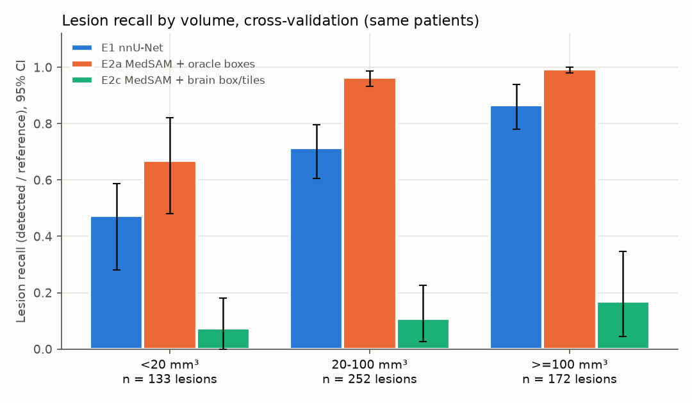
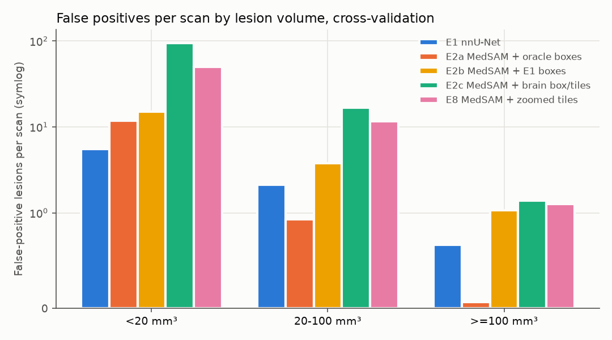
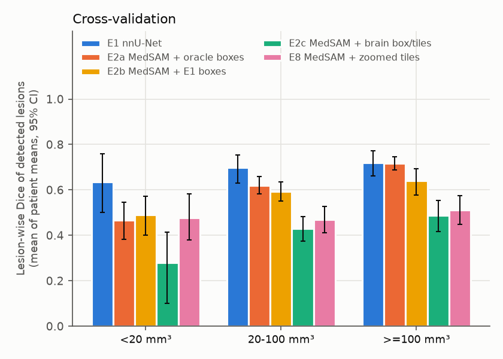

# E2 cross-validation comparison — E1 nnU-Net vs MedSAM (E2a oracle boxes, E2b E1 boxes, E2c brain box + tiles)

Generated 2026-11-20 00:45 from commit `e215f0e` by `scripts/e2_summary.py`.

> **Complete: all 15 MSSEG training patients, each scored by the fold model that did not train on them, for E1, E2a, E2b, E2c, E8.**

Same patient-level folds for all models (E1's `splits_final.json`). Lesion rule: Anima-port (6-connected, > 3.0 mm³, α 0.1 / β 0.7 / γ 0.65); reference = MSSEG consensus. MedSAM: frozen image encoder, prompt encoder + mask decoder fine-tuned per condition and fold (10000 steps × 16, same box type at training and validation). **E2a uses the reference to place its boxes and is an upper bound on tracing, not a fair comparison; E2c is the fair head-to-head with E1. E2b refines E1's detections (boxes from E1 out-of-fold predictions), so its lesion recall is bounded by E1's.** No test case is used.

Loss: per-box soft Dice on boxes containing lesion voxels + BCE on every box (`dice_on: lesion_boxes`). **Post-hoc correction:** the first E2c run used Dice on every box and collapsed on the training folds; the loss was changed after that run, from training-fold behaviour only, with no test data involved (appendix). E2a's loss is identical under both settings (all its boxes contain lesion voxels) and was not rerun.

| model | folds evaluated | patients |
|---|---|---|
| E1 nnU-Net | 0, 1, 2, 3, 4 | 15 |
| E2a MedSAM + oracle boxes | 0, 1, 2, 3, 4 | 15 |
| E2b MedSAM + E1 boxes | 0, 1, 2, 3, 4 | 15 |
| E2c MedSAM + brain box/tiles | 0, 1, 2, 3, 4 | 15 |
| E8 MedSAM + zoomed tiles | 0, 1, 2, 3, 4 | 15 |

## Pooled metrics (15 patients, one value per patient)

Mean ± SD, with the percentile-bootstrap 95% CI of the mean below (10,000 patient resamples). `fp_lesions` = false-positive lesions per scan. Size-bin rows: recall leaves out patients without a reference lesion in the bin; F1 leaves out patients with no lesion of that size in either mask.

| metric | E1 nnU-Net | E2a MedSAM + oracle boxes | E2b MedSAM + E1 boxes | E2c MedSAM + brain box/tiles | E8 MedSAM + zoomed tiles |
|---|---|---|---|---|---|
| dice | 0.767 ± 0.082 [0.727, 0.807] | 0.757 ± 0.032 [0.742, 0.773] | 0.683 ± 0.073 [0.646, 0.718] | 0.457 ± 0.149 [0.384, 0.527] | 0.513 ± 0.152 [0.439, 0.585] |
| lesion_precision | 0.734 ± 0.115 [0.675, 0.785] | 0.791 ± 0.145 [0.718, 0.859] | 0.616 ± 0.135 [0.550, 0.681] | 0.193 ± 0.152 [0.121, 0.269] | 0.283 ± 0.169 [0.200, 0.364] |
| lesion_recall | 0.687 ± 0.183 [0.594, 0.774] | 0.905 ± 0.093 [0.859, 0.948] | 0.659 ± 0.194 [0.556, 0.747] | 0.434 ± 0.150 [0.362, 0.509] | 0.502 ± 0.182 [0.410, 0.588] |
| lesion_f1 | 0.693 ± 0.133 [0.627, 0.757] | 0.840 ± 0.117 [0.781, 0.895] | 0.619 ± 0.147 [0.542, 0.687] | 0.210 ± 0.103 [0.160, 0.259] | 0.296 ± 0.127 [0.235, 0.357] |
| fp_lesions | 8.333 ± 4.791 [6.000, 10.733] | 12.733 ± 14.577 [6.333, 20.467] | 20.000 ± 16.432 [12.532, 28.468] | 113.133 ± 38.676 [94.398, 132.135] | 62.867 ± 25.368 [51.132, 75.933] |
| recall_<20 | 0.322 ± 0.255 [0.185, 0.457] (n=12) | 0.572 ± 0.371 [0.367, 0.767] (n=12) | 0.278 ± 0.233 [0.153, 0.402] (n=12) | 0.076 ± 0.122 [0.012, 0.143] (n=12) | 0.123 ± 0.152 [0.046, 0.210] (n=12) |
| recall_20-100 | 0.702 ± 0.224 [0.589, 0.809] | 0.962 ± 0.063 [0.928, 0.990] | 0.666 ± 0.255 [0.531, 0.781] | 0.395 ± 0.179 [0.308, 0.484] | 0.518 ± 0.232 [0.408, 0.634] |
| recall_>=100 | 0.867 ± 0.153 [0.787, 0.937] | 0.994 ± 0.022 [0.983, 1.000] | 0.874 ± 0.137 [0.805, 0.938] | 0.719 ± 0.205 [0.616, 0.816] | 0.729 ± 0.264 [0.594, 0.852] |
| f1_<20 | 0.261 ± 0.258 [0.139, 0.389] | 0.410 ± 0.359 [0.237, 0.583] | 0.237 ± 0.223 [0.127, 0.350] (n=14) | 0.039 ± 0.069 [0.008, 0.074] | 0.089 ± 0.119 [0.036, 0.149] |
| f1_20-100 | 0.708 ± 0.181 [0.618, 0.795] | 0.950 ± 0.055 [0.921, 0.975] | 0.665 ± 0.227 [0.540, 0.763] | 0.279 ± 0.148 [0.205, 0.350] | 0.387 ± 0.160 [0.309, 0.464] |
| f1_>=100 | 0.886 ± 0.112 [0.827, 0.935] | 0.995 ± 0.014 [0.987, 1.000] | 0.869 ± 0.105 [0.818, 0.918] | 0.721 ± 0.209 [0.618, 0.822] | 0.653 ± 0.295 [0.505, 0.790] |

## Lesion-level recall by size bin (pooled lesions)

Detected / reference lesions summed over patients (95% CI: cluster bootstrap over patients).

| bin (mm³) | E1 nnU-Net | E2a MedSAM + oracle boxes | E2b MedSAM + E1 boxes | E2c MedSAM + brain box/tiles | E8 MedSAM + zoomed tiles |
|---|---|---|---|---|---|
| <20 | 63/133 = 0.474 [0.281, 0.586] | 89/133 = 0.669 [0.480, 0.821] | 54/133 = 0.406 [0.226, 0.533] | 20/133 = 0.150 [0.042, 0.231] | 25/133 = 0.188 [0.085, 0.282] |
| 20-100 | 180/252 = 0.714 [0.605, 0.797] | 243/252 = 0.964 [0.933, 0.987] | 176/252 = 0.698 [0.592, 0.777] | 88/252 = 0.349 [0.277, 0.429] | 111/252 = 0.440 [0.348, 0.540] |
| >=100 | 149/172 = 0.866 [0.780, 0.939] | 171/172 = 0.994 [0.980, 1.000] | 149/172 = 0.866 [0.791, 0.935] | 115/172 = 0.669 [0.551, 0.778] | 113/172 = 0.657 [0.500, 0.803] |

Per scanner (detected / reference, recall):

| scanner | bin (mm³) | E1 | E2a | E2b | E2c | E8 |
|---|---|---|---|---|---|---|
| Siemens Verio 3T | <20 | 10/38 (0.26) | 20/38 (0.53) | 8/38 (0.21) | 5/38 (0.13) | 6/38 (0.16) |
| Siemens Verio 3T | 20-100 | 44/64 (0.69) | 62/64 (0.97) | 42/64 (0.66) | 17/64 (0.27) | 21/64 (0.33) |
| Siemens Verio 3T | >=100 | 30/41 (0.73) | 40/41 (0.98) | 32/41 (0.78) | 29/41 (0.71) | 18/41 (0.44) |
| Siemens Aera 1.5T | <20 | 2/9 (0.22) | 1/9 (0.11) | 1/9 (0.11) | 0/9 (0.00) | 0/9 (0.00) |
| Siemens Aera 1.5T | 20-100 | 30/54 (0.56) | 50/54 (0.93) | 30/54 (0.56) | 18/54 (0.33) | 20/54 (0.37) |
| Siemens Aera 1.5T | >=100 | 55/63 (0.87) | 63/63 (1.00) | 54/63 (0.86) | 36/63 (0.57) | 40/63 (0.63) |
| Philips Ingenia 3T | <20 | 51/86 (0.59) | 68/86 (0.79) | 45/86 (0.52) | 15/86 (0.17) | 19/86 (0.22) |
| Philips Ingenia 3T | 20-100 | 106/134 (0.79) | 131/134 (0.98) | 104/134 (0.78) | 53/134 (0.40) | 70/134 (0.52) |
| Philips Ingenia 3T | >=100 | 64/68 (0.94) | 68/68 (1.00) | 63/68 (0.93) | 50/68 (0.74) | 55/68 (0.81) |

## False positives per scan

Scanner columns: FP lesions per scan for that scanner. Bin columns: FP lesion counts by their own volume.

| model | FP lesions | FP / scan | Siemens Verio 3T | Siemens Aera 1.5T | Philips Ingenia 3T | <20 mm³ | 20-100 mm³ | >=100 mm³ | share < 20 mm³ |
|---|---|---|---|---|---|---|---|---|---|
| E1 nnU-Net | 125 | 8.3 | 5.0 | 7.0 | 13.0 | 83 | 32 | 10 | 66% |
| E2a MedSAM + oracle boxes | 191 | 12.7 | 15.6 | 12.8 | 9.8 | 176 | 14 | 1 | 92% |
| E2b MedSAM + E1 boxes | 300 | 20.0 | 20.0 | 17.2 | 22.8 | 227 | 57 | 16 | 76% |
| E2c MedSAM + brain box/tiles | 1697 | 113.1 | 110.6 | 136.6 | 92.2 | 1423 | 253 | 21 | 84% |
| E8 MedSAM + zoomed tiles | 943 | 62.9 | 47.8 | 83.2 | 57.6 | 750 | 174 | 19 | 80% |

## Recall and false positives by size bin

Recall: pooled detected / reference lesions in the bin. FP / scan: false-positive lesions whose own volume falls in the bin, per scan.

| model | recall <20 | FP/scan <20 | recall 20-100 | FP/scan 20-100 | recall >=100 | FP/scan >=100 |
|---|---|---|---|---|---|---|
| E1 nnU-Net | 0.474 | 5.5 | 0.714 | 2.1 | 0.866 | 0.7 |
| E2a MedSAM + oracle boxes | 0.669 | 11.7 | 0.964 | 0.9 | 0.994 | 0.1 |
| E2b MedSAM + E1 boxes | 0.406 | 15.1 | 0.698 | 3.8 | 0.866 | 1.1 |
| E2c MedSAM + brain box/tiles | 0.150 | 94.9 | 0.349 | 16.9 | 0.669 | 1.4 |
| E8 MedSAM + zoomed tiles | 0.188 | 50.0 | 0.440 | 11.6 | 0.657 | 1.3 |

## Missed lesions

Missed / reference lesions; in brackets, missed lesions with no predicted voxel at all.

| bin (mm³) | E1 nnU-Net | E2a MedSAM + oracle boxes | E2b MedSAM + E1 boxes | E2c MedSAM + brain box/tiles | E8 MedSAM + zoomed tiles |
|---|---|---|---|---|---|
| <20 | 70 / 133 (no voxel: 67) | 44 / 133 (no voxel: 32) | 79 / 133 (no voxel: 73) | 113 / 133 (no voxel: 109) | 108 / 133 (no voxel: 108) |
| 20-100 | 72 / 252 (no voxel: 69) | 9 / 252 (no voxel: 3) | 76 / 252 (no voxel: 66) | 164 / 252 (no voxel: 147) | 141 / 252 (no voxel: 135) |
| >=100 | 23 / 172 (no voxel: 17) | 1 / 172 (no voxel: 0) | 23 / 172 (no voxel: 17) | 57 / 172 (no voxel: 32) | 59 / 172 (no voxel: 32) |

## Paired comparisons (same patients)

Per-patient metrics: mean difference (A − B) with paired bootstrap 95% CI (patients resampled together), median difference and two-sided Wilcoxon signed-rank p; p (Holm) adjusts within each comparison over the metrics listed. Patients missing a value in either model (empty size bins) are dropped pairwise. Pooled lesion recall per bin: difference of pooled recalls with a paired cluster bootstrap CI.

### E2c MedSAM + brain box/tiles − E1 nnU-Net

| metric | n | mean E2c | mean E1 | mean diff | 95% CI | median diff | Wilcoxon p | p (Holm) |
|---|---|---|---|---|---|---|---|---|
| dice | 15 | 0.457 | 0.767 | -0.310 | [-0.355, -0.262] | -0.329 | 0.000 | 0.001 |
| lesion_precision | 15 | 0.193 | 0.734 | -0.541 | [-0.629, -0.453] | -0.554 | 0.000 | 0.001 |
| lesion_recall | 15 | 0.434 | 0.687 | -0.253 | [-0.337, -0.160] | -0.286 | 0.001 | 0.004 |
| lesion_f1 | 15 | 0.210 | 0.693 | -0.484 | [-0.561, -0.408] | -0.473 | 0.000 | 0.001 |
| fp_lesions | 15 | 113.133 | 8.333 | 104.800 | [85.133, 124.602] | 101.000 | 0.000 | 0.001 |
| recall_<20 | 12 | 0.076 | 0.322 | -0.246 | [-0.343, -0.142] | -0.292 | 0.004 | 0.019 |
| recall_20-100 | 15 | 0.395 | 0.702 | -0.307 | [-0.409, -0.182] | -0.312 | 0.004 | 0.019 |
| recall_>=100 | 15 | 0.719 | 0.867 | -0.147 | [-0.256, -0.049] | -0.125 | 0.012 | 0.023 |
| f1_<20 | 15 | 0.039 | 0.261 | -0.222 | [-0.328, -0.120] | -0.286 | 0.008 | 0.023 |
| f1_20-100 | 15 | 0.279 | 0.708 | -0.429 | [-0.516, -0.348] | -0.403 | 0.000 | 0.001 |
| f1_>=100 | 15 | 0.721 | 0.886 | -0.164 | [-0.264, -0.072] | -0.123 | 0.008 | 0.023 |
| pooled recall <20 | 15 | 0.150 | 0.474 | -0.323 | [-0.408, -0.206] | – | – | – |
| pooled recall 20-100 | 15 | 0.349 | 0.714 | -0.365 | [-0.454, -0.255] | – | – | – |
| pooled recall >=100 | 15 | 0.669 | 0.866 | -0.198 | [-0.313, -0.072] | – | – | – |

### E2a MedSAM + oracle boxes − E2c MedSAM + brain box/tiles

| metric | n | mean E2a | mean E2c | mean diff | 95% CI | median diff | Wilcoxon p | p (Holm) |
|---|---|---|---|---|---|---|---|---|
| dice | 15 | 0.757 | 0.457 | 0.300 | [0.240, 0.363] | 0.274 | 0.000 | 0.001 |
| lesion_precision | 15 | 0.791 | 0.193 | 0.598 | [0.472, 0.717] | 0.652 | 0.000 | 0.001 |
| lesion_recall | 15 | 0.905 | 0.434 | 0.470 | [0.401, 0.534] | 0.482 | 0.000 | 0.001 |
| lesion_f1 | 15 | 0.840 | 0.210 | 0.630 | [0.546, 0.719] | 0.617 | 0.000 | 0.001 |
| fp_lesions | 15 | 12.733 | 113.133 | -100.400 | [-123.133, -77.332] | -101.000 | 0.001 | 0.004 |
| recall_<20 | 12 | 0.572 | 0.076 | 0.496 | [0.305, 0.684] | 0.523 | 0.002 | 0.006 |
| recall_20-100 | 15 | 0.962 | 0.395 | 0.567 | [0.487, 0.647] | 0.562 | 0.001 | 0.004 |
| recall_>=100 | 15 | 0.994 | 0.719 | 0.275 | [0.180, 0.377] | 0.273 | 0.001 | 0.006 |
| f1_<20 | 15 | 0.410 | 0.039 | 0.372 | [0.211, 0.534] | 0.441 | 0.005 | 0.006 |
| f1_20-100 | 15 | 0.950 | 0.279 | 0.671 | [0.599, 0.748] | 0.658 | 0.000 | 0.001 |
| f1_>=100 | 15 | 0.995 | 0.721 | 0.273 | [0.175, 0.376] | 0.259 | 0.001 | 0.006 |
| pooled recall <20 | 15 | 0.669 | 0.150 | 0.519 | [0.381, 0.628] | – | – | – |
| pooled recall 20-100 | 15 | 0.964 | 0.349 | 0.615 | [0.546, 0.673] | – | – | – |
| pooled recall >=100 | 15 | 0.994 | 0.669 | 0.326 | [0.218, 0.444] | – | – | – |

### E2b MedSAM + E1 boxes − E1 nnU-Net

| metric | n | mean E2b | mean E1 | mean diff | 95% CI | median diff | Wilcoxon p | p (Holm) |
|---|---|---|---|---|---|---|---|---|
| dice | 15 | 0.683 | 0.767 | -0.084 | [-0.096, -0.070] | -0.090 | 0.000 | 0.001 |
| lesion_precision | 15 | 0.616 | 0.734 | -0.118 | [-0.185, -0.052] | -0.079 | 0.006 | 0.057 |
| lesion_recall | 15 | 0.659 | 0.687 | -0.028 | [-0.064, 0.003] | -0.012 | 0.075 | 0.528 |
| lesion_f1 | 15 | 0.619 | 0.693 | -0.075 | [-0.118, -0.031] | -0.065 | 0.009 | 0.073 |
| fp_lesions | 15 | 20.000 | 8.333 | 11.667 | [5.333, 19.068] | 6.000 | 0.001 | 0.013 |
| recall_<20 | 12 | 0.278 | 0.322 | -0.044 | [-0.094, -0.006] | 0.000 | 0.125 | 0.625 |
| recall_20-100 | 15 | 0.666 | 0.702 | -0.036 | [-0.090, 0.003] | 0.000 | 0.173 | 0.692 |
| recall_>=100 | 15 | 0.874 | 0.867 | 0.007 | [-0.023, 0.041] | 0.000 | 0.750 | 0.750 |
| f1_<20 | 14 | 0.237 | 0.280 | -0.043 | [-0.091, 0.003] | -0.007 | 0.093 | 0.557 |
| f1_20-100 | 15 | 0.665 | 0.708 | -0.043 | [-0.111, 0.009] | -0.017 | 0.221 | 0.692 |
| f1_>=100 | 15 | 0.869 | 0.886 | -0.016 | [-0.038, 0.003] | 0.000 | 0.374 | 0.749 |
| pooled recall <20 | 15 | 0.406 | 0.474 | -0.068 | [-0.141, -0.012] | – | – | – |
| pooled recall 20-100 | 15 | 0.698 | 0.714 | -0.016 | [-0.038, 0.000] | – | – | – |
| pooled recall >=100 | 15 | 0.866 | 0.866 | 0.000 | [-0.028, 0.031] | – | – | – |

### E8 MedSAM + zoomed tiles − E2c MedSAM + brain box/tiles

| metric | n | mean E8 | mean E2c | mean diff | 95% CI | median diff | Wilcoxon p | p (Holm) |
|---|---|---|---|---|---|---|---|---|
| dice | 15 | 0.513 | 0.457 | 0.056 | [0.024, 0.087] | 0.051 | 0.003 | 0.030 |
| lesion_precision | 15 | 0.283 | 0.193 | 0.091 | [0.038, 0.142] | 0.080 | 0.007 | 0.047 |
| lesion_recall | 15 | 0.502 | 0.434 | 0.067 | [0.017, 0.118] | 0.043 | 0.033 | 0.164 |
| lesion_f1 | 15 | 0.296 | 0.210 | 0.086 | [0.049, 0.126] | 0.062 | 0.001 | 0.009 |
| fp_lesions | 15 | 62.867 | 113.133 | -50.267 | [-67.533, -32.733] | -40.000 | 0.000 | 0.003 |
| recall_<20 | 12 | 0.123 | 0.076 | 0.047 | [-0.001, 0.119] | 0.000 | 0.125 | 0.375 |
| recall_20-100 | 15 | 0.518 | 0.395 | 0.123 | [0.057, 0.199] | 0.133 | 0.008 | 0.047 |
| recall_>=100 | 15 | 0.729 | 0.719 | 0.010 | [-0.093, 0.107] | 0.000 | 0.813 | 0.813 |
| f1_<20 | 15 | 0.089 | 0.039 | 0.050 | [0.013, 0.093] | 0.000 | 0.043 | 0.170 |
| f1_20-100 | 15 | 0.387 | 0.279 | 0.108 | [0.045, 0.167] | 0.098 | 0.004 | 0.034 |
| f1_>=100 | 15 | 0.653 | 0.721 | -0.068 | [-0.178, 0.026] | -0.059 | 0.239 | 0.479 |
| pooled recall <20 | 15 | 0.188 | 0.150 | 0.038 | [0.000, 0.090] | – | – | – |
| pooled recall 20-100 | 15 | 0.440 | 0.349 | 0.091 | [0.038, 0.150] | – | – | – |
| pooled recall >=100 | 15 | 0.657 | 0.669 | -0.012 | [-0.126, 0.099] | – | – | – |

### E8 MedSAM + zoomed tiles − E1 nnU-Net

| metric | n | mean E8 | mean E1 | mean diff | 95% CI | median diff | Wilcoxon p | p (Holm) |
|---|---|---|---|---|---|---|---|---|
| dice | 15 | 0.513 | 0.767 | -0.254 | [-0.297, -0.212] | -0.238 | 0.000 | 0.001 |
| lesion_precision | 15 | 0.283 | 0.734 | -0.450 | [-0.534, -0.370] | -0.448 | 0.000 | 0.001 |
| lesion_recall | 15 | 0.502 | 0.687 | -0.186 | [-0.270, -0.097] | -0.176 | 0.005 | 0.027 |
| lesion_f1 | 15 | 0.296 | 0.693 | -0.398 | [-0.477, -0.316] | -0.406 | 0.000 | 0.001 |
| fp_lesions | 15 | 62.867 | 8.333 | 54.533 | [42.533, 67.733] | 52.000 | 0.000 | 0.001 |
| recall_<20 | 12 | 0.123 | 0.322 | -0.199 | [-0.302, -0.097] | -0.219 | 0.016 | 0.047 |
| recall_20-100 | 15 | 0.518 | 0.702 | -0.184 | [-0.294, -0.065] | -0.200 | 0.016 | 0.047 |
| recall_>=100 | 15 | 0.729 | 0.867 | -0.138 | [-0.262, -0.024] | -0.083 | 0.037 | 0.047 |
| f1_<20 | 15 | 0.089 | 0.261 | -0.172 | [-0.267, -0.082] | -0.051 | 0.008 | 0.031 |
| f1_20-100 | 15 | 0.387 | 0.708 | -0.321 | [-0.401, -0.234] | -0.319 | 0.000 | 0.001 |
| f1_>=100 | 15 | 0.653 | 0.886 | -0.232 | [-0.347, -0.125] | -0.166 | 0.002 | 0.014 |
| pooled recall <20 | 15 | 0.188 | 0.474 | -0.286 | [-0.389, -0.151] | – | – | – |
| pooled recall 20-100 | 15 | 0.440 | 0.714 | -0.274 | [-0.370, -0.155] | – | – | – |
| pooled recall >=100 | 15 | 0.657 | 0.866 | -0.209 | [-0.337, -0.083] | – | – | – |

## E8 decision rule

Rule fixed in `configs/experiment.yaml` before any MedSAM training (metric `pooled_recall_lt20_cv`: pooled lesion-level recall in the <20 mm³ bin over the cross-validation patients; no test data).

- recall(E2a, <20 mm³) = 89/133 = **0.6692**
- recall(E2c, <20 mm³) = 20/133 = **0.1504**
- difference E2a − E2c = **0.5188** (paired cluster bootstrap 95% CI [0.381, 0.628]; the rule uses the point estimate)

1. `recall(E2a) - recall(E2c) >= 0.15` → 0.6692 - 0.1504 = 0.5188 >= 0.15 → **true** → **zoomed_tiles**

**Selected fix: `zoomed_tiles`**

## Collapse check (training data only)

Logged on the training batches of each fold: lesion-box loss vs its value over steps 1–100, and the share of lesion boxes with a non-empty prediction (any logit > 0 inside the box). Checked at step 3000 and every 1000 steps after; a fold stops if the ratio is > 0.8 or the share is < 0.1 (pooled, and for E2c also for the brain box and the tiles separately). E2a was trained before the check existed.

| model | fold | checks | last step | result | start lesion loss | lesion loss ratio @3000 | lesion loss ratio @end | non-empty @3000 | non-empty @end | brain non-empty @end | tile non-empty @end | empty-box non-empty @end |
|---|---|---|---|---|---|---|---|---|---|---|---|---|
| E2c | 0 | 8 | 10000 | passed | 1.028 | 0.405 | 0.287 | 0.980 | 0.984 | 0.989 | 0.983 | 0.605 |
| E2c | 1 | 8 | 10000 | passed | 1.008 | 0.409 | 0.279 | 0.987 | 0.992 | 1.000 | 0.991 | 0.591 |
| E2c | 2 | 8 | 10000 | passed | 1.072 | 0.402 | 0.273 | 0.978 | 0.987 | 1.000 | 0.985 | 0.584 |
| E2c | 3 | 8 | 10000 | passed | 1.012 | 0.400 | 0.275 | 0.982 | 0.982 | 1.000 | 0.979 | 0.598 |
| E2c | 4 | 8 | 10000 | passed | 1.022 | 0.379 | 0.288 | 0.986 | 0.986 | 1.000 | 0.985 | 0.582 |
| E2b | 0 | 8 | 10000 | passed | 0.439 | 0.559 | 0.418 | 0.999 | 0.999 | – | – | 0.940 |
| E2b | 1 | 8 | 10000 | passed | 0.424 | 0.572 | 0.384 | 0.991 | 0.999 | – | – | 0.932 |
| E2b | 2 | 8 | 10000 | passed | 0.447 | 0.496 | 0.360 | 1.000 | 0.999 | – | – | 0.931 |
| E2b | 3 | 8 | 10000 | passed | 0.440 | 0.555 | 0.395 | 0.999 | 0.998 | – | – | 0.946 |
| E2b | 4 | 8 | 10000 | passed | 0.430 | 0.586 | 0.419 | 0.998 | 0.996 | – | – | 0.946 |
| E8 | 0 | 8 | 10000 | passed | 1.706 | 0.267 | 0.184 | 0.995 | 0.998 | 1.000 | 0.997 | 0.719 |
| E8 | 1 | 8 | 10000 | passed | 1.724 | 0.267 | 0.176 | 0.995 | 0.996 | 1.000 | 0.996 | 0.698 |
| E8 | 2 | 8 | 10000 | passed | 1.765 | 0.263 | 0.160 | 0.996 | 0.996 | 0.990 | 0.997 | 0.712 |
| E8 | 3 | 8 | 10000 | passed | 1.707 | 0.262 | 0.179 | 0.999 | 0.996 | 1.000 | 0.996 | 0.671 |
| E8 | 4 | 8 | 10000 | passed | 1.693 | 0.257 | 0.180 | 0.999 | 0.998 | 0.978 | 1.000 | 0.722 |

Box diagnostics, E2c MedSAM + brain box/tiles (final checkpoint, 4 training patients per fold, `scripts/medsam_box_diagnostics.py`):

| model | fold | training patients | brain lesion boxes non-empty | tile lesion boxes non-empty | lesion-free boxes non-empty | voxel recall (mean_all) | FP voxels / patient (mean_all) | voxel recall (brain_only) | FP voxels / patient (brain_only) | voxel recall (tiles_only) | FP voxels / patient (tiles_only) |
|---|---|---|---|---|---|---|---|---|---|---|---|
| E2c | 0 | 4 | 1.000 | 0.988 | 0.528 | 0.848 | 28080.750 | 0.835 | 46532.000 | 0.849 | 31610.000 |
| E2c | 1 | 4 | 0.999 | 0.982 | 0.451 | 0.785 | 15047.500 | 0.720 | 18084.250 | 0.811 | 20744.750 |
| E2c | 2 | 4 | 0.997 | 0.986 | 0.411 | 0.792 | 10998.750 | 0.741 | 15226.500 | 0.812 | 14232.000 |
| E2c | 3 | 4 | 1.000 | 0.989 | 0.476 | 0.856 | 20588.000 | 0.814 | 31007.500 | 0.868 | 26000.000 |
| E2c | 4 | 4 | 1.000 | 0.978 | 0.428 | 0.841 | 18434.750 | 0.800 | 22406.250 | 0.857 | 23978.250 |

Box diagnostics, E2b MedSAM + E1 boxes (final checkpoint, 4 training patients per fold, `scripts/medsam_box_diagnostics.py`):

| model | fold | training patients | box lesion boxes non-empty | lesion-free boxes non-empty | voxel recall (mean_all) | FP voxels / patient (mean_all) |
|---|---|---|---|---|---|---|
| E2b | 0 | 4 | 0.998 | 0.947 | 0.804 | 14989.500 |
| E2b | 1 | 4 | 0.999 | 0.929 | 0.790 | 15135.000 |
| E2b | 2 | 4 | 0.998 | 0.911 | 0.776 | 10555.500 |
| E2b | 3 | 4 | 0.999 | 0.937 | 0.777 | 11843.750 |
| E2b | 4 | 4 | 0.998 | 0.918 | 0.790 | 10999.750 |

## Exploratory: predicted-IoU mask filter (post-hoc, decided after seeing E2c results)

> **Post hoc, decided after seeing E2c results; exploratory, not part of the pre-specified comparison.** A box whose MedSAM predicted-IoU score is below a threshold t gets an empty mask (it still counts in the per-pixel coverage). t is chosen per outer fold by nested cross-validation inside that fold's 12 training patients (4 inner folds, inner models trained with the same recipe; criterion: mean per-patient lesion F1 on the inner held-out patients, ties to the lowest t), then applied to the fold's validation patients, which are never used to choose it (`scripts/iou_filter_analysis.py`). Not applied to any test set.

Thresholds selected per outer fold (inner mean lesion F1 without / with the filter):

| model | fold | inner_patients | level | threshold | inner_f1_no_filter | inner_f1_selected | unfiltered_mismatch_voxels |
|---|---|---|---|---|---|---|---|
| E2c | 0 | 12 | 17 | 0.400 | 0.190 | 0.203 | 0 |
| E2c | 1 | 12 | 16 | 0.375 | 0.182 | 0.191 | 0 |
| E2c | 2 | 12 | 14 | 0.325 | 0.183 | 0.186 | 0 |
| E2c | 3 | 12 | 17 | 0.400 | 0.206 | 0.214 | 0 |
| E2c | 4 | 12 | 15 | 0.350 | 0.225 | 0.230 | 0 |
| E8 | 0 | 12 | 15 | 0.350 | 0.244 | 0.245 | 0 |
| E8 | 1 | 12 | 15 | 0.350 | 0.256 | 0.258 | 0 |
| E8 | 2 | 12 | 18 | 0.425 | 0.233 | 0.238 | 0 |
| E8 | 3 | 12 | 20 | 0.475 | 0.265 | 0.267 | 0 |
| E8 | 4 | 12 | 13 | 0.300 | 0.285 | 0.286 | 0 |

### E2c MedSAM + brain box/tiles: unfiltered vs IoU-filtered (15 patients)

| metric | unfiltered | filtered | diff (filtered − unfiltered) | Wilcoxon p (unadjusted) |
|---|---|---|---|---|
| lesion_f1 | 0.210 ± 0.103 | 0.226 ± 0.104 | 0.016 [0.007, 0.028] | 0.00577 |
| fp_lesions | 113.133 ± 38.676 | 110.267 ± 36.041 | -2.867 [-5.333, -0.800] | 0.0259 |
| lesion_precision | 0.193 ± 0.152 | 0.208 ± 0.151 | 0.016 [0.007, 0.026] | 0.00577 |
| lesion_recall | 0.434 ± 0.150 | 0.427 ± 0.156 | -0.007 [-0.023, 0.003] | 0.593 |
| dice | 0.457 ± 0.149 | 0.443 ± 0.145 | -0.014 [-0.024, -0.007] | 0.00465 |
| pooled recall <20 | 20/133 = 0.150 | 19/133 = 0.143 | -0.008 [-0.026, 0.000] | – |
| pooled recall 20-100 | 88/252 = 0.349 | 87/252 = 0.345 | -0.004 [-0.026, 0.012] | – |
| pooled recall >=100 | 115/172 = 0.669 | 115/172 = 0.669 | 0.000 [0.000, 0.000] | – |
| FP / scan <20 | 94.9 | 92.8 | -2.1 | – |
| FP / scan 20-100 | 16.9 | 16.1 | -0.7 | – |
| FP / scan >=100 | 1.4 | 1.3 | -0.1 | – |

### E8 MedSAM + zoomed tiles: unfiltered vs IoU-filtered (15 patients)

| metric | unfiltered | filtered | diff (filtered − unfiltered) | Wilcoxon p (unadjusted) |
|---|---|---|---|---|
| lesion_f1 | 0.296 ± 0.127 | 0.298 ± 0.124 | 0.002 [-0.003, 0.008] | 0.327 |
| fp_lesions | 62.867 ± 25.368 | 61.667 ± 24.729 | -1.200 [-3.067, -0.067] | 0.0741 |
| lesion_precision | 0.283 ± 0.169 | 0.293 ± 0.175 | 0.010 [0.000, 0.026] | 0.123 |
| lesion_recall | 0.502 ± 0.182 | 0.490 ± 0.184 | -0.011 [-0.028, 0.000] | 0.109 |
| dice | 0.513 ± 0.152 | 0.505 ± 0.144 | -0.008 [-0.017, -0.001] | 0.0663 |
| pooled recall <20 | 25/133 = 0.188 | 24/133 = 0.180 | -0.008 [-0.026, 0.000] | – |
| pooled recall 20-100 | 111/252 = 0.440 | 109/252 = 0.433 | -0.008 [-0.023, 0.000] | – |
| pooled recall >=100 | 113/172 = 0.657 | 111/172 = 0.645 | -0.012 [-0.032, 0.000] | – |
| FP / scan <20 | 50.0 | 49.2 | -0.8 | – |
| FP / scan 20-100 | 11.6 | 11.3 | -0.3 | – |
| FP / scan >=100 | 1.3 | 1.2 | -0.1 | – |

## Per-patient results

| fold | case_id | scanner | n_ref_lesions | dice E1 | dice E2a | dice E2b | dice E2c | dice E8 | lesion_f1 E1 | lesion_f1 E2a | lesion_f1 E2b | lesion_f1 E2c | lesion_f1 E8 | fp_lesions E1 | fp_lesions E2a | fp_lesions E2b | fp_lesions E2c | fp_lesions E8 |
|---|---|---|---|---|---|---|---|---|---|---|---|---|---|---|---|---|---|---|
| 2 | msseg_train_c01_p01 | siemens_verio_3t | 44 | 0.884 | 0.749 | 0.772 | 0.573 | 0.574 | 0.412 | 0.670 | 0.353 | 0.240 | 0.268 | 7 | 33 | 26 | 68 | 35 |
| 4 | msseg_train_c01_p02 | siemens_verio_3t | 28 | 0.675 | 0.755 | 0.653 | 0.539 | 0.438 | 0.688 | 0.861 | 0.583 | 0.207 | 0.343 | 6 | 10 | 14 | 104 | 67 |
| 3 | msseg_train_c01_p03 | siemens_verio_3t | 59 | 0.900 | 0.805 | 0.793 | 0.715 | 0.759 | 0.810 | 0.758 | 0.588 | 0.198 | 0.324 | 9 | 27 | 51 | 146 | 41 |
| 1 | msseg_train_c01_p04 | siemens_verio_3t | 7 | 0.710 | 0.745 | 0.636 | 0.339 | 0.467 | 0.769 | 1.000 | 0.769 | 0.061 | 0.123 | 1 | 0 | 1 | 89 | 54 |
| 0 | msseg_train_c01_p05 | siemens_verio_3t | 5 | 0.810 | 0.814 | 0.754 | 0.563 | 0.616 | 0.533 | 0.656 | 0.308 | 0.208 | 0.460 | 2 | 8 | 8 | 146 | 42 |
| 3 | msseg_train_c07_p01 | siemens_aera_1p5t | 18 | 0.626 | 0.718 | 0.528 | 0.214 | 0.220 | 0.538 | 0.950 | 0.667 | 0.054 | 0.091 | 5 | 2 | 4 | 166 | 77 |
| 2 | msseg_train_c07_p02 | siemens_aera_1p5t | 53 | 0.788 | 0.733 | 0.702 | 0.459 | 0.501 | 0.641 | 0.611 | 0.482 | 0.308 | 0.261 | 10 | 53 | 50 | 75 | 41 |
| 0 | msseg_train_c07_p03 | siemens_aera_1p5t | 14 | 0.662 | 0.733 | 0.586 | 0.301 | 0.386 | 0.594 | 0.870 | 0.581 | 0.121 | 0.160 | 12 | 2 | 14 | 182 | 111 |
| 4 | msseg_train_c07_p04 | siemens_aera_1p5t | 24 | 0.743 | 0.753 | 0.669 | 0.306 | 0.384 | 0.905 | 0.931 | 0.842 | 0.151 | 0.308 | 4 | 4 | 8 | 138 | 73 |
| 1 | msseg_train_c07_p05 | siemens_aera_1p5t | 17 | 0.770 | 0.802 | 0.720 | 0.388 | 0.532 | 0.806 | 0.919 | 0.699 | 0.136 | 0.166 | 4 | 3 | 10 | 122 | 114 |
| 0 | msseg_train_c08_p01 | philips_ingenia_3t | 85 | 0.785 | 0.757 | 0.694 | 0.567 | 0.674 | 0.792 | 0.948 | 0.754 | 0.332 | 0.505 | 9 | 9 | 15 | 110 | 50 |
| 4 | msseg_train_c08_p02 | philips_ingenia_3t | 27 | 0.683 | 0.701 | 0.593 | 0.252 | 0.277 | 0.648 | 0.807 | 0.624 | 0.128 | 0.222 | 10 | 5 | 12 | 140 | 62 |
| 2 | msseg_train_c08_p03 | philips_ingenia_3t | 33 | 0.842 | 0.754 | 0.728 | 0.473 | 0.614 | 0.756 | 0.854 | 0.691 | 0.310 | 0.371 | 14 | 14 | 25 | 61 | 81 |
| 3 | msseg_train_c08_p04 | philips_ingenia_3t | 47 | 0.824 | 0.763 | 0.705 | 0.566 | 0.617 | 0.701 | 0.870 | 0.630 | 0.304 | 0.434 | 15 | 5 | 16 | 71 | 31 |
| 1 | msseg_train_c08_p05 | philips_ingenia_3t | 96 | 0.805 | 0.780 | 0.716 | 0.602 | 0.645 | 0.809 | 0.900 | 0.709 | 0.392 | 0.402 | 17 | 16 | 46 | 79 | 64 |

## Appendix — first E2c run (collapsed; documented failure)

**What happened.** The first E2c run (2026-11-17) used MedSAM's loss as is: per-box soft Dice + BCE on
*every* box, with half of each training batch lesion-free tiles. Training loss plateaued at ≈ 0.49 in all
five folds and the validation predictions were unusable (folds 1–2 almost empty, fold 0 145–224 false
positives per patient). It was replaced by the corrected run above; its numbers are kept here for the
record. Per-box Dice of an empty target is ≈ 0 only for an exactly empty output, so the empty tiles push
every box towards empty output.

**Diagnosis, corrected after the rerun was set up** (training patients only, box diagnostics table below):
the collapse was in the **tiles**, not in every box. With fold 1's final checkpoint only ≈ 5 % of
lesion-containing tiles gave any output, while the whole-brain box still marked most lesion voxels and
over-segmented heavily. At inference each pixel takes the mean probability over the brain box and the 1–4
tiles covering it, so empty tiles outvoted the brain box (fold 1: almost nothing predicted), or the brain
box flooded through where the tiles were weak (fold 0). The earlier reading that the ≈ 0.5 loss plateau is
"an empty output for every box" was wrong: it is the average of a well-fitted empty-tile term and a poor
lesion-box term. A 3,000-step replay of the first-run loss on fold 1 (`--dice-on all_boxes`) still had
58 % of lesion boxes non-empty at step 3,000, so the collapse built up later. That is why the collapse
check runs from step 3,000 to the end, for the brain box and the tiles separately.

**Correction (post hoc, training folds only, no test data):** Dice only on boxes whose target contains lesion
voxels, BCE on every box (`finetune.dice_on: lesion_boxes`), the same for E2a, E2b, E2c and E8. E2a's loss is
identical under both settings (every E2a box contains lesion voxels), so it was not rerun.

Same 15 patients; first run (Dice on every box) vs the corrected rerun.

| metric | E2c run 1 (collapsed) | E2c MedSAM + brain box/tiles |
|---|---|---|
| dice | 0.170 ± 0.233 [0.067, 0.291] | 0.457 ± 0.149 [0.384, 0.527] |
| lesion_precision | 0.108 ± 0.173 [0.033, 0.200] | 0.193 ± 0.152 [0.121, 0.269] |
| lesion_recall | 0.139 ± 0.208 [0.048, 0.251] | 0.434 ± 0.150 [0.362, 0.509] |
| lesion_f1 | 0.067 ± 0.082 [0.029, 0.109] | 0.210 ± 0.103 [0.160, 0.259] |
| fp_lesions | 41.800 ± 70.847 [10.933, 80.200] | 113.133 ± 38.676 [94.398, 132.135] |
| pooled recall <20 | 10/133 = 0.075 | 20/133 = 0.150 |
| pooled recall 20-100 | 27/252 = 0.107 | 88/252 = 0.349 |
| pooled recall >=100 | 29/172 = 0.169 | 115/172 = 0.669 |

E8 rule on the first run (superseded): 0.6692 − 0.0752 = 0.5940 → `zoomed_tiles`.

Box diagnostics of the first run (final checkpoint, 4 training patients per fold, `scripts/medsam_box_diagnostics.py`):

| model | fold | training patients | brain lesion boxes non-empty | tile lesion boxes non-empty | lesion-free boxes non-empty | voxel recall (mean_all) | FP voxels / patient (mean_all) | voxel recall (brain_only) | FP voxels / patient (brain_only) | voxel recall (tiles_only) | FP voxels / patient (tiles_only) |
|---|---|---|---|---|---|---|---|---|---|---|---|
| E2c_run1 | 0 | 4 | 0.752 | 0.642 | 0.102 | 0.691 | 28323.250 | 0.760 | 42061.500 | 0.647 | 35731.500 |
| E2c_run1 | 1 | 4 | 0.969 | 0.050 | 0.004 | 0.084 | 1435.500 | 0.812 | 49721.250 | 0.019 | 617.000 |
| E2c_run1 | 2 | 4 | 0.858 | 0.000 | 0.000 | 0.012 | 1.750 | 0.808 | 34808.750 | 0.000 | 0.000 |
| E2c_run1 | 3 | 4 | 0.902 | 0.507 | 0.018 | 0.529 | 5981.500 | 0.698 | 12393.750 | 0.438 | 7870.250 |
| E2c_run1 | 4 | 4 | 0.927 | 0.113 | 0.023 | 0.106 | 1598.500 | 0.753 | 17338.250 | 0.028 | 7067.500 |

<!-- segq:start -->
## Segmentation-quality metrics (added after the results freeze)

> **Added after the results freeze, on the frozen predictions.** No model, prediction, threshold or number above this section was changed. Same lesions, matching rule (Anima port), size bins, patients and statistical handling as above.

Definitions (`msbench.metrics.segquality`): for each **detected** reference lesion, its prediction is the union of the predicted components overlapping it. **Lesion-wise Dice** = Dice of that pair; **lesion HD95** = max of the two directed 95th-percentile surface distances (mm); **lesion ASD** = symmetric mean surface distance (mm). Each is averaged over the detected lesions of a scan (overall and by the reference lesion's size bin), then over scans. Missed lesions have no value: these metrics describe tracing quality *given* detection, so a model that detects more (often harder, smaller) lesions is compared on a different lesion set; rows marked ‡ restrict each pair of models to the lesions both detected (unadjusted p). **† Whole-mask HD95** uses the raw masks: one distant false positive can dominate it, so it mostly reflects stray false positives rather than outline quality. Cross-validation: 15 MSSEG training patients, each scored by the fold model that did not train on them (E2a: oracle boxes, an upper bound).

Paired comparisons: per-scan values, A − B, paired patient-bootstrap 95% CI, Wilcoxon signed-rank; **Holm adjustment within each comparison over lesion-wise Dice (overall and the three size bins) and lesion HD95**; scans where either model has no detected lesion (in the bin) are dropped pairwise.

15 scans, 15 patients. Mean ± SD over scans of the per-scan values, 95% CI (patient bootstrap); (n=…) = scans with at least one detected lesion (in the bin).

| metric | E1 nnU-Net | E2a MedSAM + oracle boxes | E2b MedSAM + E1 boxes | E2c MedSAM + brain box/tiles | E8 MedSAM + zoomed tiles |
|---|---|---|---|---|---|
| lesion-wise Dice | 0.702 ± 0.082 [0.662, 0.741] | 0.642 ± 0.066 [0.610, 0.675] | 0.608 ± 0.081 [0.569, 0.647] | 0.455 ± 0.116 [0.398, 0.511] | 0.492 ± 0.088 [0.448, 0.535] |
| lesion-wise Dice <20 mm³ | 0.636 ± 0.203 [0.501, 0.760] (n=9) | 0.467 ± 0.137 [0.381, 0.545] (n=10) | 0.490 ± 0.134 [0.401, 0.571] (n=9) | 0.279 ± 0.133 [0.100, 0.414] (n=4) | 0.478 ± 0.139 [0.381, 0.582] (n=7) |
| lesion-wise Dice 20-100 mm³ | 0.697 ± 0.125 [0.631, 0.753] | 0.620 ± 0.078 [0.582, 0.658] | 0.594 ± 0.084 [0.550, 0.635] (n=14) | 0.430 ± 0.112 [0.375, 0.483] | 0.469 ± 0.117 [0.411, 0.526] |
| lesion-wise Dice >=100 mm³ | 0.719 ± 0.115 [0.660, 0.771] | 0.717 ± 0.058 [0.688, 0.745] | 0.639 ± 0.120 [0.578, 0.693] | 0.488 ± 0.139 [0.418, 0.553] | 0.511 ± 0.129 [0.449, 0.574] |
| lesion HD95 (mm) | 5.25 ± 5.31 [2.929, 8.084] | 2.41 ± 1.34 [1.819, 3.126] | 6.38 ± 6.80 [3.413, 10.062] | 7.68 ± 8.91 [3.917, 12.628] | 5.69 ± 3.81 [3.959, 7.706] |
| lesion ASD (mm) | 1.77 ± 2.17 [0.880, 2.980] | 0.85 ± 0.63 [0.574, 1.189] | 2.18 ± 2.61 [1.078, 3.597] | 3.55 ± 4.95 [1.371, 6.297] | 2.11 ± 1.70 [1.360, 3.033] |
| whole-mask HD95 (mm) † | 10.49 ± 6.01 [7.617, 13.486] | 2.02 ± 0.76 [1.679, 2.433] | 10.58 ± 7.29 [7.207, 14.318] | 22.58 ± 14.47 [15.874, 29.984] | 17.19 ± 9.61 [12.714, 22.059] |

Detected reference lesions behind the lesion-wise values: E1 392, E2a 503, E2b 379, E2c 223, E8 249 (of 557).

**E2c MedSAM + brain box/tiles − E1 nnU-Net**

| metric | n scans | n patients | mean E2c | mean E1 | mean diff | 95% CI | Wilcoxon p | p (Holm) |
|---|---|---|---|---|---|---|---|---|
| lesion-wise Dice | 15 | 15 | 0.455 | 0.702 | -0.247 | [-0.303, -0.191] | 0.000 | 0.000 |
| lesion-wise Dice <20 mm³ | 4 | 4 | 0.279 | 0.648 | -0.369 | [-0.591, -0.085] | 0.125 | 0.250 |
| lesion-wise Dice 20-100 mm³ | 15 | 15 | 0.430 | 0.697 | -0.268 | [-0.344, -0.182] | 0.000 | 0.001 |
| lesion-wise Dice >=100 mm³ | 15 | 15 | 0.488 | 0.719 | -0.231 | [-0.296, -0.163] | 0.000 | 0.000 |
| lesion HD95 (mm) | 15 | 15 | 7.685 | 5.252 | 2.433 | [-1.803, 6.996] | 0.135 | 0.250 |
| lesion-wise Dice, lesions detected by both ‡ | 15 | 15 | 0.462 | 0.731 | -0.269 | [-0.330, -0.209] | 0.000 | – |
| lesion HD95, lesions detected by both ‡ | 15 | 15 | 7.749 | 6.459 | 1.290 | [-2.966, 5.578] | 0.151 | – |

**E2a MedSAM + oracle boxes − E2c MedSAM + brain box/tiles**

| metric | n scans | n patients | mean E2a | mean E2c | mean diff | 95% CI | Wilcoxon p | p (Holm) |
|---|---|---|---|---|---|---|---|---|
| lesion-wise Dice | 15 | 15 | 0.642 | 0.455 | 0.187 | [0.146, 0.229] | 0.000 | 0.000 |
| lesion-wise Dice <20 mm³ | 4 | 4 | 0.468 | 0.279 | 0.189 | [0.076, 0.281] | 0.125 | 0.125 |
| lesion-wise Dice 20-100 mm³ | 15 | 15 | 0.620 | 0.430 | 0.190 | [0.147, 0.234] | 0.000 | 0.000 |
| lesion-wise Dice >=100 mm³ | 15 | 15 | 0.717 | 0.488 | 0.229 | [0.175, 0.286] | 0.000 | 0.000 |
| lesion HD95 (mm) | 15 | 15 | 2.409 | 7.685 | -5.275 | [-9.880, -1.790] | 0.000 | 0.000 |
| lesion-wise Dice, lesions detected by both ‡ | 15 | 15 | 0.715 | 0.458 | 0.257 | [0.211, 0.309] | 0.000 | – |
| lesion HD95, lesions detected by both ‡ | 15 | 15 | 2.675 | 7.650 | -4.975 | [-9.649, -1.677] | 0.001 | – |

**E2b MedSAM + E1 boxes − E1 nnU-Net**

| metric | n scans | n patients | mean E2b | mean E1 | mean diff | 95% CI | Wilcoxon p | p (Holm) |
|---|---|---|---|---|---|---|---|---|
| lesion-wise Dice | 15 | 15 | 0.608 | 0.702 | -0.095 | [-0.134, -0.044] | 0.005 | 0.016 |
| lesion-wise Dice <20 mm³ | 9 | 9 | 0.490 | 0.636 | -0.146 | [-0.237, -0.056] | 0.027 | 0.055 |
| lesion-wise Dice 20-100 mm³ | 14 | 14 | 0.594 | 0.722 | -0.128 | [-0.169, -0.085] | 0.001 | 0.002 |
| lesion-wise Dice >=100 mm³ | 15 | 15 | 0.639 | 0.719 | -0.080 | [-0.099, -0.061] | 0.000 | 0.000 |
| lesion HD95 (mm) | 15 | 15 | 6.383 | 5.252 | 1.132 | [0.268, 2.223] | 0.107 | 0.107 |
| lesion-wise Dice, lesions detected by both ‡ | 15 | 15 | 0.613 | 0.723 | -0.111 | [-0.140, -0.082] | 0.000 | – |
| lesion HD95, lesions detected by both ‡ | 15 | 15 | 6.477 | 5.748 | 0.729 | [0.052, 1.512] | 0.208 | – |

**E8 MedSAM + zoomed tiles − E2c MedSAM + brain box/tiles**

| metric | n scans | n patients | mean E8 | mean E2c | mean diff | 95% CI | Wilcoxon p | p (Holm) |
|---|---|---|---|---|---|---|---|---|
| lesion-wise Dice | 15 | 15 | 0.492 | 0.455 | 0.037 | [-0.009, 0.080] | 0.169 | 0.844 |
| lesion-wise Dice <20 mm³ | 4 | 4 | 0.400 | 0.279 | 0.121 | [-0.072, 0.269] | 0.375 | 0.917 |
| lesion-wise Dice 20-100 mm³ | 15 | 15 | 0.469 | 0.430 | 0.040 | [-0.011, 0.090] | 0.229 | 0.917 |
| lesion-wise Dice >=100 mm³ | 15 | 15 | 0.511 | 0.488 | 0.023 | [-0.047, 0.083] | 0.277 | 0.917 |
| lesion HD95 (mm) | 15 | 15 | 5.689 | 7.685 | -1.996 | [-5.352, 0.719] | 0.762 | 0.917 |
| lesion-wise Dice, lesions detected by both ‡ | 15 | 15 | 0.527 | 0.468 | 0.059 | [0.020, 0.099] | 0.008 | – |
| lesion HD95, lesions detected by both ‡ | 15 | 15 | 5.850 | 7.784 | -1.934 | [-5.523, 0.863] | 0.720 | – |

**E8 MedSAM + zoomed tiles − E1 nnU-Net**

| metric | n scans | n patients | mean E8 | mean E1 | mean diff | 95% CI | Wilcoxon p | p (Holm) |
|---|---|---|---|---|---|---|---|---|
| lesion-wise Dice | 15 | 15 | 0.492 | 0.702 | -0.210 | [-0.248, -0.172] | 0.000 | 0.000 |
| lesion-wise Dice <20 mm³ | 7 | 7 | 0.478 | 0.598 | -0.121 | [-0.329, 0.116] | 0.219 | 0.438 |
| lesion-wise Dice 20-100 mm³ | 15 | 15 | 0.469 | 0.697 | -0.228 | [-0.287, -0.156] | 0.000 | 0.001 |
| lesion-wise Dice >=100 mm³ | 15 | 15 | 0.511 | 0.719 | -0.208 | [-0.281, -0.138] | 0.000 | 0.001 |
| lesion HD95 (mm) | 15 | 15 | 5.689 | 5.252 | 0.437 | [-2.259, 2.819] | 0.229 | 0.438 |
| lesion-wise Dice, lesions detected by both ‡ | 15 | 15 | 0.499 | 0.711 | -0.212 | [-0.259, -0.172] | 0.000 | – |
| lesion HD95, lesions detected by both ‡ | 15 | 15 | 6.175 | 6.622 | -0.447 | [-3.607, 2.302] | 0.762 | – |

### Appendix — whole-mask IoU

IoU = |A ∩ B| / |A ∪ B| on the raw masks (monotone in whole-mask Dice: IoU = Dice / (2 − Dice) per scan); mean ± SD over scans, 95% CI (patient bootstrap).

| model | whole-mask IoU |
|---|---|
| E1 nnU-Net | 0.629 ± 0.108 [0.577, 0.683] |
| E2a MedSAM + oracle boxes | 0.611 ± 0.042 [0.591, 0.632] |
| E2b MedSAM + E1 boxes | 0.523 ± 0.083 [0.482, 0.563] |
| E2c MedSAM + brain box/tiles | 0.308 ± 0.126 [0.247, 0.369] |
| E8 MedSAM + zoomed tiles | 0.358 ± 0.136 [0.293, 0.425] |

<!-- segq:end -->
