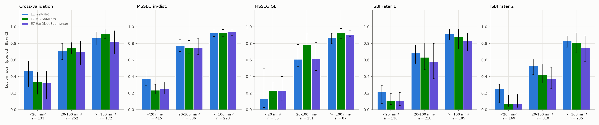
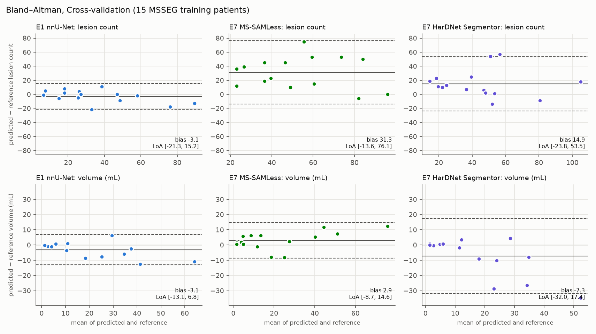
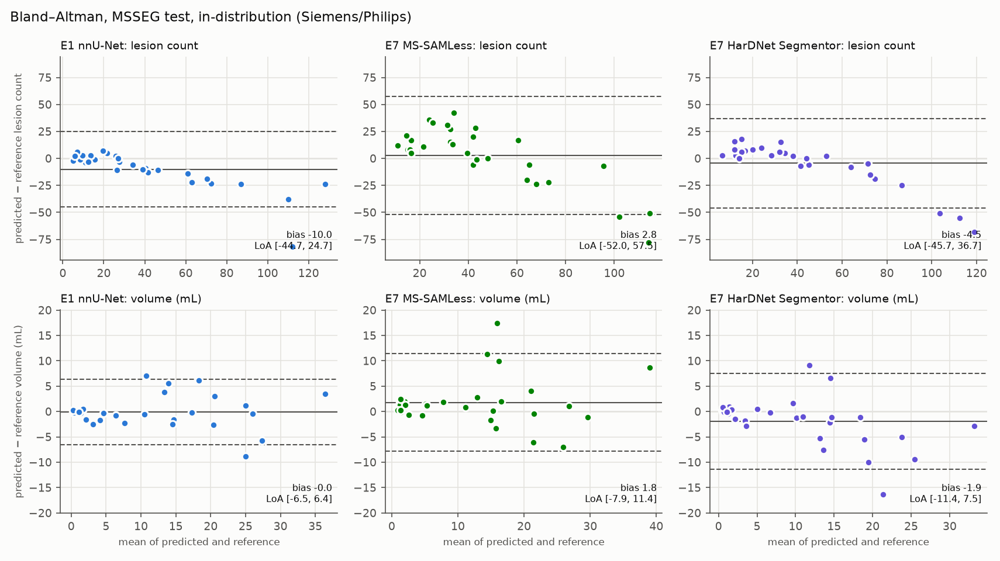

# E7 — MS-SAMLess and HarDNet Segmentor vs E1 nnU-Net (exploratory, added after the results freeze)

Generated 2026-11-20 17:55 from commit `b5a2d94` (branch `e7-ms-sam-less`) by `scripts/e7_summary.py`.

> **Exploratory, added after the results freeze.** Not part of the pre-specified comparison and not used to change anything in the frozen results (tags `results-frozen`, `-v2`, `-v3`). Same patients, folds, lesion rule, size bins, metrics and statistics as the frozen reports; E1's numbers are the frozen ones.

**What E7 is.** MS-SAMLess (Proietto Salanitri et al., *Pattern Recognit. Lett.* 2026; code `perceivelab/MS-SAM-LESS` @ `dde835c`, used unmodified): a HarDNet-85 prompt learner trained with a frozen SAM ViT-B (phase 1), then a SAM-free ConvUpsample segmentor on that backbone (phase 2, the model scored here). **HarDNet Segmentor**: the same network trained from ImageNet weights without SAM, for the same total training (300 epochs), so E7 − HarDNet isolates SAM's guidance. 2D axial slices, FLAIR/T1/T2, E1's 5 folds, last-epoch checkpoints; test sets: 5-fold mean-probability ensembles.

**Deviations from the paper** (approved; details in `experiments/E7/README.md`, config `e7.deviations`): FLAIR/T1/T2 instead of FLAIR only; each training scan 8x per epoch (~2,400 phase-1 updates, roughly their MSLesSeg setup); last-epoch checkpoint instead of best validation IoU, no per-epoch validation; baseline 300 epochs; 1 mm resampling also at inference, mapped back to each case's grid; 5-fold ensembles on the test sets; newer Python/PyTorch/MONAI.

**Statistics** as in `results/test/summary.md`: means over scans, 95% CI by patient bootstrap; ISBI's 21 scans come from 5 patients, so ISBI bootstraps resample patients and Wilcoxon tests use per-patient means (n = 5, smallest possible p = 0.0625). Paired differences A − B; Holm within each comparison and set over the per-scan metrics. `msseg_test_c07_p08` (empty consensus) is reported separately and left out.

## Overview

Means over scans (empty-reference scan excluded); CIs and tests below.

| set | metric | E1 nnU-Net | E7 MS-SAMLess | E7 HarDNet Segmentor |
|---|---|---|---|---|
| Cross-validation | lesion F1 | 0.693 | 0.421 | 0.492 |
| Cross-validation | Dice | 0.767 | 0.629 | 0.649 |
| Cross-validation | FP / scan | 8.333 | 45.467 | 29.000 |
| Cross-validation | pooled recall <20 mm³ | 0.474 | 0.338 | 0.323 |
| MSSEG in-dist. | lesion F1 | 0.725 | 0.513 | 0.611 |
| MSSEG in-dist. | Dice | 0.744 | 0.634 | 0.672 |
| MSSEG in-dist. | FP / scan | 5.138 | 24.621 | 13.966 |
| MSSEG in-dist. | pooled recall <20 mm³ | 0.378 | 0.236 | 0.253 |
| MSSEG GE | lesion F1 | 0.648 | 0.488 | 0.550 |
| MSSEG GE | Dice | 0.667 | 0.609 | 0.606 |
| MSSEG GE | FP / scan | 8.875 | 32.625 | 18.375 |
| MSSEG GE | pooled recall <20 mm³ | 0.133 | 0.233 | 0.233 |
| ISBI rater 1 | lesion F1 | 0.649 | 0.431 | 0.511 |
| ISBI rater 1 | Dice | 0.725 | 0.626 | 0.620 |
| ISBI rater 1 | FP / scan | 7.952 | 29.476 | 15.000 |
| ISBI rater 1 | pooled recall <20 mm³ | 0.215 | 0.115 | 0.108 |
| ISBI rater 2 | lesion F1 | 0.616 | 0.386 | 0.450 |
| ISBI rater 2 | Dice | 0.690 | 0.581 | 0.566 |
| ISBI rater 2 | FP / scan | 7.143 | 30.381 | 16.048 |
| ISBI rater 2 | pooled recall <20 mm³ | 0.254 | 0.077 | 0.071 |

## Cross-validation (15 MSSEG training patients)

15 scans, 15 patients.

| metric | E1 nnU-Net | E7 MS-SAMLess | E7 HarDNet Segmentor |
|---|---|---|---|
| dice | 0.767 ± 0.082 [0.727, 0.807] | 0.629 ± 0.149 [0.552, 0.698] | 0.649 ± 0.117 [0.589, 0.703] |
| lesion_precision | 0.734 ± 0.115 [0.675, 0.785] | 0.329 ± 0.150 [0.260, 0.405] | 0.421 ± 0.154 [0.345, 0.496] |
| lesion_recall | 0.687 ± 0.183 [0.594, 0.774] | 0.701 ± 0.196 [0.598, 0.792] | 0.680 ± 0.230 [0.564, 0.787] |
| lesion_f1 | 0.693 ± 0.133 [0.627, 0.757] | 0.421 ± 0.149 [0.351, 0.496] | 0.492 ± 0.151 [0.419, 0.566] |
| fp_lesions | 8.333 ± 4.791 [6.000, 10.733] | 45.467 ± 19.048 [36.533, 55.200] | 29.000 ± 14.198 [22.465, 36.333] |
| recall_<20 | 0.322 ± 0.255 [0.184, 0.462] (n=12) | 0.256 ± 0.262 [0.118, 0.403] (n=12) | 0.223 ± 0.270 [0.083, 0.377] (n=12) |
| recall_20-100 | 0.702 ± 0.224 [0.589, 0.809] | 0.736 ± 0.258 [0.594, 0.849] | 0.730 ± 0.239 [0.607, 0.841] |
| recall_>=100 | 0.867 ± 0.153 [0.787, 0.937] | 0.939 ± 0.088 [0.892, 0.978] | 0.861 ± 0.240 [0.730, 0.962] |
| f1_<20 | 0.261 ± 0.258 [0.139, 0.389] | 0.099 ± 0.147 [0.034, 0.175] | 0.123 ± 0.172 [0.045, 0.212] |
| f1_20-100 | 0.708 ± 0.181 [0.618, 0.795] | 0.456 ± 0.232 [0.339, 0.568] | 0.566 ± 0.176 [0.480, 0.653] |
| f1_>=100 | 0.886 ± 0.112 [0.827, 0.935] | 0.794 ± 0.124 [0.735, 0.854] | 0.816 ± 0.247 [0.678, 0.911] |

Recall (pooled) and false positives per scan by size bin:

| bin (mm³) | E1 nnU-Net | E7 MS-SAMLess | E7 HarDNet Segmentor |
|---|---|---|---|
| <20 | R 63/133 = 0.474 [0.281, 0.586] FP/scan 5.5 | R 45/133 = 0.338 [0.186, 0.450] FP/scan 25.5 | R 43/133 = 0.323 [0.126, 0.470] FP/scan 19.9 |
| 20-100 | R 180/252 = 0.714 [0.605, 0.797] FP/scan 2.1 | R 188/252 = 0.746 [0.671, 0.810] FP/scan 15.9 | R 177/252 = 0.702 [0.543, 0.828] FP/scan 7.9 |
| >=100 | R 149/172 = 0.866 [0.780, 0.939] FP/scan 0.7 | R 158/172 = 0.919 [0.857, 0.971] FP/scan 4.1 | R 142/172 = 0.826 [0.674, 0.952] FP/scan 1.1 |

Lesion count and volume agreement (Bland–Altman; bias CI by patient bootstrap):

| model | quantity | bias (pred − ref) | 95% limits of agreement | MAE |
|---|---|---|---|---|
| E1 nnU-Net | lesion count | -3.07 [-7.733, 1.400] | [-21.31, 15.18] | 7.07 |
| E1 nnU-Net | volume (mL) | -3.13 [-5.631, -0.678] | [-13.08, 6.83] | 4.19 |
| E7 MS-SAMLess | lesion count | 31.27 [20.133, 42.733] | [-13.61, 76.15] | 32.07 |
| E7 MS-SAMLess | volume (mL) | 2.95 [-0.106, 5.771] | [-8.66, 14.55] | 5.24 |
| E7 HarDNet Segmentor | lesion count | 14.87 [5.933, 25.000] | [-23.79, 53.52] | 17.93 |
| E7 HarDNet Segmentor | volume (mL) | -7.29 [-13.737, -1.608] | [-31.99, 17.41] | 8.65 |

**E7 MS-SAMLess − E1 nnU-Net**

| metric | n scans | n patients | mean E7 | mean E1 | mean diff | 95% CI | Wilcoxon p | p (Holm) |
|---|---|---|---|---|---|---|---|---|
| dice | 15 | 15 | 0.629 | 0.767 | -0.138 | [-0.187, -0.092] | 0.000 | 0.001 |
| lesion_precision | 15 | 15 | 0.329 | 0.734 | -0.405 | [-0.470, -0.340] | 0.000 | 0.001 |
| lesion_recall | 15 | 15 | 0.701 | 0.687 | 0.014 | [-0.045, 0.076] | 0.638 | 1.000 |
| lesion_f1 | 15 | 15 | 0.421 | 0.693 | -0.272 | [-0.332, -0.213] | 0.000 | 0.001 |
| fp_lesions | 15 | 15 | 45.467 | 8.333 | 37.133 | [28.600, 46.667] | 0.001 | 0.005 |
| recall_<20 | 12 | 12 | 0.256 | 0.322 | -0.066 | [-0.184, 0.055] | 0.305 | 0.914 |
| recall_20-100 | 15 | 15 | 0.736 | 0.702 | 0.034 | [-0.058, 0.124] | 0.504 | 1.000 |
| recall_>=100 | 15 | 15 | 0.939 | 0.867 | 0.072 | [0.010, 0.142] | 0.066 | 0.264 |
| f1_<20 | 15 | 15 | 0.099 | 0.261 | -0.163 | [-0.249, -0.081] | 0.008 | 0.046 |
| f1_20-100 | 15 | 15 | 0.456 | 0.708 | -0.252 | [-0.338, -0.160] | 0.000 | 0.003 |
| f1_>=100 | 15 | 15 | 0.794 | 0.886 | -0.091 | [-0.158, -0.027] | 0.026 | 0.128 |
| pooled recall <20 | 15 | 15 | 0.338 | 0.474 | -0.135 | [-0.232, -0.020] | – | – |
| pooled recall 20-100 | 15 | 15 | 0.746 | 0.714 | 0.032 | [-0.043, 0.123] | – | – |
| pooled recall >=100 | 15 | 15 | 0.919 | 0.866 | 0.052 | [-0.005, 0.129] | – | – |

**E7 MS-SAMLess − E7 HarDNet Segmentor**

| metric | n scans | n patients | mean E7 | mean E7_hardnet | mean diff | 95% CI | Wilcoxon p | p (Holm) |
|---|---|---|---|---|---|---|---|---|
| dice | 15 | 15 | 0.629 | 0.649 | -0.019 | [-0.094, 0.060] | 0.277 | 1.000 |
| lesion_precision | 15 | 15 | 0.329 | 0.421 | -0.093 | [-0.152, -0.038] | 0.008 | 0.092 |
| lesion_recall | 15 | 15 | 0.701 | 0.680 | 0.022 | [-0.084, 0.131] | 0.646 | 1.000 |
| lesion_f1 | 15 | 15 | 0.421 | 0.492 | -0.071 | [-0.136, -0.009] | 0.035 | 0.318 |
| fp_lesions | 15 | 15 | 45.467 | 29.000 | 16.467 | [5.000, 28.267] | 0.022 | 0.215 |
| recall_<20 | 12 | 12 | 0.256 | 0.223 | 0.033 | [-0.098, 0.173] | 0.844 | 1.000 |
| recall_20-100 | 15 | 15 | 0.736 | 0.730 | 0.006 | [-0.140, 0.130] | 0.799 | 1.000 |
| recall_>=100 | 15 | 15 | 0.939 | 0.861 | 0.078 | [-0.010, 0.205] | 0.176 | 1.000 |
| f1_<20 | 15 | 15 | 0.099 | 0.123 | -0.025 | [-0.083, 0.021] | 0.575 | 1.000 |
| f1_20-100 | 15 | 15 | 0.456 | 0.566 | -0.110 | [-0.227, -0.002] | 0.151 | 1.000 |
| f1_>=100 | 15 | 15 | 0.794 | 0.816 | -0.021 | [-0.116, 0.100] | 0.208 | 1.000 |
| pooled recall <20 | 15 | 15 | 0.338 | 0.323 | 0.015 | [-0.127, 0.147] | – | – |
| pooled recall 20-100 | 15 | 15 | 0.746 | 0.702 | 0.044 | [-0.076, 0.180] | – | – |
| pooled recall >=100 | 15 | 15 | 0.919 | 0.826 | 0.093 | [-0.007, 0.234] | – | – |

## MSSEG test, in-distribution (Siemens/Philips)

**Empty reference, reported separately and left out:** msseg_test_c07_p08.

| scan | model | false-positive lesions | predicted volume (mL) |
|---|---|---|---|
| msseg_test_c07_p08 | E1 nnU-Net | 0 | 0.000 |
| msseg_test_c07_p08 | E7 MS-SAMLess | 35 | 1.114 |
| msseg_test_c07_p08 | E7 HarDNet Segmentor | 9 | 0.188 |

29 scans, 29 patients.

| metric | E1 nnU-Net | E7 MS-SAMLess | E7 HarDNet Segmentor |
|---|---|---|---|
| dice | 0.744 ± 0.140 [0.692, 0.793] | 0.634 ± 0.207 [0.554, 0.705] | 0.672 ± 0.176 [0.604, 0.732] |
| lesion_precision | 0.768 ± 0.176 [0.704, 0.829] | 0.451 ± 0.202 [0.377, 0.523] | 0.578 ± 0.205 [0.503, 0.649] |
| lesion_recall | 0.724 ± 0.170 [0.663, 0.783] | 0.704 ± 0.178 [0.642, 0.766] | 0.717 ± 0.170 [0.659, 0.777] |
| lesion_f1 | 0.725 ± 0.127 [0.678, 0.769] | 0.513 ± 0.175 [0.449, 0.575] | 0.611 ± 0.169 [0.548, 0.669] |
| fp_lesions | 5.138 ± 3.482 [3.966, 6.448] | 24.621 ± 11.406 [20.655, 28.897] | 13.966 ± 5.931 [11.966, 16.138] |
| recall_<20 | 0.439 ± 0.318 [0.323, 0.560] (n=26) | 0.330 ± 0.270 [0.234, 0.438] (n=26) | 0.310 ± 0.242 [0.224, 0.404] (n=26) |
| recall_20-100 | 0.809 ± 0.155 [0.753, 0.861] | 0.820 ± 0.174 [0.755, 0.880] | 0.822 ± 0.181 [0.755, 0.883] |
| recall_>=100 | 0.907 ± 0.152 [0.847, 0.956] (n=28) | 0.934 ± 0.124 [0.885, 0.974] (n=28) | 0.962 ± 0.068 [0.936, 0.984] (n=28) |
| f1_<20 | 0.367 ± 0.242 [0.278, 0.456] (n=28) | 0.162 ± 0.151 [0.109, 0.219] | 0.240 ± 0.184 [0.176, 0.307] |
| f1_20-100 | 0.772 ± 0.207 [0.693, 0.838] | 0.584 ± 0.237 [0.498, 0.667] | 0.700 ± 0.221 [0.618, 0.775] |
| f1_>=100 | 0.861 ± 0.258 [0.758, 0.941] | 0.821 ± 0.238 [0.726, 0.896] | 0.881 ± 0.255 [0.778, 0.958] |

Recall (pooled) and false positives per scan by size bin:

| bin (mm³) | E1 nnU-Net | E7 MS-SAMLess | E7 HarDNet Segmentor |
|---|---|---|---|
| <20 | R 157/415 = 0.378 [0.289, 0.467] FP/scan 3.2 | R 98/415 = 0.236 [0.188, 0.306] FP/scan 15.7 | R 105/415 = 0.253 [0.189, 0.332] FP/scan 10.6 |
| 20-100 | R 454/586 = 0.775 [0.701, 0.850] FP/scan 1.4 | R 437/586 = 0.746 [0.674, 0.834] FP/scan 7.0 | R 441/586 = 0.753 [0.667, 0.857] FP/scan 2.9 |
| >=100 | R 276/298 = 0.926 [0.883, 0.962] FP/scan 0.5 | R 277/298 = 0.930 [0.885, 0.967] FP/scan 1.9 | R 280/298 = 0.940 [0.898, 0.972] FP/scan 0.5 |

Lesion count and volume agreement (Bland–Altman; bias CI by patient bootstrap):

| model | quantity | bias (pred − ref) | 95% limits of agreement | MAE |
|---|---|---|---|---|
| E1 nnU-Net | lesion count | -10.00 [-16.759, -4.552] | [-44.74, 24.74] | 12.07 |
| E1 nnU-Net | volume (mL) | -0.05 [-1.202, 1.096] | [-6.50, 6.40] | 2.21 |
| E7 MS-SAMLess | lesion count | 2.76 [-7.724, 12.173] | [-51.98, 57.50] | 21.31 |
| E7 MS-SAMLess | volume (mL) | 1.75 [0.108, 3.613] | [-7.87, 11.38] | 3.22 |
| E7 HarDNet Segmentor | lesion count | -4.52 [-12.484, 2.310] | [-45.74, 36.70] | 13.34 |
| E7 HarDNet Segmentor | volume (mL) | -1.91 [-3.673, -0.260] | [-11.37, 7.55] | 3.31 |

**E7 MS-SAMLess − E1 nnU-Net**

| metric | n scans | n patients | mean E7 | mean E1 | mean diff | 95% CI | Wilcoxon p | p (Holm) |
|---|---|---|---|---|---|---|---|---|
| dice | 29 | 29 | 0.634 | 0.744 | -0.110 | [-0.147, -0.076] | 0.000 | 0.000 |
| lesion_precision | 29 | 29 | 0.451 | 0.768 | -0.317 | [-0.372, -0.265] | 0.000 | 0.000 |
| lesion_recall | 29 | 29 | 0.704 | 0.724 | -0.020 | [-0.064, 0.022] | 0.607 | 1.000 |
| lesion_f1 | 29 | 29 | 0.513 | 0.725 | -0.212 | [-0.259, -0.167] | 0.000 | 0.000 |
| fp_lesions | 29 | 29 | 24.621 | 5.138 | 19.483 | [15.414, 23.897] | 0.000 | 0.000 |
| recall_<20 | 26 | 26 | 0.330 | 0.439 | -0.109 | [-0.184, -0.038] | 0.012 | 0.059 |
| recall_20-100 | 29 | 29 | 0.820 | 0.809 | 0.011 | [-0.043, 0.066] | 0.472 | 1.000 |
| recall_>=100 | 28 | 28 | 0.934 | 0.907 | 0.027 | [-0.041, 0.097] | 0.423 | 1.000 |
| f1_<20 | 28 | 28 | 0.167 | 0.367 | -0.199 | [-0.268, -0.133] | 0.000 | 0.000 |
| f1_20-100 | 29 | 29 | 0.584 | 0.772 | -0.187 | [-0.259, -0.121] | 0.000 | 0.000 |
| f1_>=100 | 29 | 29 | 0.821 | 0.861 | -0.040 | [-0.106, 0.017] | 0.375 | 1.000 |
| pooled recall <20 | 29 | 29 | 0.236 | 0.378 | -0.142 | [-0.226, -0.052] | – | – |
| pooled recall 20-100 | 29 | 29 | 0.746 | 0.775 | -0.029 | [-0.100, 0.038] | – | – |
| pooled recall >=100 | 29 | 29 | 0.930 | 0.926 | 0.003 | [-0.036, 0.045] | – | – |

**E7 MS-SAMLess − E7 HarDNet Segmentor**

| metric | n scans | n patients | mean E7 | mean E7_hardnet | mean diff | 95% CI | Wilcoxon p | p (Holm) |
|---|---|---|---|---|---|---|---|---|
| dice | 29 | 29 | 0.634 | 0.672 | -0.038 | [-0.063, -0.014] | 0.004 | 0.025 |
| lesion_precision | 29 | 29 | 0.451 | 0.578 | -0.127 | [-0.160, -0.093] | 0.000 | 0.000 |
| lesion_recall | 29 | 29 | 0.704 | 0.717 | -0.013 | [-0.047, 0.019] | 0.273 | 1.000 |
| lesion_f1 | 29 | 29 | 0.513 | 0.611 | -0.098 | [-0.130, -0.068] | 0.000 | 0.000 |
| fp_lesions | 29 | 29 | 24.621 | 13.966 | 10.655 | [7.172, 14.483] | 0.000 | 0.000 |
| recall_<20 | 26 | 26 | 0.330 | 0.310 | 0.020 | [-0.047, 0.117] | 0.609 | 1.000 |
| recall_20-100 | 29 | 29 | 0.820 | 0.822 | -0.002 | [-0.047, 0.049] | 0.820 | 1.000 |
| recall_>=100 | 28 | 28 | 0.934 | 0.962 | -0.029 | [-0.080, 0.013] | 0.484 | 1.000 |
| f1_<20 | 29 | 29 | 0.162 | 0.240 | -0.078 | [-0.120, -0.040] | 0.002 | 0.015 |
| f1_20-100 | 29 | 29 | 0.584 | 0.700 | -0.116 | [-0.166, -0.069] | 0.000 | 0.002 |
| f1_>=100 | 29 | 29 | 0.821 | 0.881 | -0.060 | [-0.112, -0.013] | 0.028 | 0.141 |
| pooled recall <20 | 29 | 29 | 0.236 | 0.253 | -0.017 | [-0.049, 0.016] | – | – |
| pooled recall 20-100 | 29 | 29 | 0.746 | 0.753 | -0.007 | [-0.053, 0.028] | – | – |
| pooled recall >=100 | 29 | 29 | 0.930 | 0.940 | -0.010 | [-0.056, 0.021] | – | – |

## MSSEG test, GE Discovery 3T (unseen scanner)

8 scans, 8 patients.

| metric | E1 nnU-Net | E7 MS-SAMLess | E7 HarDNet Segmentor |
|---|---|---|---|
| dice | 0.667 ± 0.172 [0.553, 0.774] | 0.609 ± 0.184 [0.489, 0.723] | 0.606 ± 0.105 [0.535, 0.672] |
| lesion_precision | 0.622 ± 0.145 [0.527, 0.711] | 0.376 ± 0.174 [0.266, 0.489] | 0.473 ± 0.178 [0.362, 0.592] |
| lesion_recall | 0.712 ± 0.158 [0.609, 0.808] | 0.841 ± 0.114 [0.768, 0.913] | 0.767 ± 0.155 [0.669, 0.866] |
| lesion_f1 | 0.648 ± 0.116 [0.574, 0.723] | 0.488 ± 0.143 [0.395, 0.580] | 0.550 ± 0.102 [0.486, 0.618] |
| fp_lesions | 8.875 ± 3.091 [7.125, 11.000] | 32.625 ± 10.391 [26.375, 39.750] | 18.375 ± 7.009 [14.000, 23.125] |
| recall_<20 | 0.205 ± 0.299 [0.009, 0.438] (n=6) | 0.204 ± 0.197 [0.062, 0.354] (n=6) | 0.315 ± 0.384 [0.065, 0.628] (n=6) |
| recall_20-100 | 0.709 ± 0.219 [0.574, 0.843] | 0.875 ± 0.140 [0.782, 0.968] | 0.752 ± 0.236 [0.600, 0.898] |
| recall_>=100 | 0.875 ± 0.133 [0.779, 0.949] | 0.935 ± 0.095 [0.867, 0.991] | 0.922 ± 0.072 [0.872, 0.966] |
| f1_<20 | 0.141 ± 0.231 [0.013, 0.315] | 0.114 ± 0.127 [0.029, 0.197] | 0.175 ± 0.199 [0.045, 0.309] |
| f1_20-100 | 0.667 ± 0.131 [0.582, 0.751] | 0.639 ± 0.124 [0.555, 0.713] | 0.507 ± 0.231 [0.343, 0.636] |
| f1_>=100 | 0.721 ± 0.347 [0.472, 0.916] | 0.656 ± 0.339 [0.416, 0.853] | 0.828 ± 0.337 [0.583, 0.967] |

Recall (pooled) and false positives per scan by size bin:

| bin (mm³) | E1 nnU-Net | E7 MS-SAMLess | E7 HarDNet Segmentor |
|---|---|---|---|
| <20 | R 4/30 = 0.133 [0.026, 0.500] FP/scan 5.0 | R 7/30 = 0.233 [0.138, 0.333] FP/scan 22.2 | R 7/30 = 0.233 [0.107, 0.400] FP/scan 12.6 |
| 20-100 | R 80/131 = 0.611 [0.519, 0.788] FP/scan 3.0 | R 103/131 = 0.786 [0.721, 0.913] FP/scan 7.4 | R 81/131 = 0.618 [0.474, 0.809] FP/scan 5.5 |
| >=100 | R 76/87 = 0.874 [0.800, 0.921] FP/scan 0.9 | R 81/87 = 0.931 [0.856, 0.978] FP/scan 3.0 | R 79/87 = 0.908 [0.880, 0.951] FP/scan 0.2 |

Lesion count and volume agreement (Bland–Altman; bias CI by patient bootstrap):

| model | quantity | bias (pred − ref) | 95% limits of agreement | MAE |
|---|---|---|---|---|
| E1 nnU-Net | lesion count | -2.62 [-9.875, 3.000] | [-22.83, 17.58] | 7.12 |
| E1 nnU-Net | volume (mL) | -4.43 [-9.834, -0.269] | [-18.72, 9.87] | 4.70 |
| E7 MS-SAMLess | lesion count | 24.75 [17.125, 33.625] | [-0.65, 50.15] | 24.75 |
| E7 MS-SAMLess | volume (mL) | -3.08 [-8.228, 0.875] | [-16.59, 10.43] | 4.38 |
| E7 HarDNet Segmentor | lesion count | 11.25 [8.125, 14.500] | [1.49, 21.01] | 11.25 |
| E7 HarDNet Segmentor | volume (mL) | -7.97 [-16.495, -1.051] | [-32.17, 16.22] | 7.97 |

**E7 MS-SAMLess − E1 nnU-Net**

| metric | n scans | n patients | mean E7 | mean E1 | mean diff | 95% CI | Wilcoxon p | p (Holm) |
|---|---|---|---|---|---|---|---|---|
| dice | 8 | 8 | 0.609 | 0.667 | -0.058 | [-0.085, -0.032] | 0.008 | 0.086 |
| lesion_precision | 8 | 8 | 0.376 | 0.622 | -0.246 | [-0.322, -0.170] | 0.008 | 0.086 |
| lesion_recall | 8 | 8 | 0.841 | 0.712 | 0.129 | [0.060, 0.195] | 0.031 | 0.250 |
| lesion_f1 | 8 | 8 | 0.488 | 0.648 | -0.159 | [-0.250, -0.061] | 0.039 | 0.273 |
| fp_lesions | 8 | 8 | 32.625 | 8.875 | 23.750 | [17.500, 31.125] | 0.008 | 0.086 |
| recall_<20 | 6 | 6 | 0.204 | 0.205 | -0.000 | [-0.143, 0.118] | 1.000 | 1.000 |
| recall_20-100 | 8 | 8 | 0.875 | 0.709 | 0.166 | [0.073, 0.257] | 0.062 | 0.375 |
| recall_>=100 | 8 | 8 | 0.935 | 0.875 | 0.060 | [0.019, 0.112] | 0.125 | 0.625 |
| f1_<20 | 8 | 8 | 0.114 | 0.141 | -0.027 | [-0.147, 0.092] | 0.625 | 1.000 |
| f1_20-100 | 8 | 8 | 0.639 | 0.667 | -0.028 | [-0.135, 0.069] | 0.578 | 1.000 |
| f1_>=100 | 8 | 8 | 0.656 | 0.721 | -0.065 | [-0.146, 0.002] | 0.188 | 0.750 |
| pooled recall <20 | 8 | 8 | 0.233 | 0.133 | 0.100 | [-0.182, 0.172] | – | – |
| pooled recall 20-100 | 8 | 8 | 0.786 | 0.611 | 0.176 | [0.066, 0.274] | – | – |
| pooled recall >=100 | 8 | 8 | 0.931 | 0.874 | 0.057 | [0.019, 0.100] | – | – |

**E7 MS-SAMLess − E7 HarDNet Segmentor**

| metric | n scans | n patients | mean E7 | mean E7_hardnet | mean diff | 95% CI | Wilcoxon p | p (Holm) |
|---|---|---|---|---|---|---|---|---|
| dice | 8 | 8 | 0.609 | 0.606 | 0.003 | [-0.064, 0.070] | 0.945 | 1.000 |
| lesion_precision | 8 | 8 | 0.376 | 0.473 | -0.097 | [-0.155, -0.033] | 0.039 | 0.391 |
| lesion_recall | 8 | 8 | 0.841 | 0.767 | 0.074 | [-0.003, 0.146] | 0.109 | 0.766 |
| lesion_f1 | 8 | 8 | 0.488 | 0.550 | -0.062 | [-0.133, 0.007] | 0.250 | 1.000 |
| fp_lesions | 8 | 8 | 32.625 | 18.375 | 14.250 | [8.125, 21.500] | 0.008 | 0.086 |
| recall_<20 | 6 | 6 | 0.204 | 0.315 | -0.111 | [-0.500, 0.167] | 1.000 | 1.000 |
| recall_20-100 | 8 | 8 | 0.875 | 0.752 | 0.122 | [0.043, 0.204] | 0.062 | 0.562 |
| recall_>=100 | 8 | 8 | 0.935 | 0.922 | 0.013 | [-0.066, 0.071] | 0.625 | 1.000 |
| f1_<20 | 8 | 8 | 0.114 | 0.175 | -0.061 | [-0.181, 0.052] | 0.312 | 1.000 |
| f1_20-100 | 8 | 8 | 0.639 | 0.507 | 0.132 | [-0.000, 0.306] | 0.195 | 1.000 |
| f1_>=100 | 8 | 8 | 0.656 | 0.828 | -0.172 | [-0.323, -0.036] | 0.078 | 0.625 |
| pooled recall <20 | 8 | 8 | 0.233 | 0.233 | 0.000 | [-0.200, 0.143] | – | – |
| pooled recall 20-100 | 8 | 8 | 0.786 | 0.618 | 0.168 | [0.074, 0.254] | – | – |
| pooled recall >=100 | 8 | 8 | 0.931 | 0.908 | 0.023 | [-0.090, 0.080] | – | – |

Per scan, GE Discovery 3T:

| case_id | n_ref_lesions | dice E1 | lesion_f1 E1 | fp_lesions E1 | dice E7 | lesion_f1 E7 | fp_lesions E7 | dice E7_hardnet | lesion_f1 E7_hardnet | fp_lesions E7_hardnet |
|---|---|---|---|---|---|---|---|---|---|---|
| msseg_test_c03_p01 | 61 | 0.860 | 0.532 | 12 | 0.825 | 0.610 | 34 | 0.703 | 0.672 | 23 |
| msseg_test_c03_p02 | 21 | 0.821 | 0.802 | 7 | 0.710 | 0.516 | 31 | 0.757 | 0.695 | 17 |
| msseg_test_c03_p03 | 9 | 0.467 | 0.488 | 8 | 0.412 | 0.286 | 39 | 0.557 | 0.485 | 14 |
| msseg_test_c03_p04 | 8 | 0.554 | 0.691 | 6 | 0.469 | 0.359 | 24 | 0.541 | 0.400 | 12 |
| msseg_test_c03_p05 | 19 | 0.719 | 0.621 | 7 | 0.614 | 0.350 | 53 | 0.597 | 0.510 | 19 |
| msseg_test_c03_p06 | 9 | 0.399 | 0.579 | 7 | 0.331 | 0.500 | 18 | 0.415 | 0.490 | 9 |
| msseg_test_c03_p07 | 73 | 0.786 | 0.667 | 15 | 0.785 | 0.679 | 30 | 0.650 | 0.619 | 22 |
| msseg_test_c03_p08 | 48 | 0.733 | 0.801 | 9 | 0.724 | 0.607 | 32 | 0.627 | 0.532 | 31 |

## ISBI 2015, rater 1

21 scans, 5 patients.

| metric | E1 nnU-Net | E7 MS-SAMLess | E7 HarDNet Segmentor |
|---|---|---|---|
| dice | 0.725 ± 0.099 [0.635, 0.800] | 0.626 ± 0.114 [0.530, 0.708] | 0.620 ± 0.126 [0.501, 0.706] |
| lesion_precision | 0.679 ± 0.116 [0.613, 0.740] | 0.356 ± 0.109 [0.272, 0.431] | 0.506 ± 0.130 [0.400, 0.584] |
| lesion_recall | 0.645 ± 0.144 [0.550, 0.733] | 0.606 ± 0.185 [0.458, 0.745] | 0.572 ± 0.218 [0.400, 0.728] |
| lesion_f1 | 0.649 ± 0.100 [0.594, 0.713] | 0.431 ± 0.113 [0.336, 0.517] | 0.511 ± 0.151 [0.384, 0.622] |
| fp_lesions | 7.952 ± 4.685 [4.750, 11.550] | 29.476 ± 10.008 [21.750, 36.500] | 15.000 ± 5.797 [10.700, 19.783] |
| recall_<20 | 0.201 ± 0.205 [0.097, 0.274] | 0.126 ± 0.181 [0.049, 0.201] | 0.146 ± 0.164 [0.060, 0.240] |
| recall_20-100 | 0.674 ± 0.198 [0.568, 0.771] | 0.658 ± 0.220 [0.506, 0.796] | 0.617 ± 0.272 [0.411, 0.801] |
| recall_>=100 | 0.920 ± 0.096 [0.859, 0.976] | 0.881 ± 0.148 [0.752, 0.967] | 0.813 ± 0.135 [0.706, 0.903] |
| f1_<20 | 0.120 ± 0.155 [0.049, 0.187] | 0.068 ± 0.076 [0.028, 0.108] | 0.107 ± 0.116 [0.054, 0.159] |
| f1_20-100 | 0.630 ± 0.223 [0.480, 0.742] | 0.524 ± 0.163 [0.428, 0.611] | 0.603 ± 0.241 [0.439, 0.748] |
| f1_>=100 | 0.869 ± 0.079 [0.828, 0.918] | 0.854 ± 0.171 [0.701, 0.945] | 0.824 ± 0.174 [0.673, 0.930] |

Recall (pooled) and false positives per scan by size bin:

| bin (mm³) | E1 nnU-Net | E7 MS-SAMLess | E7 HarDNet Segmentor |
|---|---|---|---|
| <20 | R 28/130 = 0.215 [0.077, 0.295] FP/scan 3.5 | R 15/130 = 0.115 [0.062, 0.194] FP/scan 21.2 | R 14/130 = 0.108 [0.051, 0.209] FP/scan 11.0 |
| 20-100 | R 149/218 = 0.683 [0.554, 0.778] FP/scan 2.7 | R 138/218 = 0.633 [0.483, 0.804] FP/scan 6.8 | R 126/218 = 0.578 [0.374, 0.800] FP/scan 2.8 |
| >=100 | R 169/185 = 0.914 [0.843, 0.975] FP/scan 1.8 | R 163/185 = 0.881 [0.734, 0.975] FP/scan 1.5 | R 154/185 = 0.832 [0.709, 0.922] FP/scan 1.3 |

Lesion count and volume agreement (Bland–Altman; bias CI by patient bootstrap):

| model | quantity | bias (pred − ref) | 95% limits of agreement | MAE |
|---|---|---|---|---|
| E1 nnU-Net | lesion count | -1.95 [-5.950, 1.286] | [-14.49, 10.59] | 5.00 |
| E1 nnU-Net | volume (mL) | 2.05 [0.241, 4.188] | [-3.14, 7.24] | 2.31 |
| E7 MS-SAMLess | lesion count | 19.86 [8.400, 29.478] | [-7.46, 47.17] | 21.00 |
| E7 MS-SAMLess | volume (mL) | -3.09 [-7.039, -0.193] | [-11.80, 5.62] | 3.39 |
| E7 HarDNet Segmentor | lesion count | 5.00 [-1.700, 11.478] | [-12.76, 22.76] | 8.05 |
| E7 HarDNet Segmentor | volume (mL) | -4.95 [-9.325, -0.977] | [-15.36, 5.45] | 4.95 |

**E7 MS-SAMLess − E1 nnU-Net**

| metric | n scans | n patients | mean E7 | mean E1 | mean diff | 95% CI | Wilcoxon p | p (Holm) |
|---|---|---|---|---|---|---|---|---|
| dice | 21 | 5 | 0.626 | 0.725 | -0.099 | [-0.191, -0.031] | 0.125 | 1.000 |
| lesion_precision | 21 | 5 | 0.356 | 0.679 | -0.323 | [-0.447, -0.195] | 0.062 | 0.688 |
| lesion_recall | 21 | 5 | 0.606 | 0.645 | -0.039 | [-0.158, 0.063] | 0.812 | 1.000 |
| lesion_f1 | 21 | 5 | 0.431 | 0.649 | -0.218 | [-0.271, -0.156] | 0.062 | 0.688 |
| fp_lesions | 21 | 5 | 29.476 | 7.952 | 21.524 | [10.900, 29.500] | 0.062 | 0.688 |
| recall_<20 | 21 | 5 | 0.126 | 0.201 | -0.075 | [-0.211, 0.046] | 0.625 | 1.000 |
| recall_20-100 | 21 | 5 | 0.658 | 0.674 | -0.016 | [-0.181, 0.106] | 1.000 | 1.000 |
| recall_>=100 | 21 | 5 | 0.881 | 0.920 | -0.039 | [-0.131, 0.031] | 0.625 | 1.000 |
| f1_<20 | 21 | 5 | 0.068 | 0.120 | -0.052 | [-0.117, 0.013] | 0.438 | 1.000 |
| f1_20-100 | 21 | 5 | 0.524 | 0.630 | -0.106 | [-0.201, -0.004] | 0.312 | 1.000 |
| f1_>=100 | 21 | 5 | 0.854 | 0.869 | -0.015 | [-0.138, 0.060] | 0.625 | 1.000 |
| pooled recall <20 | 21 | 5 | 0.115 | 0.215 | -0.100 | [-0.219, 0.064] | – | – |
| pooled recall 20-100 | 21 | 5 | 0.633 | 0.683 | -0.050 | [-0.222, 0.100] | – | – |
| pooled recall >=100 | 21 | 5 | 0.881 | 0.914 | -0.032 | [-0.135, 0.036] | – | – |

**E7 MS-SAMLess − E7 HarDNet Segmentor**

| metric | n scans | n patients | mean E7 | mean E7_hardnet | mean diff | 95% CI | Wilcoxon p | p (Holm) |
|---|---|---|---|---|---|---|---|---|
| dice | 21 | 5 | 0.626 | 0.620 | 0.006 | [-0.030, 0.041] | 0.812 | 1.000 |
| lesion_precision | 21 | 5 | 0.356 | 0.506 | -0.151 | [-0.198, -0.096] | 0.062 | 0.688 |
| lesion_recall | 21 | 5 | 0.606 | 0.572 | 0.034 | [-0.010, 0.089] | 0.438 | 1.000 |
| lesion_f1 | 21 | 5 | 0.431 | 0.511 | -0.080 | [-0.139, -0.007] | 0.188 | 1.000 |
| fp_lesions | 21 | 5 | 29.476 | 15.000 | 14.476 | [9.950, 18.591] | 0.062 | 0.688 |
| recall_<20 | 21 | 5 | 0.126 | 0.146 | -0.020 | [-0.054, 0.017] | 0.625 | 1.000 |
| recall_20-100 | 21 | 5 | 0.658 | 0.617 | 0.041 | [-0.026, 0.124] | 0.438 | 1.000 |
| recall_>=100 | 21 | 5 | 0.881 | 0.813 | 0.068 | [-0.008, 0.158] | 0.312 | 1.000 |
| f1_<20 | 21 | 5 | 0.068 | 0.107 | -0.039 | [-0.093, 0.008] | 0.625 | 1.000 |
| f1_20-100 | 21 | 5 | 0.524 | 0.603 | -0.079 | [-0.150, 0.003] | 0.188 | 1.000 |
| f1_>=100 | 21 | 5 | 0.854 | 0.824 | 0.029 | [-0.000, 0.070] | 0.312 | 1.000 |
| pooled recall <20 | 21 | 5 | 0.115 | 0.108 | 0.008 | [-0.044, 0.043] | – | – |
| pooled recall 20-100 | 21 | 5 | 0.633 | 0.578 | 0.055 | [-0.022, 0.135] | – | – |
| pooled recall >=100 | 21 | 5 | 0.881 | 0.832 | 0.049 | [-0.012, 0.134] | – | – |

## ISBI 2015, rater 2

21 scans, 5 patients.

| metric | E1 nnU-Net | E7 MS-SAMLess | E7 HarDNet Segmentor |
|---|---|---|---|
| dice | 0.690 ± 0.117 [0.600, 0.779] | 0.581 ± 0.119 [0.488, 0.678] | 0.566 ± 0.115 [0.470, 0.649] |
| lesion_precision | 0.704 ± 0.118 [0.674, 0.750] | 0.339 ± 0.114 [0.258, 0.421] | 0.479 ± 0.136 [0.369, 0.566] |
| lesion_recall | 0.566 ± 0.117 [0.471, 0.635] | 0.510 ± 0.194 [0.360, 0.659] | 0.470 ± 0.202 [0.307, 0.634] |
| lesion_f1 | 0.616 ± 0.087 [0.564, 0.653] | 0.386 ± 0.108 [0.302, 0.462] | 0.450 ± 0.150 [0.321, 0.564] |
| fp_lesions | 7.143 ± 3.953 [4.714, 9.286] | 30.381 ± 10.562 [21.750, 38.227] | 16.048 ± 6.719 [10.850, 22.000] |
| recall_<20 | 0.179 ± 0.191 [0.053, 0.319] | 0.124 ± 0.197 [0.045, 0.194] | 0.108 ± 0.166 [0.037, 0.186] |
| recall_20-100 | 0.507 ± 0.159 [0.421, 0.583] | 0.426 ± 0.218 [0.305, 0.536] | 0.380 ± 0.201 [0.248, 0.493] |
| recall_>=100 | 0.824 ± 0.114 [0.745, 0.894] | 0.801 ± 0.133 [0.693, 0.907] | 0.734 ± 0.179 [0.586, 0.874] |
| f1_<20 | 0.160 ± 0.209 [0.028, 0.305] | 0.038 ± 0.060 [0.015, 0.063] | 0.050 ± 0.083 [0.018, 0.084] |
| f1_20-100 | 0.569 ± 0.157 [0.521, 0.620] | 0.409 ± 0.170 [0.316, 0.493] | 0.452 ± 0.211 [0.322, 0.565] |
| f1_>=100 | 0.827 ± 0.079 [0.773, 0.871] | 0.799 ± 0.147 [0.670, 0.886] | 0.762 ± 0.185 [0.591, 0.893] |

Recall (pooled) and false positives per scan by size bin:

| bin (mm³) | E1 nnU-Net | E7 MS-SAMLess | E7 HarDNet Segmentor |
|---|---|---|---|
| <20 | R 43/169 = 0.254 [0.089, 0.305] FP/scan 2.9 | R 13/169 = 0.077 [0.040, 0.174] FP/scan 21.3 | R 12/169 = 0.071 [0.029, 0.185] FP/scan 11.5 |
| 20-100 | R 165/310 = 0.532 [0.424, 0.610] FP/scan 2.5 | R 131/310 = 0.423 [0.322, 0.549] FP/scan 7.2 | R 115/310 = 0.371 [0.254, 0.511] FP/scan 3.0 |
| >=100 | R 196/235 = 0.834 [0.754, 0.891] FP/scan 1.8 | R 191/235 = 0.813 [0.687, 0.926] FP/scan 1.9 | R 176/235 = 0.749 [0.583, 0.890] FP/scan 1.6 |

Lesion count and volume agreement (Bland–Altman; bias CI by patient bootstrap):

| model | quantity | bias (pred − ref) | 95% limits of agreement | MAE |
|---|---|---|---|---|
| E1 nnU-Net | lesion count | -10.57 [-17.500, -4.409] | [-30.85, 9.71] | 10.95 |
| E1 nnU-Net | volume (mL) | 0.70 [-1.405, 3.033] | [-5.68, 7.07] | 2.48 |
| E7 MS-SAMLess | lesion count | 11.24 [-8.900, 25.522] | [-30.17, 52.64] | 20.76 |
| E7 MS-SAMLess | volume (mL) | -4.44 [-8.954, -1.096] | [-14.14, 5.26] | 4.47 |
| E7 HarDNet Segmentor | lesion count | -3.62 [-17.800, 8.048] | [-35.74, 28.50] | 12.19 |
| E7 HarDNet Segmentor | volume (mL) | -6.31 [-11.033, -1.841] | [-17.61, 5.00] | 6.31 |

**E7 MS-SAMLess − E1 nnU-Net**

| metric | n scans | n patients | mean E7 | mean E1 | mean diff | 95% CI | Wilcoxon p | p (Holm) |
|---|---|---|---|---|---|---|---|---|
| dice | 21 | 5 | 0.581 | 0.690 | -0.109 | [-0.224, -0.027] | 0.125 | 0.875 |
| lesion_precision | 21 | 5 | 0.339 | 0.704 | -0.365 | [-0.491, -0.255] | 0.062 | 0.688 |
| lesion_recall | 21 | 5 | 0.510 | 0.566 | -0.056 | [-0.202, 0.076] | 0.625 | 1.000 |
| lesion_f1 | 21 | 5 | 0.386 | 0.616 | -0.230 | [-0.298, -0.168] | 0.062 | 0.688 |
| fp_lesions | 21 | 5 | 30.381 | 7.143 | 23.238 | [14.250, 31.091] | 0.062 | 0.688 |
| recall_<20 | 21 | 5 | 0.124 | 0.179 | -0.055 | [-0.241, 0.114] | 0.438 | 1.000 |
| recall_20-100 | 21 | 5 | 0.426 | 0.507 | -0.081 | [-0.241, 0.064] | 0.625 | 1.000 |
| recall_>=100 | 21 | 5 | 0.801 | 0.824 | -0.024 | [-0.138, 0.081] | 0.625 | 1.000 |
| f1_<20 | 21 | 5 | 0.038 | 0.160 | -0.122 | [-0.271, 0.013] | 0.312 | 1.000 |
| f1_20-100 | 21 | 5 | 0.409 | 0.569 | -0.160 | [-0.259, -0.066] | 0.062 | 0.688 |
| f1_>=100 | 21 | 5 | 0.799 | 0.827 | -0.028 | [-0.138, 0.055] | 1.000 | 1.000 |
| pooled recall <20 | 21 | 5 | 0.077 | 0.254 | -0.178 | [-0.255, 0.048] | – | – |
| pooled recall 20-100 | 21 | 5 | 0.423 | 0.532 | -0.110 | [-0.264, 0.070] | – | – |
| pooled recall >=100 | 21 | 5 | 0.813 | 0.834 | -0.021 | [-0.147, 0.089] | – | – |

**E7 MS-SAMLess − E7 HarDNet Segmentor**

| metric | n scans | n patients | mean E7 | mean E7_hardnet | mean diff | 95% CI | Wilcoxon p | p (Holm) |
|---|---|---|---|---|---|---|---|---|
| dice | 21 | 5 | 0.581 | 0.566 | 0.014 | [-0.009, 0.041] | 0.438 | 1.000 |
| lesion_precision | 21 | 5 | 0.339 | 0.479 | -0.140 | [-0.193, -0.078] | 0.062 | 0.688 |
| lesion_recall | 21 | 5 | 0.510 | 0.470 | 0.040 | [-0.005, 0.076] | 0.188 | 1.000 |
| lesion_f1 | 21 | 5 | 0.386 | 0.450 | -0.064 | [-0.118, 0.007] | 0.188 | 1.000 |
| fp_lesions | 21 | 5 | 30.381 | 16.048 | 14.333 | [9.700, 18.545] | 0.062 | 0.688 |
| recall_<20 | 21 | 5 | 0.124 | 0.108 | 0.015 | [-0.027, 0.065] | 0.750 | 1.000 |
| recall_20-100 | 21 | 5 | 0.426 | 0.380 | 0.047 | [0.003, 0.085] | 0.188 | 1.000 |
| recall_>=100 | 21 | 5 | 0.801 | 0.734 | 0.067 | [-0.001, 0.153] | 0.188 | 1.000 |
| f1_<20 | 21 | 5 | 0.038 | 0.050 | -0.012 | [-0.027, 0.001] | 0.250 | 1.000 |
| f1_20-100 | 21 | 5 | 0.409 | 0.452 | -0.044 | [-0.077, 0.003] | 0.188 | 1.000 |
| f1_>=100 | 21 | 5 | 0.799 | 0.762 | 0.037 | [-0.014, 0.096] | 0.438 | 1.000 |
| pooled recall <20 | 21 | 5 | 0.077 | 0.071 | 0.006 | [-0.020, 0.027] | – | – |
| pooled recall 20-100 | 21 | 5 | 0.423 | 0.371 | 0.052 | [0.000, 0.086] | – | – |
| pooled recall >=100 | 21 | 5 | 0.813 | 0.749 | 0.064 | [0.004, 0.156] | – | – |

