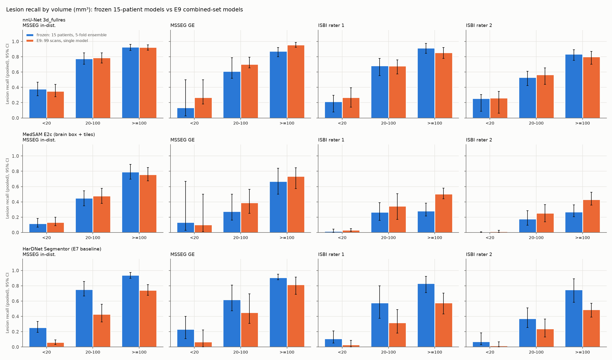

# E9 — data scaling: MSSEG + MSLesSeg training (exploratory, added after the results freeze; MSLesSeg labels follow a different annotation protocol)

Generated 2026-11-21 06:18 from commit `9d38358` (branch `e9-data-scaling`) by `scripts/e9_summary.py`.

> **Exploratory, added after the results freeze; MSLesSeg labels follow a different annotation protocol.** Not part of the pre-specified comparison and not used to change any frozen result. MSLesSeg lesions were annotated under MSLesSeg's own protocol, not the MSSEG consensus protocol the MSSEG test sets are scored against, so part of any change can come from the label definition rather than the amount of data.

**Training set** (one model per method, no cross-validation): 99 scans of 64 patients — MSSEG-2016 training 15 scans / 15 patients and MSLesSeg training 84 scans / 49 patients. Scanners: philips_ingenia 64, philips_achieva_dstream 20, siemens_verio_3t 5, siemens_aera_1p5t 5, philips_ingenia_3t 5. Excluded MSLesSeg scans (GE or unknown scanner, per scan, so the GE test stays unseen): 9 scans of 8 patients (unknown 5, ge_signa_hdxt 2, ge_signa_explorer 1, ge_optima_mr450w 1).

**Budgets — each method follows its own standard recipe.** MedSAM E2c and the HarDNet Segmentor keep the same updates per training scan as their 12-scan CV folds (E2c: 10,000 × 99/12 = 82,500 steps; HarDNet: 300 epochs with each scan 8× per epoch = 29,700 iterations). nnU-Net uses its standard 1000 epochs × 250 iterations, so it gets fewer updates per scan than E1. nnU-Net: new dataset 502, automatic planning on the combined data, default trainer, fold `all`. Same loss and collapse check for E2c; same recipe and deviations as E7 for HarDNet.

**Comparison.** Each E9 model (single model) is paired with its frozen counterpart — **a 5-fold ensemble of 12-patient models** — on the same test scans: E9 nnU-Net vs E1, E9 E2c vs E2c, E9 HarDNet vs E7 HarDNet. The ensemble/single-model difference works against E9. Statistics as `results/test/summary.md`: means over scans, 95% CIs by patient bootstrap, paired Wilcoxon, Holm within each comparison and test set. **ISBI: 21 scans of 5 patients — resampled and tested by patient (smallest possible p = 0.0625). ISBI caveat: MSLesSeg, like ISBI, is Philips data registered to MNI space at 1 mm, so ISBI is a less external test for the E9 models than for the frozen ones.** `msseg_test_c07_p08` (empty consensus) is reported separately.

## Overview

Means over scans (empty-reference scan excluded); diff = E9 − frozen; p (Holm) from the paired comparisons below.

| test set | method | metric | frozen (15 pts, ensemble) | E9 (99 scans, single) | diff | p (Holm) |
|---|---|---|---|---|---|---|
| MSSEG in-dist. | nnU-Net 3d_fullres | lesion F1 | 0.725 | 0.726 | 0.001 | 1.000 |
| MSSEG in-dist. | nnU-Net 3d_fullres | Dice | 0.744 | 0.731 | -0.013 | 0.017 |
| MSSEG in-dist. | nnU-Net 3d_fullres | FP / scan | 5.138 | 6.103 | 0.966 | 0.272 |
| MSSEG in-dist. | nnU-Net 3d_fullres | pooled recall <20 mm³ | 0.378 | 0.349 | -0.029 | – |
| MSSEG in-dist. | MedSAM E2c (brain box + tiles) | lesion F1 | 0.235 | 0.256 | 0.021 | 0.586 |
| MSSEG in-dist. | MedSAM E2c (brain box + tiles) | Dice | 0.485 | 0.479 | -0.005 | 1.000 |
| MSSEG in-dist. | MedSAM E2c (brain box + tiles) | FP / scan | 78.793 | 80.138 | 1.345 | 1.000 |
| MSSEG in-dist. | MedSAM E2c (brain box + tiles) | pooled recall <20 mm³ | 0.116 | 0.133 | 0.017 | – |
| MSSEG in-dist. | HarDNet Segmentor (E7 baseline) | lesion F1 | 0.611 | 0.415 | -0.196 | 0.000 |
| MSSEG in-dist. | HarDNet Segmentor (E7 baseline) | Dice | 0.672 | 0.456 | -0.216 | 0.000 |
| MSSEG in-dist. | HarDNet Segmentor (E7 baseline) | FP / scan | 13.966 | 16.241 | 2.276 | 0.273 |
| MSSEG in-dist. | HarDNet Segmentor (E7 baseline) | pooled recall <20 mm³ | 0.253 | 0.060 | -0.193 | – |
| MSSEG GE | nnU-Net 3d_fullres | lesion F1 | 0.648 | 0.695 | 0.047 | 1.000 |
| MSSEG GE | nnU-Net 3d_fullres | Dice | 0.667 | 0.669 | 0.002 | 1.000 |
| MSSEG GE | nnU-Net 3d_fullres | FP / scan | 8.875 | 11.875 | 3.000 | 1.000 |
| MSSEG GE | nnU-Net 3d_fullres | pooled recall <20 mm³ | 0.133 | 0.267 | 0.133 | – |
| MSSEG GE | MedSAM E2c (brain box + tiles) | lesion F1 | 0.154 | 0.147 | -0.007 | 1.000 |
| MSSEG GE | MedSAM E2c (brain box + tiles) | Dice | 0.299 | 0.327 | 0.028 | 0.781 |
| MSSEG GE | MedSAM E2c (brain box + tiles) | FP / scan | 71.125 | 81.000 | 9.875 | 0.688 |
| MSSEG GE | MedSAM E2c (brain box + tiles) | pooled recall <20 mm³ | 0.133 | 0.100 | -0.033 | – |
| MSSEG GE | HarDNet Segmentor (E7 baseline) | lesion F1 | 0.550 | 0.446 | -0.104 | 0.352 |
| MSSEG GE | HarDNet Segmentor (E7 baseline) | Dice | 0.606 | 0.496 | -0.110 | 0.086 |
| MSSEG GE | HarDNet Segmentor (E7 baseline) | FP / scan | 18.375 | 19.375 | 1.000 | 1.000 |
| MSSEG GE | HarDNet Segmentor (E7 baseline) | pooled recall <20 mm³ | 0.233 | 0.067 | -0.167 | – |
| ISBI rater 1 | nnU-Net 3d_fullres | lesion F1 | 0.649 | 0.622 | -0.027 | 1.000 |
| ISBI rater 1 | nnU-Net 3d_fullres | Dice | 0.725 | 0.721 | -0.005 | 1.000 |
| ISBI rater 1 | nnU-Net 3d_fullres | FP / scan | 7.952 | 10.381 | 2.429 | 0.688 |
| ISBI rater 1 | nnU-Net 3d_fullres | pooled recall <20 mm³ | 0.215 | 0.269 | 0.054 | – |
| ISBI rater 1 | MedSAM E2c (brain box + tiles) | lesion F1 | 0.079 | 0.146 | 0.067 | 1.000 |
| ISBI rater 1 | MedSAM E2c (brain box + tiles) | Dice | 0.190 | 0.318 | 0.128 | 0.688 |
| ISBI rater 1 | MedSAM E2c (brain box + tiles) | FP / scan | 61.429 | 60.381 | -1.048 | 1.000 |
| ISBI rater 1 | MedSAM E2c (brain box + tiles) | pooled recall <20 mm³ | 0.015 | 0.031 | 0.015 | – |
| ISBI rater 1 | HarDNet Segmentor (E7 baseline) | lesion F1 | 0.511 | 0.373 | -0.137 | 0.688 |
| ISBI rater 1 | HarDNet Segmentor (E7 baseline) | Dice | 0.620 | 0.384 | -0.235 | 0.688 |
| ISBI rater 1 | HarDNet Segmentor (E7 baseline) | FP / scan | 15.000 | 11.190 | -3.810 | 0.875 |
| ISBI rater 1 | HarDNet Segmentor (E7 baseline) | pooled recall <20 mm³ | 0.108 | 0.031 | -0.077 | – |
| ISBI rater 2 | nnU-Net 3d_fullres | lesion F1 | 0.616 | 0.607 | -0.009 | 1.000 |
| ISBI rater 2 | nnU-Net 3d_fullres | Dice | 0.690 | 0.683 | -0.006 | 1.000 |
| ISBI rater 2 | nnU-Net 3d_fullres | FP / scan | 7.143 | 8.762 | 1.619 | 1.000 |
| ISBI rater 2 | nnU-Net 3d_fullres | pooled recall <20 mm³ | 0.254 | 0.260 | 0.006 | – |
| ISBI rater 2 | MedSAM E2c (brain box + tiles) | lesion F1 | 0.076 | 0.127 | 0.052 | 1.000 |
| ISBI rater 2 | MedSAM E2c (brain box + tiles) | Dice | 0.168 | 0.288 | 0.120 | 0.688 |
| ISBI rater 2 | MedSAM E2c (brain box + tiles) | FP / scan | 61.238 | 61.429 | 0.190 | 1.000 |
| ISBI rater 2 | MedSAM E2c (brain box + tiles) | pooled recall <20 mm³ | 0.006 | 0.012 | 0.006 | – |
| ISBI rater 2 | HarDNet Segmentor (E7 baseline) | lesion F1 | 0.450 | 0.331 | -0.119 | 0.688 |
| ISBI rater 2 | HarDNet Segmentor (E7 baseline) | Dice | 0.566 | 0.329 | -0.238 | 0.688 |
| ISBI rater 2 | HarDNet Segmentor (E7 baseline) | FP / scan | 16.048 | 11.190 | -4.857 | 1.000 |
| ISBI rater 2 | HarDNet Segmentor (E7 baseline) | pooled recall <20 mm³ | 0.071 | 0.018 | -0.053 | – |

## MSSEG test, in-distribution (Siemens/Philips)

**Empty reference, reported separately and left out:** msseg_test_c07_p08.

| scan | model | false-positive lesions | predicted volume (mL) |
|---|---|---|---|
| msseg_test_c07_p08 | E9 nnU-Net | 0 | 0.000 |
| msseg_test_c07_p08 | E1 nnU-Net (frozen) | 0 | 0.000 |
| msseg_test_c07_p08 | E9 MedSAM E2c | 97 | 1.191 |
| msseg_test_c07_p08 | E2c MedSAM (frozen) | 130 | 1.890 |
| msseg_test_c07_p08 | E9 HarDNet | 1 | 0.005 |
| msseg_test_c07_p08 | E7 HarDNet (E7 branch) | 9 | 0.188 |

29 scans, 29 patients.

| metric | E9 nnU-Net | E1 nnU-Net (frozen) | E9 MedSAM E2c | E2c MedSAM (frozen) | E9 HarDNet | E7 HarDNet (E7 branch) |
|---|---|---|---|---|---|---|
| dice | 0.731 ± 0.145 [0.676, 0.781] | 0.744 ± 0.140 [0.692, 0.793] | 0.479 ± 0.190 [0.411, 0.546] | 0.485 ± 0.201 [0.411, 0.556] | 0.456 ± 0.175 [0.395, 0.520] | 0.672 ± 0.176 [0.604, 0.732] |
| lesion_precision | 0.775 ± 0.151 [0.720, 0.827] | 0.768 ± 0.176 [0.704, 0.829] | 0.202 ± 0.122 [0.159, 0.246] | 0.192 ± 0.130 [0.147, 0.239] | 0.431 ± 0.212 [0.354, 0.509] | 0.578 ± 0.205 [0.503, 0.649] |
| lesion_recall | 0.723 ± 0.176 [0.660, 0.783] | 0.724 ± 0.170 [0.663, 0.783] | 0.527 ± 0.207 [0.455, 0.599] | 0.495 ± 0.185 [0.430, 0.561] | 0.478 ± 0.198 [0.410, 0.548] | 0.717 ± 0.170 [0.659, 0.777] |
| lesion_f1 | 0.726 ± 0.118 [0.682, 0.766] | 0.725 ± 0.127 [0.678, 0.769] | 0.256 ± 0.122 [0.213, 0.300] | 0.235 ± 0.127 [0.191, 0.281] | 0.415 ± 0.175 [0.353, 0.477] | 0.611 ± 0.169 [0.548, 0.669] |
| fp_lesions | 6.103 ± 4.585 [4.586, 7.897] | 5.138 ± 3.482 [3.966, 6.448] | 80.138 ± 23.202 [71.793, 88.138] | 78.793 ± 29.658 [68.655, 89.690] | 16.241 ± 10.514 [12.966, 20.345] | 13.966 ± 5.931 [11.966, 16.138] |
| recall_<20 | 0.451 ± 0.312 [0.336, 0.569] (n=26) | 0.439 ± 0.318 [0.323, 0.560] (n=26) | 0.182 ± 0.230 [0.104, 0.274] (n=26) | 0.156 ± 0.237 [0.077, 0.255] (n=26) | 0.118 ± 0.228 [0.044, 0.214] (n=26) | 0.310 ± 0.242 [0.224, 0.404] (n=26) |
| recall_20-100 | 0.808 ± 0.153 [0.752, 0.860] | 0.809 ± 0.155 [0.753, 0.861] | 0.565 ± 0.235 [0.482, 0.647] | 0.483 ± 0.180 [0.417, 0.546] | 0.499 ± 0.241 [0.416, 0.585] | 0.822 ± 0.181 [0.755, 0.883] |
| recall_>=100 | 0.906 ± 0.141 [0.852, 0.953] (n=28) | 0.907 ± 0.152 [0.847, 0.956] (n=28) | 0.815 ± 0.203 [0.739, 0.886] (n=28) | 0.846 ± 0.201 [0.769, 0.915] (n=28) | 0.790 ± 0.185 [0.722, 0.857] (n=28) | 0.962 ± 0.068 [0.936, 0.984] (n=28) |
| f1_<20 | 0.370 ± 0.244 [0.282, 0.458] | 0.367 ± 0.242 [0.278, 0.456] (n=28) | 0.073 ± 0.065 [0.049, 0.096] | 0.061 ± 0.066 [0.038, 0.085] | 0.090 ± 0.137 [0.045, 0.142] | 0.240 ± 0.184 [0.176, 0.307] |
| f1_20-100 | 0.782 ± 0.194 [0.707, 0.842] | 0.772 ± 0.207 [0.693, 0.838] | 0.423 ± 0.194 [0.353, 0.492] | 0.330 ± 0.192 [0.261, 0.397] | 0.440 ± 0.240 [0.354, 0.526] | 0.700 ± 0.221 [0.618, 0.775] |
| f1_>=100 | 0.865 ± 0.256 [0.762, 0.944] | 0.861 ± 0.258 [0.758, 0.941] | 0.738 ± 0.269 [0.636, 0.830] | 0.777 ± 0.244 [0.685, 0.858] | 0.642 ± 0.368 [0.507, 0.769] | 0.881 ± 0.255 [0.778, 0.958] |

Recall (pooled) and false positives per scan by size bin:

| bin (mm³) | E9 nnU-Net | E1 nnU-Net (frozen) | E9 MedSAM E2c | E2c MedSAM (frozen) | E9 HarDNet | E7 HarDNet (E7 branch) |
|---|---|---|---|---|---|---|
| <20 | R 0.349 [0.276, 0.440] FP/scan 4.1 | R 0.378 [0.289, 0.467] FP/scan 3.2 | R 0.133 [0.087, 0.200] FP/scan 70.2 | R 0.116 [0.069, 0.184] FP/scan 66.7 | R 0.060 [0.031, 0.094] FP/scan 9.7 | R 0.253 [0.189, 0.332] FP/scan 10.6 |
| 20-100 | R 0.787 [0.719, 0.852] FP/scan 1.6 | R 0.775 [0.701, 0.850] FP/scan 1.4 | R 0.480 [0.379, 0.577] FP/scan 8.8 | R 0.451 [0.349, 0.544] FP/scan 10.7 | R 0.430 [0.327, 0.560] FP/scan 5.2 | R 0.753 [0.667, 0.857] FP/scan 2.9 |
| >=100 | R 0.923 [0.886, 0.954] FP/scan 0.4 | R 0.926 [0.883, 0.962] FP/scan 0.5 | R 0.758 [0.676, 0.849] FP/scan 1.2 | R 0.792 [0.697, 0.890] FP/scan 1.4 | R 0.742 [0.674, 0.814] FP/scan 1.3 | R 0.940 [0.898, 0.972] FP/scan 0.5 |

Lesion count and volume agreement (Bland–Altman; bias CI by patient bootstrap):

| model | quantity | bias (pred − ref) | 95% limits of agreement | MAE |
|---|---|---|---|---|
| E9 nnU-Net | lesion count | -9.76 [-16.552, -4.241] | [-44.80, 25.28] | 12.24 |
| E9 nnU-Net | volume (mL) | -0.08 [-1.443, 1.300] | [-7.67, 7.51] | 2.61 |
| E1 nnU-Net (frozen) | lesion count | -10.00 [-16.759, -4.552] | [-44.74, 24.74] | 12.07 |
| E1 nnU-Net (frozen) | volume (mL) | -0.05 [-1.202, 1.096] | [-6.50, 6.40] | 2.21 |
| E9 MedSAM E2c | lesion count | 56.24 [42.931, 68.655] | [-15.06, 127.54] | 60.86 |
| E9 MedSAM E2c | volume (mL) | -3.12 [-5.055, -1.388] | [-13.31, 7.08] | 3.80 |
| E2c MedSAM (frozen) | lesion count | 52.31 [35.552, 68.138] | [-38.60, 143.22] | 62.03 |
| E2c MedSAM (frozen) | volume (mL) | -1.95 [-3.927, -0.178] | [-12.36, 8.46] | 3.51 |
| E9 HarDNet | lesion count | -13.90 [-24.035, -5.137] | [-66.88, 39.09] | 19.07 |
| E9 HarDNet | volume (mL) | -6.86 [-9.421, -4.539] | [-20.30, 6.57] | 6.90 |
| E7 HarDNet (E7 branch) | lesion count | -4.52 [-12.484, 2.310] | [-45.74, 36.70] | 13.34 |
| E7 HarDNet (E7 branch) | volume (mL) | -1.91 [-3.673, -0.260] | [-11.37, 7.55] | 3.31 |

**nnU-Net 3d_fullres: E9 nnU-Net − E1 nnU-Net (frozen)** (single model vs 5-fold ensemble)

| metric | n scans | n patients | mean E9_nnunet | mean E1 | mean diff | 95% CI | Wilcoxon p | p (Holm) |
|---|---|---|---|---|---|---|---|---|
| dice | 29 | 29 | 0.731 | 0.744 | -0.013 | [-0.021, -0.005] | 0.002 | 0.017 |
| lesion_precision | 29 | 29 | 0.775 | 0.768 | 0.007 | [-0.031, 0.053] | 0.517 | 1.000 |
| lesion_recall | 29 | 29 | 0.723 | 0.724 | -0.002 | [-0.024, 0.020] | 0.811 | 1.000 |
| lesion_f1 | 29 | 29 | 0.726 | 0.725 | 0.001 | [-0.021, 0.022] | 0.909 | 1.000 |
| fp_lesions | 29 | 29 | 6.103 | 5.138 | 0.966 | [0.276, 1.759] | 0.027 | 0.272 |
| recall_<20 | 26 | 26 | 0.451 | 0.439 | 0.012 | [-0.035, 0.069] | 0.959 | 1.000 |
| recall_20-100 | 29 | 29 | 0.808 | 0.809 | -0.001 | [-0.025, 0.019] | 0.754 | 1.000 |
| recall_>=100 | 28 | 28 | 0.906 | 0.907 | -0.000 | [-0.018, 0.018] | 1.000 | 1.000 |
| f1_<20 | 28 | 28 | 0.383 | 0.367 | 0.016 | [-0.035, 0.074] | 0.879 | 1.000 |
| f1_20-100 | 29 | 29 | 0.782 | 0.772 | 0.010 | [-0.026, 0.047] | 0.819 | 1.000 |
| f1_>=100 | 29 | 29 | 0.865 | 0.861 | 0.004 | [-0.011, 0.020] | 0.717 | 1.000 |
| pooled recall <20 | 29 | 29 | 0.349 | 0.378 | -0.029 | [-0.071, 0.017] | – | – |
| pooled recall 20-100 | 29 | 29 | 0.787 | 0.775 | 0.012 | [-0.013, 0.034] | – | – |
| pooled recall >=100 | 29 | 29 | 0.923 | 0.926 | -0.003 | [-0.024, 0.017] | – | – |

**MedSAM E2c (brain box + tiles): E9 MedSAM E2c − E2c MedSAM (frozen)** (single model vs 5-fold ensemble)

| metric | n scans | n patients | mean E9_E2c | mean E2c | mean diff | 95% CI | Wilcoxon p | p (Holm) |
|---|---|---|---|---|---|---|---|---|
| dice | 29 | 29 | 0.479 | 0.485 | -0.005 | [-0.018, 0.008] | 0.417 | 1.000 |
| lesion_precision | 29 | 29 | 0.202 | 0.192 | 0.010 | [-0.013, 0.033] | 0.294 | 1.000 |
| lesion_recall | 29 | 29 | 0.527 | 0.495 | 0.032 | [-0.010, 0.079] | 0.080 | 0.586 |
| lesion_f1 | 29 | 29 | 0.256 | 0.235 | 0.021 | [-0.001, 0.042] | 0.066 | 0.586 |
| fp_lesions | 29 | 29 | 80.138 | 78.793 | 1.345 | [-5.070, 7.552] | 0.647 | 1.000 |
| recall_<20 | 26 | 26 | 0.182 | 0.156 | 0.026 | [-0.092, 0.142] | 0.443 | 1.000 |
| recall_20-100 | 29 | 29 | 0.565 | 0.483 | 0.082 | [0.005, 0.172] | 0.008 | 0.078 |
| recall_>=100 | 28 | 28 | 0.815 | 0.846 | -0.031 | [-0.063, -0.001] | 0.065 | 0.586 |
| f1_<20 | 29 | 29 | 0.073 | 0.061 | 0.012 | [-0.010, 0.035] | 0.191 | 1.000 |
| f1_20-100 | 29 | 29 | 0.423 | 0.330 | 0.094 | [0.043, 0.146] | 0.000 | 0.004 |
| f1_>=100 | 29 | 29 | 0.738 | 0.777 | -0.038 | [-0.123, 0.019] | 0.426 | 1.000 |
| pooled recall <20 | 29 | 29 | 0.133 | 0.116 | 0.017 | [-0.015, 0.048] | – | – |
| pooled recall 20-100 | 29 | 29 | 0.480 | 0.451 | 0.029 | [0.002, 0.061] | – | – |
| pooled recall >=100 | 29 | 29 | 0.758 | 0.792 | -0.034 | [-0.069, 0.000] | – | – |

**HarDNet Segmentor (E7 baseline): E9 HarDNet − E7 HarDNet (E7 branch)** (single model vs 5-fold ensemble)

| metric | n scans | n patients | mean E9_hardnet | mean E7_hardnet | mean diff | 95% CI | Wilcoxon p | p (Holm) |
|---|---|---|---|---|---|---|---|---|
| dice | 29 | 29 | 0.456 | 0.672 | -0.216 | [-0.258, -0.174] | 0.000 | 0.000 |
| lesion_precision | 29 | 29 | 0.431 | 0.578 | -0.146 | [-0.217, -0.078] | 0.000 | 0.002 |
| lesion_recall | 29 | 29 | 0.478 | 0.717 | -0.240 | [-0.282, -0.190] | 0.000 | 0.000 |
| lesion_f1 | 29 | 29 | 0.415 | 0.611 | -0.196 | [-0.252, -0.142] | 0.000 | 0.000 |
| fp_lesions | 29 | 29 | 16.241 | 13.966 | 2.276 | [-0.345, 5.552] | 0.273 | 0.273 |
| recall_<20 | 26 | 26 | 0.118 | 0.310 | -0.193 | [-0.308, -0.066] | 0.001 | 0.002 |
| recall_20-100 | 29 | 29 | 0.499 | 0.822 | -0.323 | [-0.408, -0.244] | 0.000 | 0.000 |
| recall_>=100 | 28 | 28 | 0.790 | 0.962 | -0.172 | [-0.234, -0.112] | 0.000 | 0.002 |
| f1_<20 | 29 | 29 | 0.090 | 0.240 | -0.150 | [-0.223, -0.076] | 0.001 | 0.002 |
| f1_20-100 | 29 | 29 | 0.440 | 0.700 | -0.260 | [-0.337, -0.180] | 0.000 | 0.000 |
| f1_>=100 | 29 | 29 | 0.642 | 0.881 | -0.239 | [-0.363, -0.124] | 0.000 | 0.002 |
| pooled recall <20 | 29 | 29 | 0.060 | 0.253 | -0.193 | [-0.253, -0.148] | – | – |
| pooled recall 20-100 | 29 | 29 | 0.430 | 0.753 | -0.323 | [-0.385, -0.258] | – | – |
| pooled recall >=100 | 29 | 29 | 0.742 | 0.940 | -0.198 | [-0.242, -0.143] | – | – |

## MSSEG test, GE Discovery 3T (unseen scanner)

8 scans, 8 patients.

| metric | E9 nnU-Net | E1 nnU-Net (frozen) | E9 MedSAM E2c | E2c MedSAM (frozen) | E9 HarDNet | E7 HarDNet (E7 branch) |
|---|---|---|---|---|---|---|
| dice | 0.669 ± 0.151 [0.563, 0.760] | 0.667 ± 0.172 [0.553, 0.774] | 0.327 ± 0.118 [0.248, 0.402] | 0.299 ± 0.097 [0.236, 0.361] | 0.496 ± 0.130 [0.412, 0.579] | 0.606 ± 0.105 [0.535, 0.672] |
| lesion_precision | 0.629 ± 0.086 [0.570, 0.682] | 0.622 ± 0.145 [0.527, 0.711] | 0.087 ± 0.063 [0.049, 0.130] | 0.097 ± 0.068 [0.054, 0.142] | 0.423 ± 0.225 [0.279, 0.572] | 0.473 ± 0.178 [0.362, 0.592] |
| lesion_recall | 0.800 ± 0.116 [0.726, 0.872] | 0.712 ± 0.158 [0.609, 0.808] | 0.564 ± 0.197 [0.428, 0.675] | 0.515 ± 0.212 [0.370, 0.639] | 0.624 ± 0.244 [0.471, 0.781] | 0.767 ± 0.155 [0.669, 0.866] |
| lesion_f1 | 0.695 ± 0.056 [0.659, 0.732] | 0.648 ± 0.116 [0.574, 0.723] | 0.147 ± 0.097 [0.088, 0.212] | 0.154 ± 0.101 [0.091, 0.221] | 0.446 ± 0.169 [0.339, 0.559] | 0.550 ± 0.102 [0.486, 0.618] |
| fp_lesions | 11.875 ± 6.468 [7.750, 16.125] | 8.875 ± 3.091 [7.125, 11.000] | 81.000 ± 24.565 [66.625, 98.000] | 71.125 ± 24.897 [55.375, 87.500] | 19.375 ± 7.230 [14.875, 24.250] | 18.375 ± 7.009 [14.000, 23.125] |
| recall_<20 | 0.371 ± 0.352 [0.137, 0.663] (n=6) | 0.205 ± 0.299 [0.009, 0.438] (n=6) | 0.306 ± 0.400 [0.042, 0.625] (n=6) | 0.472 ± 0.452 [0.139, 0.812] (n=6) | 0.094 ± 0.201 [0.000, 0.260] (n=6) | 0.315 ± 0.384 [0.065, 0.628] (n=6) |
| recall_20-100 | 0.745 ± 0.139 [0.660, 0.838] | 0.709 ± 0.219 [0.574, 0.843] | 0.467 ± 0.232 [0.320, 0.612] | 0.402 ± 0.244 [0.251, 0.561] | 0.534 ± 0.316 [0.341, 0.750] | 0.752 ± 0.236 [0.600, 0.898] |
| recall_>=100 | 0.967 ± 0.047 [0.935, 0.991] | 0.875 ± 0.133 [0.779, 0.949] | 0.760 ± 0.243 [0.593, 0.903] | 0.721 ± 0.271 [0.540, 0.885] | 0.837 ± 0.177 [0.715, 0.940] | 0.922 ± 0.072 [0.872, 0.966] |
| f1_<20 | 0.149 ± 0.164 [0.042, 0.256] | 0.141 ± 0.231 [0.013, 0.315] | 0.037 ± 0.056 [0.006, 0.075] | 0.048 ± 0.061 [0.013, 0.090] | 0.072 ± 0.164 [0.000, 0.189] | 0.175 ± 0.199 [0.045, 0.309] |
| f1_20-100 | 0.716 ± 0.100 [0.648, 0.776] | 0.667 ± 0.131 [0.582, 0.751] | 0.341 ± 0.185 [0.217, 0.454] | 0.291 ± 0.134 [0.204, 0.375] | 0.466 ± 0.284 [0.284, 0.650] | 0.507 ± 0.231 [0.343, 0.636] |
| f1_>=100 | 0.770 ± 0.326 [0.529, 0.929] | 0.721 ± 0.347 [0.472, 0.916] | 0.273 ± 0.275 [0.100, 0.467] | 0.223 ± 0.357 [0.035, 0.476] | 0.672 ± 0.310 [0.446, 0.839] | 0.828 ± 0.337 [0.583, 0.967] |

Recall (pooled) and false positives per scan by size bin:

| bin (mm³) | E9 nnU-Net | E1 nnU-Net (frozen) | E9 MedSAM E2c | E2c MedSAM (frozen) | E9 HarDNet | E7 HarDNet (E7 branch) |
|---|---|---|---|---|---|---|
| <20 | R 0.267 [0.182, 0.500] FP/scan 6.9 | R 0.133 [0.026, 0.500] FP/scan 5.0 | R 0.100 [0.013, 0.500] FP/scan 64.0 | R 0.133 [0.029, 0.667] FP/scan 54.4 | R 0.067 [0.000, 0.222] FP/scan 13.1 | R 0.233 [0.107, 0.400] FP/scan 12.6 |
| 20-100 | R 0.702 [0.653, 0.793] FP/scan 3.2 | R 0.611 [0.519, 0.788] FP/scan 3.0 | R 0.389 [0.250, 0.562] FP/scan 12.1 | R 0.275 [0.163, 0.500] FP/scan 13.4 | R 0.450 [0.309, 0.694] FP/scan 5.1 | R 0.618 [0.474, 0.809] FP/scan 5.5 |
| >=100 | R 0.954 [0.925, 0.989] FP/scan 1.8 | R 0.874 [0.800, 0.921] FP/scan 0.9 | R 0.736 [0.573, 0.846] FP/scan 4.9 | R 0.667 [0.500, 0.841] FP/scan 3.4 | R 0.816 [0.690, 0.912] FP/scan 1.1 | R 0.908 [0.880, 0.951] FP/scan 0.2 |

Lesion count and volume agreement (Bland–Altman; bias CI by patient bootstrap):

| model | quantity | bias (pred − ref) | 95% limits of agreement | MAE |
|---|---|---|---|---|
| E9 nnU-Net | lesion count | 2.88 [-1.125, 7.250] | [-10.06, 15.81] | 5.38 |
| E9 nnU-Net | volume (mL) | -4.16 [-9.173, -0.265] | [-17.42, 9.09] | 4.46 |
| E1 nnU-Net (frozen) | lesion count | -2.62 [-9.875, 3.000] | [-22.83, 17.58] | 7.12 |
| E1 nnU-Net (frozen) | volume (mL) | -4.43 [-9.834, -0.269] | [-18.72, 9.87] | 4.70 |
| E9 MedSAM E2c | lesion count | 57.38 [48.747, 66.125] | [30.75, 84.00] | 57.38 |
| E9 MedSAM E2c | volume (mL) | -12.14 [-26.046, -1.246] | [-51.14, 26.86] | 12.32 |
| E2c MedSAM (frozen) | lesion count | 47.62 [38.125, 57.750] | [18.07, 77.18] | 47.62 |
| E2c MedSAM (frozen) | volume (mL) | -12.82 [-27.078, -1.643] | [-52.67, 27.03] | 12.85 |
| E9 HarDNet | lesion count | 7.38 [-0.625, 13.250] | [-14.42, 29.17] | 11.88 |
| E9 HarDNet | volume (mL) | -9.44 [-19.850, -1.050] | [-38.86, 19.99] | 9.49 |
| E7 HarDNet (E7 branch) | lesion count | 11.25 [8.125, 14.500] | [1.49, 21.01] | 11.25 |
| E7 HarDNet (E7 branch) | volume (mL) | -7.97 [-16.495, -1.051] | [-32.17, 16.22] | 7.97 |

**nnU-Net 3d_fullres: E9 nnU-Net − E1 nnU-Net (frozen)** (single model vs 5-fold ensemble)

| metric | n scans | n patients | mean E9_nnunet | mean E1 | mean diff | 95% CI | Wilcoxon p | p (Holm) |
|---|---|---|---|---|---|---|---|---|
| dice | 8 | 8 | 0.669 | 0.667 | 0.002 | [-0.049, 0.058] | 0.945 | 1.000 |
| lesion_precision | 8 | 8 | 0.629 | 0.622 | 0.007 | [-0.071, 0.085] | 1.000 | 1.000 |
| lesion_recall | 8 | 8 | 0.800 | 0.712 | 0.087 | [0.030, 0.147] | 0.031 | 0.344 |
| lesion_f1 | 8 | 8 | 0.695 | 0.648 | 0.047 | [-0.020, 0.106] | 0.148 | 1.000 |
| fp_lesions | 8 | 8 | 11.875 | 8.875 | 3.000 | [0.125, 5.753] | 0.141 | 1.000 |
| recall_<20 | 6 | 6 | 0.371 | 0.205 | 0.166 | [-0.120, 0.547] | 0.625 | 1.000 |
| recall_20-100 | 8 | 8 | 0.745 | 0.709 | 0.036 | [-0.065, 0.128] | 0.562 | 1.000 |
| recall_>=100 | 8 | 8 | 0.967 | 0.875 | 0.092 | [0.023, 0.190] | 0.062 | 0.625 |
| f1_<20 | 8 | 8 | 0.149 | 0.141 | 0.008 | [-0.085, 0.103] | 0.625 | 1.000 |
| f1_20-100 | 8 | 8 | 0.716 | 0.667 | 0.049 | [-0.033, 0.133] | 0.383 | 1.000 |
| f1_>=100 | 8 | 8 | 0.770 | 0.721 | 0.048 | [-0.065, 0.171] | 0.688 | 1.000 |
| pooled recall <20 | 8 | 8 | 0.267 | 0.133 | 0.133 | [-0.111, 0.267] | – | – |
| pooled recall 20-100 | 8 | 8 | 0.702 | 0.611 | 0.092 | [-0.034, 0.170] | – | – |
| pooled recall >=100 | 8 | 8 | 0.954 | 0.874 | 0.080 | [0.037, 0.159] | – | – |

**MedSAM E2c (brain box + tiles): E9 MedSAM E2c − E2c MedSAM (frozen)** (single model vs 5-fold ensemble)

| metric | n scans | n patients | mean E9_E2c | mean E2c | mean diff | 95% CI | Wilcoxon p | p (Holm) |
|---|---|---|---|---|---|---|---|---|
| dice | 8 | 8 | 0.327 | 0.299 | 0.028 | [0.006, 0.047] | 0.078 | 0.781 |
| lesion_precision | 8 | 8 | 0.087 | 0.097 | -0.009 | [-0.024, 0.005] | 0.461 | 1.000 |
| lesion_recall | 8 | 8 | 0.564 | 0.515 | 0.049 | [0.008, 0.101] | 0.125 | 1.000 |
| lesion_f1 | 8 | 8 | 0.147 | 0.154 | -0.007 | [-0.024, 0.009] | 0.461 | 1.000 |
| fp_lesions | 8 | 8 | 81.000 | 71.125 | 9.875 | [1.750, 18.625] | 0.062 | 0.688 |
| recall_<20 | 6 | 6 | 0.306 | 0.472 | -0.167 | [-0.500, 0.000] | 1.000 | 1.000 |
| recall_20-100 | 8 | 8 | 0.467 | 0.402 | 0.065 | [0.014, 0.130] | 0.125 | 1.000 |
| recall_>=100 | 8 | 8 | 0.760 | 0.721 | 0.040 | [-0.007, 0.093] | 0.250 | 1.000 |
| f1_<20 | 8 | 8 | 0.037 | 0.048 | -0.011 | [-0.041, 0.007] | 0.875 | 1.000 |
| f1_20-100 | 8 | 8 | 0.341 | 0.291 | 0.049 | [-0.017, 0.122] | 0.383 | 1.000 |
| f1_>=100 | 8 | 8 | 0.273 | 0.223 | 0.050 | [-0.075, 0.185] | 0.625 | 1.000 |
| pooled recall <20 | 8 | 8 | 0.100 | 0.133 | -0.033 | [-0.250, 0.000] | – | – |
| pooled recall 20-100 | 8 | 8 | 0.389 | 0.275 | 0.115 | [0.022, 0.198] | – | – |
| pooled recall >=100 | 8 | 8 | 0.736 | 0.667 | 0.069 | [-0.018, 0.143] | – | – |

**HarDNet Segmentor (E7 baseline): E9 HarDNet − E7 HarDNet (E7 branch)** (single model vs 5-fold ensemble)

| metric | n scans | n patients | mean E9_hardnet | mean E7_hardnet | mean diff | 95% CI | Wilcoxon p | p (Holm) |
|---|---|---|---|---|---|---|---|---|
| dice | 8 | 8 | 0.496 | 0.606 | -0.110 | [-0.147, -0.075] | 0.008 | 0.086 |
| lesion_precision | 8 | 8 | 0.423 | 0.473 | -0.049 | [-0.096, 0.001] | 0.109 | 0.875 |
| lesion_recall | 8 | 8 | 0.624 | 0.767 | -0.144 | [-0.296, 0.006] | 0.156 | 0.875 |
| lesion_f1 | 8 | 8 | 0.446 | 0.550 | -0.104 | [-0.181, -0.031] | 0.039 | 0.352 |
| fp_lesions | 8 | 8 | 19.375 | 18.375 | 1.000 | [-3.750, 5.253] | 0.773 | 1.000 |
| recall_<20 | 6 | 6 | 0.094 | 0.315 | -0.222 | [-0.555, -0.020] | 0.250 | 1.000 |
| recall_20-100 | 8 | 8 | 0.534 | 0.752 | -0.219 | [-0.434, -0.013] | 0.109 | 0.875 |
| recall_>=100 | 8 | 8 | 0.837 | 0.922 | -0.085 | [-0.207, 0.005] | 0.250 | 1.000 |
| f1_<20 | 8 | 8 | 0.072 | 0.175 | -0.103 | [-0.205, -0.027] | 0.125 | 0.875 |
| f1_20-100 | 8 | 8 | 0.466 | 0.507 | -0.041 | [-0.180, 0.121] | 0.375 | 1.000 |
| f1_>=100 | 8 | 8 | 0.672 | 0.828 | -0.157 | [-0.266, -0.065] | 0.016 | 0.156 |
| pooled recall <20 | 8 | 8 | 0.067 | 0.233 | -0.167 | [-0.286, -0.050] | – | – |
| pooled recall 20-100 | 8 | 8 | 0.450 | 0.618 | -0.168 | [-0.356, -0.023] | – | – |
| pooled recall >=100 | 8 | 8 | 0.816 | 0.908 | -0.092 | [-0.250, 0.014] | – | – |

Per scan, GE Discovery 3T (lesion F1):

| case_id | n_ref_lesions | F1 E9_nnunet | F1 E1 | F1 E9_E2c | F1 E2c | F1 E9_hardnet | F1 E7_hardnet |
|---|---|---|---|---|---|---|---|
| msseg_test_c03_p01 | 61 | 0.647 | 0.532 | 0.017 | 0.030 | 0.386 | 0.672 |
| msseg_test_c03_p02 | 21 | 0.702 | 0.802 | 0.320 | 0.305 | 0.753 | 0.695 |
| msseg_test_c03_p03 | 9 | 0.615 | 0.488 | 0.071 | 0.056 | 0.267 | 0.485 |
| msseg_test_c03_p04 | 8 | 0.794 | 0.691 | 0.086 | 0.090 | 0.216 | 0.400 |
| msseg_test_c03_p05 | 19 | 0.650 | 0.621 | 0.155 | 0.187 | 0.415 | 0.510 |
| msseg_test_c03_p06 | 9 | 0.727 | 0.579 | 0.136 | 0.106 | 0.462 | 0.490 |
| msseg_test_c03_p07 | 73 | 0.714 | 0.667 | 0.147 | 0.179 | 0.540 | 0.619 |
| msseg_test_c03_p08 | 48 | 0.711 | 0.801 | 0.243 | 0.282 | 0.532 | 0.532 |

## ISBI 2015, rater 1

21 scans, 5 patients.

| metric | E9 nnU-Net | E1 nnU-Net (frozen) | E9 MedSAM E2c | E2c MedSAM (frozen) | E9 HarDNet | E7 HarDNet (E7 branch) |
|---|---|---|---|---|---|---|
| dice | 0.721 ± 0.096 [0.638, 0.792] | 0.725 ± 0.099 [0.635, 0.800] | 0.318 ± 0.102 [0.244, 0.391] | 0.190 ± 0.052 [0.157, 0.227] | 0.384 ± 0.142 [0.291, 0.487] | 0.620 ± 0.126 [0.501, 0.706] |
| lesion_precision | 0.631 ± 0.114 [0.560, 0.703] | 0.679 ± 0.116 [0.613, 0.740] | 0.117 ± 0.095 [0.077, 0.157] | 0.052 ± 0.051 [0.021, 0.092] | 0.440 ± 0.279 [0.245, 0.624] | 0.506 ± 0.130 [0.400, 0.584] |
| lesion_recall | 0.641 ± 0.165 [0.541, 0.737] | 0.645 ± 0.144 [0.550, 0.733] | 0.343 ± 0.134 [0.235, 0.420] | 0.222 ± 0.097 [0.146, 0.281] | 0.360 ± 0.177 [0.222, 0.465] | 0.572 ± 0.218 [0.400, 0.728] |
| lesion_f1 | 0.622 ± 0.106 [0.551, 0.701] | 0.649 ± 0.100 [0.594, 0.713] | 0.146 ± 0.074 [0.112, 0.173] | 0.079 ± 0.069 [0.034, 0.132] | 0.373 ± 0.215 [0.210, 0.511] | 0.511 ± 0.151 [0.384, 0.622] |
| fp_lesions | 10.381 ± 5.818 [6.545, 14.600] | 7.952 ± 4.685 [4.750, 11.550] | 60.381 ± 17.494 [50.429, 73.238] | 61.429 ± 20.954 [44.714, 78.143] | 11.190 ± 8.937 [5.381, 18.500] | 15.000 ± 5.797 [10.700, 19.783] |
| recall_<20 | 0.273 ± 0.250 [0.119, 0.413] | 0.201 ± 0.205 [0.097, 0.274] | 0.024 ± 0.061 [0.008, 0.044] | 0.018 ± 0.060 [0.000, 0.042] | 0.049 ± 0.132 [0.000, 0.097] | 0.146 ± 0.164 [0.060, 0.240] |
| recall_20-100 | 0.686 ± 0.200 [0.589, 0.758] | 0.674 ± 0.198 [0.568, 0.771] | 0.386 ± 0.247 [0.216, 0.518] | 0.293 ± 0.190 [0.180, 0.406] | 0.362 ± 0.264 [0.204, 0.516] | 0.617 ± 0.272 [0.411, 0.801] |
| recall_>=100 | 0.857 ± 0.124 [0.790, 0.925] | 0.920 ± 0.096 [0.859, 0.976] | 0.518 ± 0.124 [0.453, 0.588] | 0.276 ± 0.143 [0.202, 0.376] | 0.583 ± 0.187 [0.439, 0.719] | 0.813 ± 0.135 [0.706, 0.903] |
| f1_<20 | 0.168 ± 0.174 [0.065, 0.263] | 0.120 ± 0.155 [0.049, 0.187] | 0.015 ± 0.033 [0.006, 0.023] | 0.009 ± 0.028 [0.000, 0.019] | 0.042 ± 0.108 [0.000, 0.087] | 0.107 ± 0.116 [0.054, 0.159] |
| f1_20-100 | 0.626 ± 0.158 [0.503, 0.720] | 0.630 ± 0.223 [0.480, 0.742] | 0.301 ± 0.198 [0.175, 0.404] | 0.196 ± 0.180 [0.088, 0.310] | 0.403 ± 0.274 [0.244, 0.559] | 0.603 ± 0.241 [0.439, 0.748] |
| f1_>=100 | 0.851 ± 0.085 [0.812, 0.889] | 0.869 ± 0.079 [0.828, 0.918] | 0.423 ± 0.242 [0.379, 0.473] | 0.206 ± 0.209 [0.075, 0.350] | 0.519 ± 0.327 [0.250, 0.764] | 0.824 ± 0.174 [0.673, 0.930] |

Recall (pooled) and false positives per scan by size bin:

| bin (mm³) | E9 nnU-Net | E1 nnU-Net (frozen) | E9 MedSAM E2c | E2c MedSAM (frozen) | E9 HarDNet | E7 HarDNet (E7 branch) |
|---|---|---|---|---|---|---|
| <20 | R 0.269 [0.140, 0.394] FP/scan 4.5 | R 0.215 [0.077, 0.295] FP/scan 3.5 | R 0.031 [0.016, 0.052] FP/scan 50.9 | R 0.015 [0.000, 0.045] FP/scan 49.8 | R 0.031 [0.000, 0.088] FP/scan 4.1 | R 0.108 [0.051, 0.209] FP/scan 11.0 |
| 20-100 | R 0.679 [0.576, 0.760] FP/scan 4.3 | R 0.683 [0.554, 0.778] FP/scan 2.7 | R 0.344 [0.169, 0.506] FP/scan 6.7 | R 0.266 [0.158, 0.389] FP/scan 9.7 | R 0.317 [0.182, 0.489] FP/scan 3.7 | R 0.578 [0.374, 0.800] FP/scan 2.8 |
| >=100 | R 0.854 [0.779, 0.919] FP/scan 1.6 | R 0.914 [0.843, 0.975] FP/scan 1.8 | R 0.503 [0.440, 0.581] FP/scan 2.9 | R 0.281 [0.216, 0.382] FP/scan 2.0 | R 0.578 [0.430, 0.705] FP/scan 3.4 | R 0.832 [0.709, 0.922] FP/scan 1.3 |

Lesion count and volume agreement (Bland–Altman; bias CI by patient bootstrap):

| model | quantity | bias (pred − ref) | 95% limits of agreement | MAE |
|---|---|---|---|---|
| E9 nnU-Net | lesion count | 1.48 [-3.000, 6.000] | [-15.61, 18.56] | 7.00 |
| E9 nnU-Net | volume (mL) | 0.69 [-0.297, 1.776] | [-4.00, 5.39] | 1.83 |
| E1 nnU-Net (frozen) | lesion count | -1.95 [-5.950, 1.286] | [-14.49, 10.59] | 5.00 |
| E1 nnU-Net (frozen) | volume (mL) | 2.05 [0.241, 4.188] | [-3.14, 7.24] | 2.31 |
| E9 MedSAM E2c | lesion count | 43.10 [32.429, 57.500] | [8.49, 77.70] | 43.10 |
| E9 MedSAM E2c | volume (mL) | -8.01 [-15.131, -2.827] | [-22.54, 6.52] | 8.01 |
| E2c MedSAM (frozen) | lesion count | 38.67 [25.333, 52.000] | [4.41, 72.93] | 38.67 |
| E2c MedSAM (frozen) | volume (mL) | -9.85 [-19.287, -3.112] | [-28.84, 9.14] | 9.85 |
| E9 HarDNet | lesion count | -7.29 [-9.619, -5.050] | [-20.94, 6.37] | 9.00 |
| E9 HarDNet | volume (mL) | -9.05 [-17.601, -2.611] | [-26.62, 8.53] | 9.05 |
| E7 HarDNet (E7 branch) | lesion count | 5.00 [-1.700, 11.478] | [-12.76, 22.76] | 8.05 |
| E7 HarDNet (E7 branch) | volume (mL) | -4.95 [-9.325, -0.977] | [-15.36, 5.45] | 4.95 |

**nnU-Net 3d_fullres: E9 nnU-Net − E1 nnU-Net (frozen)** (single model vs 5-fold ensemble)

| metric | n scans | n patients | mean E9_nnunet | mean E1 | mean diff | 95% CI | Wilcoxon p | p (Holm) |
|---|---|---|---|---|---|---|---|---|
| dice | 21 | 5 | 0.721 | 0.725 | -0.005 | [-0.009, 0.004] | 0.625 | 1.000 |
| lesion_precision | 21 | 5 | 0.631 | 0.679 | -0.047 | [-0.101, 0.007] | 0.188 | 1.000 |
| lesion_recall | 21 | 5 | 0.641 | 0.645 | -0.004 | [-0.024, 0.016] | 0.812 | 1.000 |
| lesion_f1 | 21 | 5 | 0.622 | 0.649 | -0.027 | [-0.061, -0.005] | 0.125 | 1.000 |
| fp_lesions | 21 | 5 | 10.381 | 7.952 | 2.429 | [0.636, 4.800] | 0.062 | 0.688 |
| recall_<20 | 21 | 5 | 0.273 | 0.201 | 0.072 | [-0.066, 0.194] | 0.438 | 1.000 |
| recall_20-100 | 21 | 5 | 0.686 | 0.674 | 0.011 | [-0.035, 0.061] | 0.750 | 1.000 |
| recall_>=100 | 21 | 5 | 0.857 | 0.920 | -0.063 | [-0.100, -0.040] | 0.062 | 0.688 |
| f1_<20 | 21 | 5 | 0.168 | 0.120 | 0.048 | [-0.052, 0.155] | 0.625 | 1.000 |
| f1_20-100 | 21 | 5 | 0.626 | 0.630 | -0.004 | [-0.035, 0.030] | 1.000 | 1.000 |
| f1_>=100 | 21 | 5 | 0.851 | 0.869 | -0.018 | [-0.044, 0.017] | 0.438 | 1.000 |
| pooled recall <20 | 21 | 5 | 0.269 | 0.215 | 0.054 | [-0.041, 0.178] | – | – |
| pooled recall 20-100 | 21 | 5 | 0.679 | 0.683 | -0.005 | [-0.043, 0.032] | – | – |
| pooled recall >=100 | 21 | 5 | 0.854 | 0.914 | -0.059 | [-0.092, -0.045] | – | – |

**MedSAM E2c (brain box + tiles): E9 MedSAM E2c − E2c MedSAM (frozen)** (single model vs 5-fold ensemble)

| metric | n scans | n patients | mean E9_E2c | mean E2c | mean diff | 95% CI | Wilcoxon p | p (Holm) |
|---|---|---|---|---|---|---|---|---|
| dice | 21 | 5 | 0.318 | 0.190 | 0.128 | [0.048, 0.201] | 0.062 | 0.688 |
| lesion_precision | 21 | 5 | 0.117 | 0.052 | 0.065 | [-0.004, 0.129] | 0.312 | 1.000 |
| lesion_recall | 21 | 5 | 0.343 | 0.222 | 0.122 | [0.083, 0.148] | 0.062 | 0.688 |
| lesion_f1 | 21 | 5 | 0.146 | 0.079 | 0.067 | [0.004, 0.125] | 0.312 | 1.000 |
| fp_lesions | 21 | 5 | 60.381 | 61.429 | -1.048 | [-11.905, 10.150] | 1.000 | 1.000 |
| recall_<20 | 21 | 5 | 0.024 | 0.018 | 0.007 | [0.000, 0.015] | 0.500 | 1.000 |
| recall_20-100 | 21 | 5 | 0.386 | 0.293 | 0.093 | [0.027, 0.149] | 0.125 | 1.000 |
| recall_>=100 | 21 | 5 | 0.518 | 0.276 | 0.242 | [0.167, 0.319] | 0.062 | 0.688 |
| f1_<20 | 21 | 5 | 0.015 | 0.009 | 0.006 | [-0.001, 0.013] | 0.375 | 1.000 |
| f1_20-100 | 21 | 5 | 0.301 | 0.196 | 0.105 | [0.005, 0.196] | 0.188 | 1.000 |
| f1_>=100 | 21 | 5 | 0.423 | 0.206 | 0.217 | [0.043, 0.372] | 0.188 | 1.000 |
| pooled recall <20 | 21 | 5 | 0.031 | 0.015 | 0.015 | [0.000, 0.027] | – | – |
| pooled recall 20-100 | 21 | 5 | 0.344 | 0.266 | 0.078 | [0.008, 0.134] | – | – |
| pooled recall >=100 | 21 | 5 | 0.503 | 0.281 | 0.222 | [0.161, 0.307] | – | – |

**HarDNet Segmentor (E7 baseline): E9 HarDNet − E7 HarDNet (E7 branch)** (single model vs 5-fold ensemble)

| metric | n scans | n patients | mean E9_hardnet | mean E7_hardnet | mean diff | 95% CI | Wilcoxon p | p (Holm) |
|---|---|---|---|---|---|---|---|---|
| dice | 21 | 5 | 0.384 | 0.620 | -0.235 | [-0.311, -0.164] | 0.062 | 0.688 |
| lesion_precision | 21 | 5 | 0.440 | 0.506 | -0.066 | [-0.271, 0.157] | 0.438 | 0.875 |
| lesion_recall | 21 | 5 | 0.360 | 0.572 | -0.212 | [-0.285, -0.141] | 0.062 | 0.688 |
| lesion_f1 | 21 | 5 | 0.373 | 0.511 | -0.137 | [-0.209, -0.037] | 0.125 | 0.688 |
| fp_lesions | 21 | 5 | 11.190 | 15.000 | -3.810 | [-9.524, 4.905] | 0.625 | 0.875 |
| recall_<20 | 21 | 5 | 0.049 | 0.146 | -0.097 | [-0.143, -0.060] | 0.062 | 0.688 |
| recall_20-100 | 21 | 5 | 0.362 | 0.617 | -0.255 | [-0.392, -0.172] | 0.062 | 0.688 |
| recall_>=100 | 21 | 5 | 0.583 | 0.813 | -0.230 | [-0.308, -0.131] | 0.062 | 0.688 |
| f1_<20 | 21 | 5 | 0.042 | 0.107 | -0.064 | [-0.082, -0.045] | 0.062 | 0.688 |
| f1_20-100 | 21 | 5 | 0.403 | 0.603 | -0.200 | [-0.304, -0.108] | 0.062 | 0.688 |
| f1_>=100 | 21 | 5 | 0.519 | 0.824 | -0.305 | [-0.500, -0.131] | 0.062 | 0.688 |
| pooled recall <20 | 21 | 5 | 0.031 | 0.108 | -0.077 | [-0.121, -0.051] | – | – |
| pooled recall 20-100 | 21 | 5 | 0.317 | 0.578 | -0.261 | [-0.402, -0.176] | – | – |
| pooled recall >=100 | 21 | 5 | 0.578 | 0.832 | -0.254 | [-0.313, -0.167] | – | – |

## ISBI 2015, rater 2

21 scans, 5 patients.

| metric | E9 nnU-Net | E1 nnU-Net (frozen) | E9 MedSAM E2c | E2c MedSAM (frozen) | E9 HarDNet | E7 HarDNet (E7 branch) |
|---|---|---|---|---|---|---|
| dice | 0.683 ± 0.124 [0.589, 0.781] | 0.690 ± 0.117 [0.600, 0.779] | 0.288 ± 0.107 [0.214, 0.371] | 0.168 ± 0.051 [0.133, 0.207] | 0.329 ± 0.104 [0.274, 0.382] | 0.566 ± 0.115 [0.470, 0.649] |
| lesion_precision | 0.671 ± 0.117 [0.611, 0.726] | 0.704 ± 0.118 [0.674, 0.750] | 0.104 ± 0.096 [0.073, 0.134] | 0.053 ± 0.057 [0.017, 0.094] | 0.439 ± 0.290 [0.236, 0.642] | 0.479 ± 0.136 [0.369, 0.566] |
| lesion_recall | 0.571 ± 0.114 [0.473, 0.661] | 0.566 ± 0.117 [0.471, 0.635] | 0.287 ± 0.119 [0.190, 0.362] | 0.189 ± 0.102 [0.122, 0.252] | 0.307 ± 0.158 [0.182, 0.409] | 0.470 ± 0.202 [0.307, 0.634] |
| lesion_f1 | 0.607 ± 0.091 [0.545, 0.670] | 0.616 ± 0.087 [0.564, 0.653] | 0.127 ± 0.075 [0.093, 0.159] | 0.076 ± 0.077 [0.027, 0.129] | 0.331 ± 0.203 [0.185, 0.462] | 0.450 ± 0.150 [0.321, 0.564] |
| fp_lesions | 8.762 ± 4.471 [6.429, 11.143] | 7.143 ± 3.953 [4.714, 9.286] | 61.429 ± 18.487 [50.429, 75.190] | 61.238 ± 20.469 [45.095, 77.381] | 11.190 ± 8.824 [5.143, 17.900] | 16.048 ± 6.719 [10.850, 22.000] |
| recall_<20 | 0.163 ± 0.179 [0.037, 0.303] | 0.179 ± 0.191 [0.053, 0.319] | 0.009 ± 0.036 [0.000, 0.025] | 0.002 ± 0.009 [0.000, 0.006] | 0.044 ± 0.123 [0.000, 0.083] | 0.108 ± 0.166 [0.037, 0.186] |
| recall_20-100 | 0.550 ± 0.148 [0.450, 0.632] | 0.507 ± 0.159 [0.421, 0.583] | 0.277 ± 0.151 [0.169, 0.363] | 0.198 ± 0.147 [0.116, 0.287] | 0.256 ± 0.199 [0.138, 0.359] | 0.380 ± 0.201 [0.248, 0.493] |
| recall_>=100 | 0.783 ± 0.127 [0.697, 0.861] | 0.824 ± 0.114 [0.745, 0.894] | 0.440 ± 0.132 [0.371, 0.517] | 0.270 ± 0.114 [0.211, 0.352] | 0.495 ± 0.146 [0.393, 0.579] | 0.734 ± 0.179 [0.586, 0.874] |
| f1_<20 | 0.109 ± 0.166 [0.018, 0.237] | 0.160 ± 0.209 [0.028, 0.305] | 0.005 ± 0.016 [0.000, 0.011] | 0.001 ± 0.005 [0.000, 0.003] | 0.025 ± 0.083 [0.000, 0.080] | 0.050 ± 0.083 [0.018, 0.084] |
| f1_20-100 | 0.592 ± 0.141 [0.517, 0.670] | 0.569 ± 0.157 [0.521, 0.620] | 0.250 ± 0.172 [0.151, 0.322] | 0.140 ± 0.157 [0.053, 0.251] | 0.317 ± 0.223 [0.179, 0.447] | 0.452 ± 0.211 [0.322, 0.565] |
| f1_>=100 | 0.834 ± 0.092 [0.780, 0.889] | 0.827 ± 0.079 [0.773, 0.871] | 0.389 ± 0.233 [0.312, 0.448] | 0.200 ± 0.226 [0.048, 0.368] | 0.480 ± 0.288 [0.291, 0.670] | 0.762 ± 0.185 [0.591, 0.893] |

Recall (pooled) and false positives per scan by size bin:

| bin (mm³) | E9 nnU-Net | E1 nnU-Net (frozen) | E9 MedSAM E2c | E2c MedSAM (frozen) | E9 HarDNet | E7 HarDNet (E7 branch) |
|---|---|---|---|---|---|---|
| <20 | R 0.260 [0.063, 0.348] FP/scan 4.0 | R 0.254 [0.089, 0.305] FP/scan 2.9 | R 0.012 [0.000, 0.027] FP/scan 51.2 | R 0.006 [0.000, 0.009] FP/scan 49.7 | R 0.018 [0.000, 0.067] FP/scan 4.0 | R 0.071 [0.029, 0.185] FP/scan 11.5 |
| 20-100 | R 0.565 [0.438, 0.654] FP/scan 3.7 | R 0.532 [0.424, 0.610] FP/scan 2.5 | R 0.252 [0.139, 0.365] FP/scan 7.1 | R 0.177 [0.094, 0.284] FP/scan 9.7 | R 0.239 [0.130, 0.367] FP/scan 4.0 | R 0.371 [0.254, 0.511] FP/scan 3.0 |
| >=100 | R 0.800 [0.703, 0.870] FP/scan 1.1 | R 0.834 [0.754, 0.891] FP/scan 1.8 | R 0.430 [0.358, 0.525] FP/scan 3.1 | R 0.268 [0.205, 0.360] FP/scan 1.9 | R 0.489 [0.390, 0.571] FP/scan 3.2 | R 0.749 [0.583, 0.890] FP/scan 1.6 |

Lesion count and volume agreement (Bland–Altman; bias CI by patient bootstrap):

| model | quantity | bias (pred − ref) | 95% limits of agreement | MAE |
|---|---|---|---|---|
| E9 nnU-Net | lesion count | -7.14 [-13.900, -1.000] | [-27.97, 13.69] | 9.43 |
| E9 nnU-Net | volume (mL) | -0.66 [-2.081, 1.251] | [-6.13, 4.81] | 2.30 |
| E1 nnU-Net (frozen) | lesion count | -10.57 [-17.500, -4.409] | [-30.85, 9.71] | 10.95 |
| E1 nnU-Net (frozen) | volume (mL) | 0.70 [-1.405, 3.033] | [-5.68, 7.07] | 2.48 |
| E9 MedSAM E2c | lesion count | 34.48 [24.350, 49.429] | [-0.80, 69.75] | 34.48 |
| E9 MedSAM E2c | volume (mL) | -9.36 [-16.668, -3.573] | [-24.54, 5.81] | 9.36 |
| E2c MedSAM (frozen) | lesion count | 30.05 [16.650, 42.429] | [-5.10, 65.19] | 30.43 |
| E2c MedSAM (frozen) | volume (mL) | -11.20 [-20.884, -3.859] | [-30.82, 8.42] | 11.20 |
| E9 HarDNet | lesion count | -15.90 [-22.950, -10.909] | [-37.57, 5.76] | 15.90 |
| E9 HarDNet | volume (mL) | -10.40 [-19.107, -3.358] | [-28.91, 8.11] | 10.40 |
| E7 HarDNet (E7 branch) | lesion count | -3.62 [-17.800, 8.048] | [-35.74, 28.50] | 12.19 |
| E7 HarDNet (E7 branch) | volume (mL) | -6.31 [-11.033, -1.841] | [-17.61, 5.00] | 6.31 |

**nnU-Net 3d_fullres: E9 nnU-Net − E1 nnU-Net (frozen)** (single model vs 5-fold ensemble)

| metric | n scans | n patients | mean E9_nnunet | mean E1 | mean diff | 95% CI | Wilcoxon p | p (Holm) |
|---|---|---|---|---|---|---|---|---|
| dice | 21 | 5 | 0.683 | 0.690 | -0.006 | [-0.016, 0.006] | 0.625 | 1.000 |
| lesion_precision | 21 | 5 | 0.671 | 0.704 | -0.033 | [-0.103, 0.036] | 0.438 | 1.000 |
| lesion_recall | 21 | 5 | 0.571 | 0.566 | 0.004 | [-0.020, 0.028] | 1.000 | 1.000 |
| lesion_f1 | 21 | 5 | 0.607 | 0.616 | -0.009 | [-0.044, 0.023] | 0.625 | 1.000 |
| fp_lesions | 21 | 5 | 8.762 | 7.143 | 1.619 | [-0.571, 4.000] | 0.375 | 1.000 |
| recall_<20 | 21 | 5 | 0.163 | 0.179 | -0.016 | [-0.060, 0.025] | 0.750 | 1.000 |
| recall_20-100 | 21 | 5 | 0.550 | 0.507 | 0.042 | [-0.017, 0.092] | 0.312 | 1.000 |
| recall_>=100 | 21 | 5 | 0.783 | 0.824 | -0.041 | [-0.081, -0.006] | 0.125 | 1.000 |
| f1_<20 | 21 | 5 | 0.109 | 0.160 | -0.050 | [-0.099, -0.011] | 0.250 | 1.000 |
| f1_20-100 | 21 | 5 | 0.592 | 0.569 | 0.023 | [-0.008, 0.052] | 0.312 | 1.000 |
| f1_>=100 | 21 | 5 | 0.834 | 0.827 | 0.007 | [-0.024, 0.039] | 0.812 | 1.000 |
| pooled recall <20 | 21 | 5 | 0.260 | 0.254 | 0.006 | [-0.051, 0.098] | – | – |
| pooled recall 20-100 | 21 | 5 | 0.565 | 0.532 | 0.032 | [-0.022, 0.072] | – | – |
| pooled recall >=100 | 21 | 5 | 0.800 | 0.834 | -0.034 | [-0.077, 0.000] | – | – |

**MedSAM E2c (brain box + tiles): E9 MedSAM E2c − E2c MedSAM (frozen)** (single model vs 5-fold ensemble)

| metric | n scans | n patients | mean E9_E2c | mean E2c | mean diff | 95% CI | Wilcoxon p | p (Holm) |
|---|---|---|---|---|---|---|---|---|
| dice | 21 | 5 | 0.288 | 0.168 | 0.120 | [0.047, 0.193] | 0.062 | 0.688 |
| lesion_precision | 21 | 5 | 0.104 | 0.053 | 0.052 | [-0.006, 0.110] | 0.438 | 1.000 |
| lesion_recall | 21 | 5 | 0.287 | 0.189 | 0.098 | [0.064, 0.123] | 0.062 | 0.688 |
| lesion_f1 | 21 | 5 | 0.127 | 0.076 | 0.052 | [0.005, 0.102] | 0.188 | 1.000 |
| fp_lesions | 21 | 5 | 61.429 | 61.238 | 0.190 | [-9.909, 11.300] | 1.000 | 1.000 |
| recall_<20 | 21 | 5 | 0.009 | 0.002 | 0.007 | [-0.003, 0.024] | 1.000 | 1.000 |
| recall_20-100 | 21 | 5 | 0.277 | 0.198 | 0.080 | [0.037, 0.119] | 0.062 | 0.688 |
| recall_>=100 | 21 | 5 | 0.440 | 0.270 | 0.170 | [0.142, 0.205] | 0.062 | 0.688 |
| f1_<20 | 21 | 5 | 0.005 | 0.001 | 0.004 | [0.000, 0.010] | 0.500 | 1.000 |
| f1_20-100 | 21 | 5 | 0.250 | 0.140 | 0.110 | [0.038, 0.176] | 0.125 | 0.875 |
| f1_>=100 | 21 | 5 | 0.389 | 0.200 | 0.189 | [0.028, 0.359] | 0.188 | 1.000 |
| pooled recall <20 | 21 | 5 | 0.012 | 0.006 | 0.006 | [0.000, 0.027] | – | – |
| pooled recall 20-100 | 21 | 5 | 0.252 | 0.177 | 0.074 | [0.029, 0.125] | – | – |
| pooled recall >=100 | 21 | 5 | 0.430 | 0.268 | 0.162 | [0.140, 0.197] | – | – |

**HarDNet Segmentor (E7 baseline): E9 HarDNet − E7 HarDNet (E7 branch)** (single model vs 5-fold ensemble)

| metric | n scans | n patients | mean E9_hardnet | mean E7_hardnet | mean diff | 95% CI | Wilcoxon p | p (Holm) |
|---|---|---|---|---|---|---|---|---|
| dice | 21 | 5 | 0.329 | 0.566 | -0.238 | [-0.310, -0.159] | 0.062 | 0.688 |
| lesion_precision | 21 | 5 | 0.439 | 0.479 | -0.041 | [-0.217, 0.162] | 0.625 | 1.000 |
| lesion_recall | 21 | 5 | 0.307 | 0.470 | -0.163 | [-0.230, -0.104] | 0.062 | 0.688 |
| lesion_f1 | 21 | 5 | 0.331 | 0.450 | -0.119 | [-0.180, -0.041] | 0.125 | 0.688 |
| fp_lesions | 21 | 5 | 11.190 | 16.048 | -4.857 | [-10.048, 3.286] | 0.500 | 1.000 |
| recall_<20 | 21 | 5 | 0.044 | 0.108 | -0.065 | [-0.129, -0.006] | 0.250 | 1.000 |
| recall_20-100 | 21 | 5 | 0.256 | 0.380 | -0.124 | [-0.166, -0.081] | 0.062 | 0.688 |
| recall_>=100 | 21 | 5 | 0.495 | 0.734 | -0.239 | [-0.318, -0.152] | 0.062 | 0.688 |
| f1_<20 | 21 | 5 | 0.025 | 0.050 | -0.024 | [-0.050, 0.001] | 0.250 | 1.000 |
| f1_20-100 | 21 | 5 | 0.317 | 0.452 | -0.135 | [-0.196, -0.070] | 0.062 | 0.688 |
| f1_>=100 | 21 | 5 | 0.480 | 0.762 | -0.282 | [-0.392, -0.160] | 0.062 | 0.688 |
| pooled recall <20 | 21 | 5 | 0.018 | 0.071 | -0.053 | [-0.124, -0.019] | – | – |
| pooled recall 20-100 | 21 | 5 | 0.239 | 0.371 | -0.132 | [-0.172, -0.090] | – | – |
| pooled recall >=100 | 21 | 5 | 0.489 | 0.749 | -0.260 | [-0.336, -0.158] | – | – |

