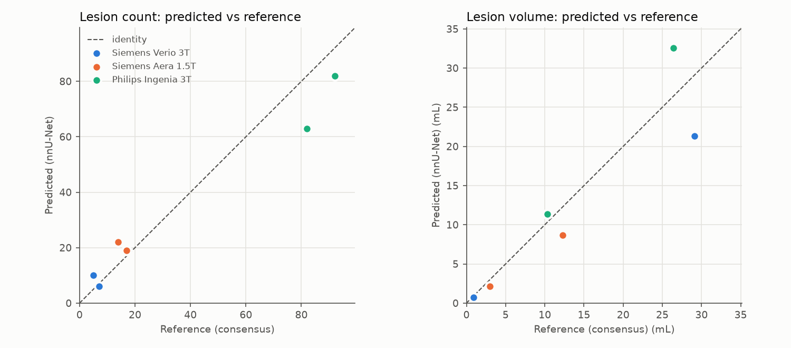
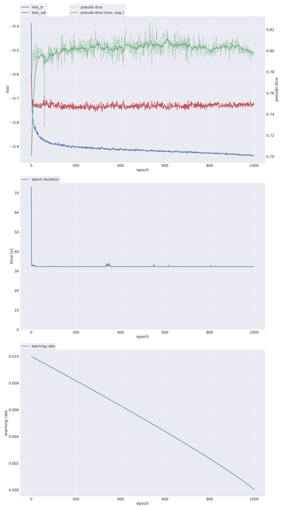
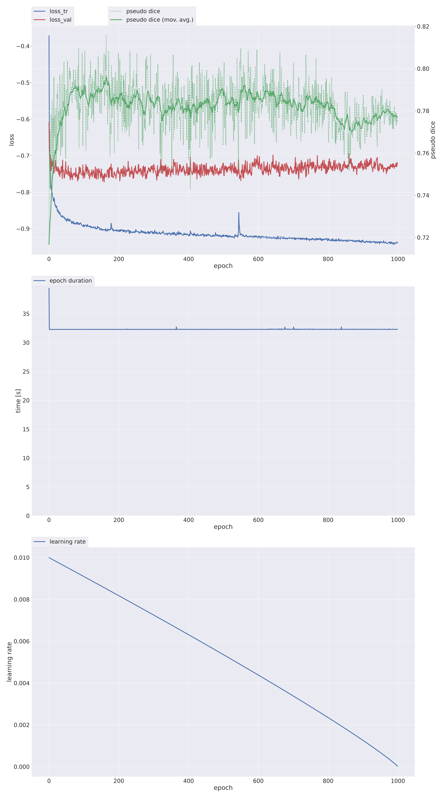
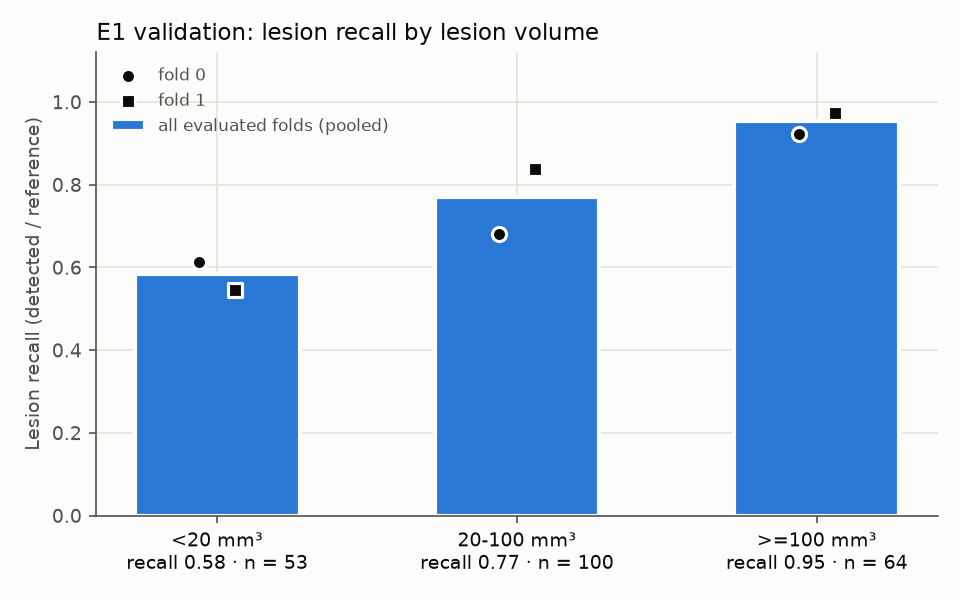

# Midpoint summary — E1 (nnU-Net v2 3d_fullres, MSSEG-2016)

Generated 2026-11-16 07:59 from commit `f2fccd5` by `scripts/midpoint_summary.py`. Lesion rule: 26-connected components ≥ 3.0 mm³, α = 0.1, γ = 0.65 (pending check against animaSegPerfAnalyzer). Size bins (fixed from MSSEG training counts): <20, 20-100, >=100 mm³. All metrics below are on **cross-validation folds of the 15 MSSEG training cases**; no test case has been scored.

## Training status

| fold | status | epochs | train time (h) | s / epoch | last pseudo-Dice | best EMA pseudo-Dice | last log entry | evaluated |
|---|---|---|---|---|---|---|---|---|
| 0 | finished | 1000 / 1000 | 8.990 | 32.400 | 0.797 | 0.812 | 2026-11-15 22:08:49 | yes |
| 1 | finished | 1000 / 1000 | 8.970 | 32.300 | 0.776 | 0.796 | 2026-11-16 07:19:58 | yes |
| 2 | not started | 0 / 1000 | 0.000 | – | – | – | – | no |
| 3 | not started | 0 / 1000 | 0.000 | – | – | – | – | no |
| 4 | not started | 0 / 1000 | 0.000 | – | – | – | – | no |

Trainer `nnUNetTrainer` (1000 epochs, same for every fold). Train time = sum of nnU-Net's per-epoch times (250 training + 50 validation iterations each). Pseudo-Dice is nnU-Net's online estimate on validation patches, not the final metric. Background job not running (`/media/kirby/KirbyData/home/jiadilab/Documents/Aijing_data/CV_MS_proj/ms-lesion-benchmark/logs/E1/job.pid`).

## Datasets

| dataset | release_split | scanner | cases | subjects |
|---|---|---|---|---|
| isbi2015 | train | philips_3t | 21 | 5 |
| mslesseg | test | ge_optima_mr450w | 1 | 1 |
| mslesseg | test | ge_signa_explorer | 1 | 1 |
| mslesseg | test | ge_signa_hde | 1 | 1 |
| mslesseg | test | ge_signa_hdxt | 2 | 2 |
| mslesseg | test | philips_achieva | 1 | 1 |
| mslesseg | test | philips_achieva_dstream | 5 | 5 |
| mslesseg | test | philips_ingenia | 10 | 10 |
| mslesseg | test | siemens_aera | 1 | 1 |
| mslesseg | train | ge_optima_mr450w | 1 | 1 |
| mslesseg | train | ge_signa_explorer | 1 | 1 |
| mslesseg | train | ge_signa_hdxt | 2 | 2 |
| mslesseg | train | philips_achieva_dstream | 20 | 19 |
| mslesseg | train | philips_ingenia | 64 | 35 |
| mslesseg | train | unknown | 5 | 4 |
| msseg2016 | test | ge_discovery_3t | 8 | 8 |
| msseg2016 | test | philips_ingenia_3t | 10 | 10 |
| msseg2016 | test | siemens_aera_1p5t | 10 | 10 |
| msseg2016 | test | siemens_verio_3t | 10 | 10 |
| msseg2016 | train | philips_ingenia_3t | 5 | 5 |
| msseg2016 | train | siemens_aera_1p5t | 5 | 5 |
| msseg2016 | train | siemens_verio_3t | 5 | 5 |

MSSEG `test` holds the 8 GE Discovery cases (unseen scanner). ISBI scans come from the release's labelled `train` folder and are our external test set. MSLesSeg is for pipeline development only.

## Lesion counts per size bin (MSSEG training consensus)

| scanner | <20 | 20-100 | >=100 | voxel mm³ | min lesion (voxels) |
|---|---|---|---|---|---|
| philips_ingenia_3t | 84 | 128 | 67 | 0.39 | 8 |
| siemens_aera_1p5t | 7 | 51 | 64 | 1.34 | 3 |
| siemens_verio_3t | 36 | 64 | 40 | 0.27 | 11 |
| all | 127 | 243 | 171 | – | – |

## Validation metrics

Mean ± SD over validation cases (size-bin rows: cases without reference lesions in that bin are excluded, so n can be smaller). `fp_lesions` = false-positive lesions per scan.

| metric | fold 0 | fold 1 | pooled |
|---|---|---|---|
| dice | 0.753 ± 0.079 (n=3) | 0.762 ± 0.048 (n=3) | 0.757 ± 0.059 (n=6) |
| lesion_precision | 0.776 ± 0.174 (n=3) | 0.831 ± 0.013 (n=3) | 0.803 ± 0.114 (n=6) |
| lesion_recall | 0.659 ± 0.235 (n=3) | 0.792 ± 0.067 (n=3) | 0.725 ± 0.171 (n=6) |
| lesion_f1 | 0.682 ± 0.141 (n=3) | 0.810 ± 0.035 (n=3) | 0.746 ± 0.115 (n=6) |
| fp_lesions | 5.000 ± 3.606 (n=3) | 6.333 ± 7.572 (n=3) | 5.667 ± 5.354 (n=6) |
| recall_<20 | 0.218 ± 0.378 (n=3) | 0.456 ± 0.174 (n=2) | 0.313 ± 0.310 (n=5) |
| recall_20-100 | 0.609 ± 0.245 (n=3) | 0.840 ± 0.167 (n=3) | 0.725 ± 0.226 (n=6) |
| recall_>=100 | 0.961 ± 0.068 (n=3) | 0.970 ± 0.052 (n=3) | 0.965 ± 0.055 (n=6) |
| f1_<20 | 0.251 ± 0.435 (n=3) | 0.331 ± 0.287 (n=3) | 0.291 ± 0.332 (n=6) |
| f1_20-100 | 0.627 ± 0.207 (n=3) | 0.800 ± 0.094 (n=3) | 0.713 ± 0.172 (n=6) |
| f1_>=100 | 0.954 ± 0.041 (n=3) | 0.966 ± 0.058 (n=3) | 0.960 ± 0.046 (n=6) |

Lesion-level recall pooled over all evaluated cases (detected / reference lesions):

| bin (mm³) | detected | reference_lesions | recall |
|---|---|---|---|
| <20 | 31 | 53 | 0.585 |
| 20-100 | 77 | 100 | 0.770 |
| >=100 | 61 | 64 | 0.953 |

### Per-case results

| fold | case_id | scanner | dice | lesion_precision | lesion_recall | lesion_f1 | fp_lesions | n_ref_lesions | n_pred_lesions | ref_volume_ml | pred_volume_ml | recall_<20 | recall_20-100 | recall_>=100 |
|---|---|---|---|---|---|---|---|---|---|---|---|---|---|---|
| 0 | msseg_train_c01_p05 | siemens_verio_3t | 0.810 | 0.800 | 0.400 | 0.533 | 2 | 5 | 10 | 29.112 | 21.318 | 0.000 | 0.333 | 1.000 |
| 0 | msseg_train_c07_p03 | siemens_aera_1p5t | 0.662 | 0.591 | 0.857 | 0.700 | 9 | 14 | 22 | 2.986 | 2.167 | 0.000 | 0.800 | 1.000 |
| 0 | msseg_train_c08_p01 | philips_ingenia_3t | 0.785 | 0.937 | 0.720 | 0.814 | 4 | 82 | 63 | 10.335 | 11.367 | 0.655 | 0.694 | 0.882 |
| 1 | msseg_train_c01_p04 | siemens_verio_3t | 0.710 | 0.833 | 0.714 | 0.769 | 1 | 7 | 6 | 0.912 | 0.749 | 0.333 | 1.000 | 1.000 |
| 1 | msseg_train_c07_p05 | siemens_aera_1p5t | 0.770 | 0.842 | 0.824 | 0.833 | 3 | 17 | 19 | 12.276 | 8.668 | – | 0.667 | 0.909 |
| 1 | msseg_train_c08_p05 | philips_ingenia_3t | 0.805 | 0.817 | 0.837 | 0.827 | 15 | 92 | 82 | 26.432 | 32.555 | 0.579 | 0.854 | 1.000 |

## Figures

- [count_volume_scatter.png](figures/count_volume_scatter.png)

  

- [fold0_progress.png](figures/fold0_progress.png)

  

- [fold1_progress.png](figures/fold1_progress.png)

  

- [recall_by_size_bin.png](figures/recall_by_size_bin.png)

  

## Data facts worth reporting

**ISBI 2015 rater disagreement.** Over 21 scans, rater 1 marks 25 lesions per scan (median) and rater 2 28; the per-scan count difference ranges -5 to +44 (mean |difference| 8.9 lesions). Inter-rater voxel Dice is 0.734 ± 0.097 (range 0.587–0.888). This is why each rater is scored separately.

Per-scan ISBI rater table

| case_id | rater1_lesions | rater2_lesions | rater1_ml | rater2_ml | inter_rater_dice |
|---|---|---|---|---|---|
| isbi_training01_01 | 25 | 20 | 17.456 | 22.298 | 0.764 |
| isbi_training01_02 | 33 | 30 | 14.981 | 17.397 | 0.765 |
| isbi_training01_03 | 19 | 30 | 17.826 | 17.665 | 0.797 |
| isbi_training01_04 | 13 | 29 | 16.426 | 18.972 | 0.794 |
| isbi_training02_01 | 39 | 83 | 26.892 | 30.108 | 0.863 |
| isbi_training02_02 | 29 | 43 | 31.405 | 27.770 | 0.804 |
| isbi_training02_03 | 29 | 43 | 31.494 | 34.719 | 0.834 |
| isbi_training02_04 | 30 | 56 | 32.333 | 34.620 | 0.888 |
| isbi_training03_01 | 26 | 27 | 5.990 | 10.545 | 0.680 |
| isbi_training03_02 | 28 | 25 | 5.264 | 7.523 | 0.729 |
| isbi_training03_03 | 27 | 26 | 5.281 | 6.429 | 0.887 |
| isbi_training03_04 | 25 | 30 | 5.176 | 7.265 | 0.772 |
| isbi_training03_05 | 25 | 26 | 5.335 | 7.356 | 0.778 |
| isbi_training04_01 | 20 | 21 | 2.298 | 3.504 | 0.618 |
| isbi_training04_02 | 25 | 28 | 2.196 | 3.123 | 0.637 |
| isbi_training04_03 | 21 | 30 | 1.950 | 3.527 | 0.592 |
| isbi_training04_04 | 16 | 22 | 2.281 | 2.814 | 0.605 |
| isbi_training05_01 | 19 | 30 | 4.331 | 4.013 | 0.587 |
| isbi_training05_02 | 23 | 27 | 4.957 | 4.314 | 0.699 |
| isbi_training05_03 | 22 | 27 | 4.540 | 3.652 | 0.649 |
| isbi_training05_04 | 20 | 24 | 4.383 | 3.872 | 0.678 |

**Empty consensus.** `msseg_test_c07_p08` (test, Siemens Aera 1.5T) has no lesion in the consensus; the 7 experts marked 2, 2, 7, 0, 1, 0, 2 lesions. With our convention (empty reference and empty prediction → F1 = 1; any predicted lesion → F1 = 0, precision 0) this case rewards a model that predicts nothing, and its Dice is 1 or 0. Report it separately or note it.

**Who contributes the smallest bin (<20 mm³).** 127 training lesions: Philips Ingenia 3T 84 (66%), Siemens Aera 1.5T 7 (6%), Siemens Verio 3T 36 (28%). Voxel volume differs 4.9× between scanners (0.27–1.34 mm³, see table above), so a 20 mm³ lesion is ≈15 voxels on the Aera 1.5T but ≈52 on the Philips. Small-lesion results are therefore largely Philips results; per-scanner size-bin numbers for the Aera are thin.

