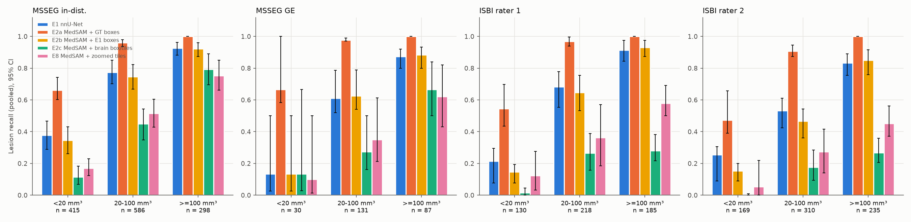
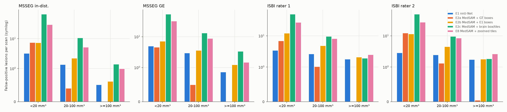
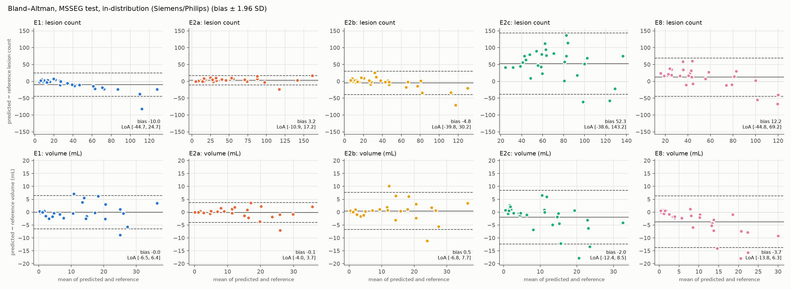
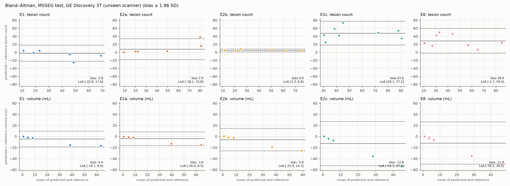
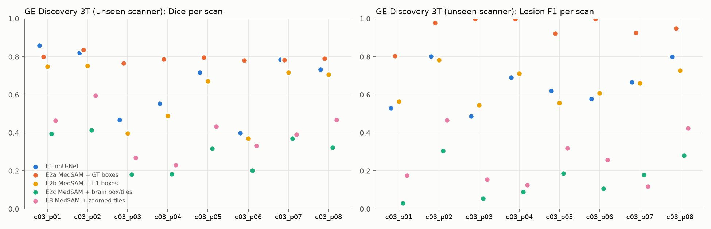
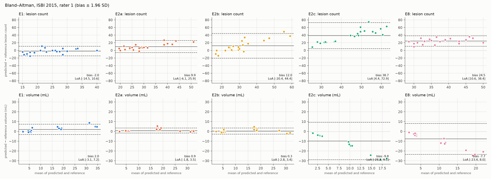
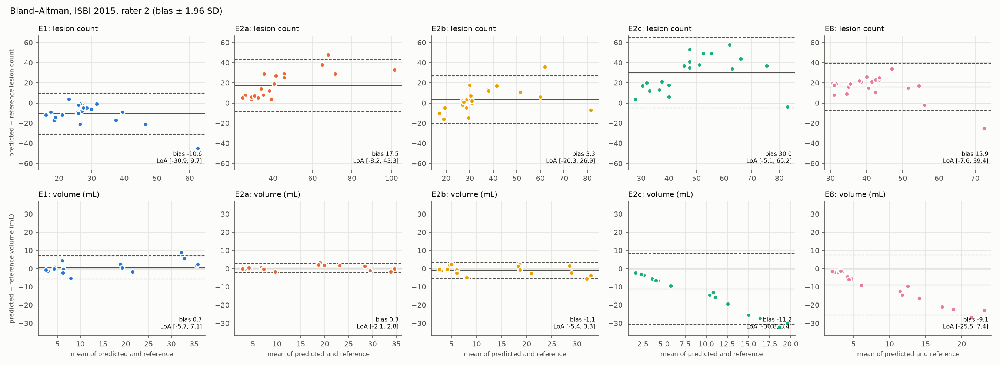
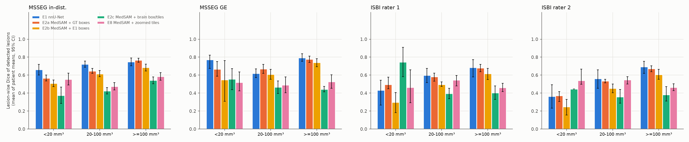
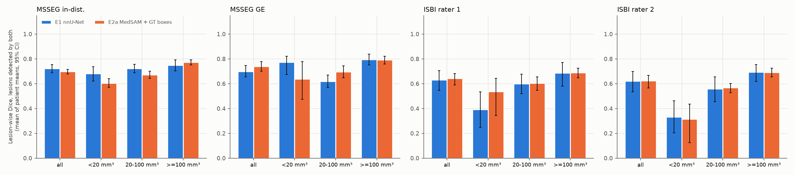

# Test results — E1 nnU-Net vs MedSAM (E2a, E2b, E2c, E8)

Generated 2026-11-20 10:10 from commit `3dd0af1` by `scripts/score_test.py`. **Experiments frozen before scoring**: models, boxes, thresholds, size bins and the E8 choice were all fixed from the MSSEG training cross-validation (`results/E2/cv_summary.md`); nothing here was tuned.

Predictions: 5-fold ensembles (`experiments/test_stage/README.md`). Lesion rule: Anima-port (6-connected, > 3.0 mm³, α 0.1 / β 0.7 / γ 0.65). Size bins (mm³, from MSSEG training counts): <20, 20-100, >=100. **E2a places its boxes from the reference (MSSEG consensus; ISBI: the same rater it is scored against): an upper bound on tracing, not a fair comparison. E2b's boxes come from E1's predictions, so its recall is bounded by E1's.**

**Statistics.** Means are over scans; 95% CIs are percentile bootstraps (10,000 resamples) over **patients**. MSSEG: one scan per patient. **ISBI 2015: the 21 scans come from only 5 patients, so the bootstrap resamples whole patients with all their scans, and paired Wilcoxon tests use one value per patient (the mean over that patient's scans), n = 5. With 5 pairs the smallest possible two-sided Wilcoxon p is 0.0625, so no ISBI comparison can reach p < 0.05; read the CIs (which are also coarse with 5 patients).** Paired differences: A − B with a paired patient bootstrap CI; Holm adjustment within each comparison and test set over the per-scan metrics. Size-bin rows: recall leaves out scans without a reference lesion in the bin, F1 scans with no lesion of that size in either mask.

## Overview

Means over scans (empty-reference scan excluded); details and CIs below. E2a is the upper bound with reference boxes.

| test set | metric | E1 | E2a | E2b | E2c | E8 |
|---|---|---|---|---|---|---|
| MSSEG in-dist. | lesion F1 | 0.725 | 0.879 | 0.675 | 0.235 | 0.376 |
| MSSEG in-dist. | Dice | 0.744 | 0.776 | 0.668 | 0.485 | 0.550 |
| MSSEG in-dist. | FP / scan | 5.1 | 7.9 | 10.3 | 78.8 | 36.0 |
| MSSEG in-dist. | pooled recall <20 mm³ | 0.378 | 0.663 | 0.347 | 0.116 | 0.171 |
| MSSEG GE | lesion F1 | 0.648 | 0.948 | 0.645 | 0.154 | 0.255 |
| MSSEG GE | Dice | 0.667 | 0.793 | 0.607 | 0.299 | 0.398 |
| MSSEG GE | FP / scan | 8.9 | 5.1 | 12.1 | 71.1 | 43.0 |
| MSSEG GE | pooled recall <20 mm³ | 0.133 | 0.667 | 0.133 | 0.133 | 0.100 |
| ISBI rater 1 | lesion F1 | 0.649 | 0.833 | 0.557 | 0.079 | 0.261 |
| ISBI rater 1 | Dice | 0.725 | 0.722 | 0.644 | 0.190 | 0.400 |
| ISBI rater 1 | FP / scan | 8.0 | 8.0 | 19.2 | 61.4 | 38.0 |
| ISBI rater 1 | pooled recall <20 mm³ | 0.215 | 0.546 | 0.146 | 0.015 | 0.123 |
| ISBI rater 2 | lesion F1 | 0.616 | 0.803 | 0.527 | 0.076 | 0.225 |
| ISBI rater 2 | Dice | 0.690 | 0.703 | 0.606 | 0.168 | 0.363 |
| ISBI rater 2 | FP / scan | 7.1 | 13.8 | 17.9 | 61.2 | 39.0 |
| ISBI rater 2 | pooled recall <20 mm³ | 0.254 | 0.473 | 0.154 | 0.006 | 0.053 |

## MSSEG test, in-distribution (Siemens/Philips)

**Empty reference, reported separately and left out of every average and test:** msseg_test_c07_p08 (consensus has no lesion).

| scan | model | false-positive lesions | predicted volume (mL) |
|---|---|---|---|
| msseg_test_c07_p08 | E1 nnU-Net | 0 | 0.000 |
| msseg_test_c07_p08 | E2a MedSAM + GT boxes | 0 | 0.000 |
| msseg_test_c07_p08 | E2b MedSAM + E1 boxes | 0 | 0.000 |
| msseg_test_c07_p08 | E2c MedSAM + brain box/tiles | 130 | 1.890 |
| msseg_test_c07_p08 | E8 MedSAM + zoomed tiles | 47 | 1.031 |

29 scans (1 left out), 29 patients.

### Per-scan metrics (mean ± SD, 95% CI)

| metric | E1 nnU-Net | E2a MedSAM + GT boxes | E2b MedSAM + E1 boxes | E2c MedSAM + brain box/tiles | E8 MedSAM + zoomed tiles |
|---|---|---|---|---|---|
| dice | 0.744 ± 0.140 [0.692, 0.793] | 0.776 ± 0.049 [0.759, 0.794] | 0.668 ± 0.140 [0.614, 0.715] | 0.485 ± 0.201 [0.411, 0.556] | 0.550 ± 0.181 [0.484, 0.614] |
| lesion_precision | 0.768 ± 0.176 [0.704, 0.829] | 0.850 ± 0.086 [0.820, 0.880] | 0.690 ± 0.172 [0.627, 0.749] | 0.192 ± 0.130 [0.147, 0.239] | 0.348 ± 0.195 [0.279, 0.418] |
| lesion_recall | 0.724 ± 0.170 [0.663, 0.783] | 0.917 ± 0.089 [0.884, 0.947] | 0.710 ± 0.179 [0.646, 0.771] | 0.495 ± 0.185 [0.430, 0.561] | 0.534 ± 0.193 [0.465, 0.602] |
| lesion_f1 | 0.725 ± 0.127 [0.678, 0.769] | 0.879 ± 0.070 [0.855, 0.903] | 0.675 ± 0.123 [0.629, 0.717] | 0.235 ± 0.127 [0.191, 0.281] | 0.376 ± 0.176 [0.313, 0.440] |
| fp_lesions | 5.138 ± 3.482 [3.966, 6.448] | 7.931 ± 9.354 [4.931, 11.517] | 10.310 ± 7.503 [7.724, 13.103] | 78.793 ± 29.658 [68.655, 89.690] | 36.000 ± 14.871 [30.759, 41.276] |
| recall_<20 | 0.439 ± 0.318 [0.323, 0.560] (n=26) | 0.770 ± 0.178 [0.704, 0.837] (n=26) | 0.369 ± 0.287 [0.264, 0.479] (n=26) | 0.156 ± 0.237 [0.077, 0.255] (n=26) | 0.207 ± 0.229 [0.128, 0.300] (n=26) |
| recall_20-100 | 0.809 ± 0.155 [0.753, 0.861] | 0.976 ± 0.043 [0.959, 0.990] | 0.789 ± 0.173 [0.725, 0.848] | 0.483 ± 0.180 [0.417, 0.546] | 0.564 ± 0.237 [0.479, 0.646] |
| recall_>=100 | 0.907 ± 0.152 [0.847, 0.956] (n=28) | 1.000 ± 0.000 [1.000, 1.000] (n=28) | 0.904 ± 0.153 [0.844, 0.955] (n=28) | 0.846 ± 0.201 [0.769, 0.915] (n=28) | 0.828 ± 0.205 [0.751, 0.901] (n=28) |
| f1_<20 | 0.367 ± 0.242 [0.278, 0.456] (n=28) | 0.579 ± 0.277 [0.477, 0.670] | 0.283 ± 0.218 [0.205, 0.361] | 0.061 ± 0.066 [0.038, 0.085] | 0.142 ± 0.127 [0.098, 0.190] |
| f1_20-100 | 0.772 ± 0.207 [0.693, 0.838] | 0.977 ± 0.037 [0.963, 0.989] | 0.763 ± 0.153 [0.708, 0.816] | 0.330 ± 0.192 [0.261, 0.397] | 0.471 ± 0.236 [0.385, 0.554] |
| f1_>=100 | 0.861 ± 0.258 [0.758, 0.941] | 1.000 ± 0.000 [1.000, 1.000] (n=28) | 0.856 ± 0.257 [0.753, 0.936] | 0.777 ± 0.244 [0.685, 0.858] | 0.752 ± 0.262 [0.651, 0.839] |

### Recall and false positives by size bin

Recall: pooled detected / reference lesions (95% CI, patient bootstrap). FP / scan: false-positive lesions whose own volume is in the bin.

| bin (mm³) | E1 | E2a | E2b | E2c | E8 |
|---|---|---|---|---|---|
| <20 | R 157/415 = 0.378 [0.289, 0.467] FP/scan 3.2 | R 275/415 = 0.663 [0.603, 0.741] FP/scan 7.5 | R 144/415 = 0.347 [0.261, 0.431] FP/scan 7.4 | R 48/415 = 0.116 [0.069, 0.184] FP/scan 66.7 | R 71/415 = 0.171 [0.124, 0.229] FP/scan 29.7 |
| 20-100 | R 454/586 = 0.775 [0.701, 0.850] FP/scan 1.4 | R 563/586 = 0.961 [0.938, 0.980] FP/scan 0.4 | R 437/586 = 0.746 [0.667, 0.824] FP/scan 2.2 | R 264/586 = 0.451 [0.349, 0.544] FP/scan 10.7 | R 302/586 = 0.515 [0.428, 0.605] FP/scan 5.3 |
| >=100 | R 276/298 = 0.926 [0.883, 0.962] FP/scan 0.5 | R 298/298 = 1.000 [1.000, 1.000] FP/scan 0.0 | R 275/298 = 0.923 [0.874, 0.960] FP/scan 0.6 | R 236/298 = 0.792 [0.697, 0.890] FP/scan 1.4 | R 224/298 = 0.752 [0.661, 0.850] FP/scan 1.0 |

### Lesion count and volume agreement (Bland–Altman)

Bias with its 95% CI (patient bootstrap); limits of agreement = bias ± 1.96 SD over scans (descriptive).

| model | quantity | bias (pred − ref) | 95% limits of agreement | MAE |
|---|---|---|---|---|
| E1 nnU-Net | lesion count | -10.00 [-16.759, -4.552] | [-44.74, 24.74] | 12.07 |
| E1 nnU-Net | volume (mL) | -0.05 [-1.202, 1.096] | [-6.50, 6.40] | 2.21 |
| E2a MedSAM + GT boxes | lesion count | 3.17 [0.414, 5.517] | [-10.86, 17.21] | 5.17 |
| E2a MedSAM + GT boxes | volume (mL) | -0.14 [-0.876, 0.505] | [-3.96, 3.67] | 1.19 |
| E2b MedSAM + E1 boxes | lesion count | -4.79 [-11.517, 0.931] | [-39.75, 30.17] | 10.59 |
| E2b MedSAM + E1 boxes | volume (mL) | 0.47 [-0.846, 1.760] | [-6.76, 7.71] | 2.29 |
| E2c MedSAM + brain box/tiles | lesion count | 52.31 [35.552, 68.138] | [-38.60, 143.22] | 62.03 |
| E2c MedSAM + brain box/tiles | volume (mL) | -1.95 [-3.927, -0.178] | [-12.36, 8.46] | 3.51 |
| E8 MedSAM + zoomed tiles | lesion count | 12.24 [1.552, 21.966] | [-44.76, 69.24] | 26.17 |
| E8 MedSAM + zoomed tiles | volume (mL) | -3.73 [-5.641, -2.027] | [-13.76, 6.30] | 4.06 |

### Paired comparisons

#### E2c MedSAM + brain box/tiles − E1 nnU-Net

| metric | n scans | n patients | mean E2c | mean E1 | mean diff | 95% CI | Wilcoxon p | p (Holm) |
|---|---|---|---|---|---|---|---|---|
| dice | 29 | 29 | 0.485 | 0.744 | -0.260 | [-0.301, -0.219] | 0.000 | 0.000 |
| lesion_precision | 29 | 29 | 0.192 | 0.768 | -0.576 | [-0.629, -0.519] | 0.000 | 0.000 |
| lesion_recall | 29 | 29 | 0.495 | 0.724 | -0.230 | [-0.277, -0.180] | 0.000 | 0.000 |
| lesion_f1 | 29 | 29 | 0.235 | 0.725 | -0.490 | [-0.537, -0.443] | 0.000 | 0.000 |
| fp_lesions | 29 | 29 | 78.793 | 5.138 | 73.655 | [63.345, 84.587] | 0.000 | 0.000 |
| recall_<20 | 26 | 26 | 0.156 | 0.439 | -0.283 | [-0.391, -0.185] | 0.000 | 0.000 |
| recall_20-100 | 29 | 29 | 0.483 | 0.809 | -0.327 | [-0.401, -0.257] | 0.000 | 0.000 |
| recall_>=100 | 28 | 28 | 0.846 | 0.907 | -0.061 | [-0.117, -0.009] | 0.023 | 0.025 |
| f1_<20 | 28 | 28 | 0.063 | 0.367 | -0.304 | [-0.386, -0.225] | 0.000 | 0.000 |
| f1_20-100 | 29 | 29 | 0.330 | 0.772 | -0.442 | [-0.521, -0.364] | 0.000 | 0.000 |
| f1_>=100 | 29 | 29 | 0.777 | 0.861 | -0.084 | [-0.152, -0.018] | 0.012 | 0.025 |
| pooled recall <20 | 29 | 29 | 0.116 | 0.378 | -0.263 | [-0.360, -0.162] | – | – |
| pooled recall 20-100 | 29 | 29 | 0.451 | 0.775 | -0.324 | [-0.384, -0.259] | – | – |
| pooled recall >=100 | 29 | 29 | 0.792 | 0.926 | -0.134 | [-0.211, -0.045] | – | – |

#### E8 MedSAM + zoomed tiles − E1 nnU-Net

| metric | n scans | n patients | mean E8 | mean E1 | mean diff | 95% CI | Wilcoxon p | p (Holm) |
|---|---|---|---|---|---|---|---|---|
| dice | 29 | 29 | 0.550 | 0.744 | -0.194 | [-0.233, -0.158] | 0.000 | 0.000 |
| lesion_precision | 29 | 29 | 0.348 | 0.768 | -0.420 | [-0.483, -0.350] | 0.000 | 0.000 |
| lesion_recall | 29 | 29 | 0.534 | 0.724 | -0.190 | [-0.235, -0.143] | 0.000 | 0.000 |
| lesion_f1 | 29 | 29 | 0.376 | 0.725 | -0.349 | [-0.405, -0.292] | 0.000 | 0.000 |
| fp_lesions | 29 | 29 | 36.000 | 5.138 | 30.862 | [25.517, 36.208] | 0.000 | 0.000 |
| recall_<20 | 26 | 26 | 0.207 | 0.439 | -0.232 | [-0.332, -0.136] | 0.000 | 0.001 |
| recall_20-100 | 29 | 29 | 0.564 | 0.809 | -0.246 | [-0.314, -0.178] | 0.000 | 0.000 |
| recall_>=100 | 28 | 28 | 0.828 | 0.907 | -0.078 | [-0.152, -0.001] | 0.052 | 0.052 |
| f1_<20 | 28 | 28 | 0.147 | 0.367 | -0.220 | [-0.305, -0.138] | 0.000 | 0.001 |
| f1_20-100 | 29 | 29 | 0.471 | 0.772 | -0.301 | [-0.375, -0.229] | 0.000 | 0.000 |
| f1_>=100 | 29 | 29 | 0.752 | 0.861 | -0.109 | [-0.208, -0.017] | 0.007 | 0.014 |
| pooled recall <20 | 29 | 29 | 0.171 | 0.378 | -0.207 | [-0.294, -0.112] | – | – |
| pooled recall 20-100 | 29 | 29 | 0.515 | 0.775 | -0.259 | [-0.307, -0.199] | – | – |
| pooled recall >=100 | 29 | 29 | 0.752 | 0.926 | -0.174 | [-0.253, -0.083] | – | – |

#### E2b MedSAM + E1 boxes − E1 nnU-Net

| metric | n scans | n patients | mean E2b | mean E1 | mean diff | 95% CI | Wilcoxon p | p (Holm) |
|---|---|---|---|---|---|---|---|---|
| dice | 29 | 29 | 0.668 | 0.744 | -0.077 | [-0.091, -0.061] | 0.000 | 0.000 |
| lesion_precision | 29 | 29 | 0.690 | 0.768 | -0.079 | [-0.110, -0.047] | 0.000 | 0.000 |
| lesion_recall | 29 | 29 | 0.710 | 0.724 | -0.015 | [-0.035, 0.003] | 0.171 | 0.685 |
| lesion_f1 | 29 | 29 | 0.675 | 0.725 | -0.050 | [-0.070, -0.030] | 0.000 | 0.000 |
| fp_lesions | 29 | 29 | 10.310 | 5.138 | 5.172 | [3.345, 7.069] | 0.000 | 0.000 |
| recall_<20 | 26 | 26 | 0.369 | 0.439 | -0.070 | [-0.167, 0.002] | 0.246 | 0.738 |
| recall_20-100 | 29 | 29 | 0.789 | 0.809 | -0.021 | [-0.046, 0.003] | 0.061 | 0.304 |
| recall_>=100 | 28 | 28 | 0.904 | 0.907 | -0.003 | [-0.013, 0.009] | 0.715 | 0.738 |
| f1_<20 | 28 | 28 | 0.293 | 0.367 | -0.074 | [-0.129, -0.022] | 0.011 | 0.074 |
| f1_20-100 | 29 | 29 | 0.763 | 0.772 | -0.009 | [-0.055, 0.051] | 0.016 | 0.096 |
| f1_>=100 | 29 | 29 | 0.856 | 0.861 | -0.005 | [-0.014, 0.003] | 0.284 | 0.738 |
| pooled recall <20 | 29 | 29 | 0.347 | 0.378 | -0.031 | [-0.063, 0.005] | – | – |
| pooled recall 20-100 | 29 | 29 | 0.746 | 0.775 | -0.029 | [-0.058, -0.008] | – | – |
| pooled recall >=100 | 29 | 29 | 0.923 | 0.926 | -0.003 | [-0.020, 0.015] | – | – |

#### E8 MedSAM + zoomed tiles − E2c MedSAM + brain box/tiles

| metric | n scans | n patients | mean E8 | mean E2c | mean diff | 95% CI | Wilcoxon p | p (Holm) |
|---|---|---|---|---|---|---|---|---|
| dice | 29 | 29 | 0.550 | 0.485 | 0.065 | [0.050, 0.082] | 0.000 | 0.000 |
| lesion_precision | 29 | 29 | 0.348 | 0.192 | 0.156 | [0.123, 0.191] | 0.000 | 0.000 |
| lesion_recall | 29 | 29 | 0.534 | 0.495 | 0.039 | [0.009, 0.071] | 0.025 | 0.123 |
| lesion_f1 | 29 | 29 | 0.376 | 0.235 | 0.140 | [0.114, 0.169] | 0.000 | 0.000 |
| fp_lesions | 29 | 29 | 36.000 | 78.793 | -42.793 | [-49.897, -35.862] | 0.000 | 0.000 |
| recall_<20 | 26 | 26 | 0.207 | 0.156 | 0.051 | [-0.001, 0.111] | 0.108 | 0.323 |
| recall_20-100 | 29 | 29 | 0.564 | 0.483 | 0.081 | [0.000, 0.173] | 0.032 | 0.128 |
| recall_>=100 | 28 | 28 | 0.828 | 0.846 | -0.018 | [-0.066, 0.039] | 0.231 | 0.462 |
| f1_<20 | 29 | 29 | 0.142 | 0.061 | 0.081 | [0.049, 0.121] | 0.000 | 0.001 |
| f1_20-100 | 29 | 29 | 0.471 | 0.330 | 0.141 | [0.093, 0.186] | 0.000 | 0.001 |
| f1_>=100 | 29 | 29 | 0.752 | 0.777 | -0.025 | [-0.119, 0.056] | 0.607 | 0.607 |
| pooled recall <20 | 29 | 29 | 0.171 | 0.116 | 0.055 | [0.019, 0.086] | – | – |
| pooled recall 20-100 | 29 | 29 | 0.515 | 0.451 | 0.065 | [0.015, 0.111] | – | – |
| pooled recall >=100 | 29 | 29 | 0.752 | 0.792 | -0.040 | [-0.082, 0.002] | – | – |

## MSSEG test, GE Discovery 3T (unseen scanner)

8 scans (0 left out), 8 patients.

### Per-scan metrics (mean ± SD, 95% CI)

| metric | E1 nnU-Net | E2a MedSAM + GT boxes | E2b MedSAM + E1 boxes | E2c MedSAM + brain box/tiles | E8 MedSAM + zoomed tiles |
|---|---|---|---|---|---|
| dice | 0.667 ± 0.172 [0.553, 0.774] | 0.793 ± 0.020 [0.781, 0.808] | 0.607 ± 0.161 [0.499, 0.704] | 0.299 ± 0.097 [0.236, 0.361] | 0.398 ± 0.118 [0.324, 0.477] |
| lesion_precision | 0.622 ± 0.145 [0.527, 0.711] | 0.924 ± 0.088 [0.864, 0.974] | 0.608 ± 0.108 [0.536, 0.676] | 0.097 ± 0.068 [0.054, 0.142] | 0.265 ± 0.259 [0.129, 0.451] |
| lesion_recall | 0.712 ± 0.158 [0.609, 0.808] | 0.974 ± 0.047 [0.941, 0.997] | 0.718 ± 0.151 [0.619, 0.810] | 0.515 ± 0.212 [0.370, 0.639] | 0.550 ± 0.265 [0.375, 0.712] |
| lesion_f1 | 0.648 ± 0.116 [0.574, 0.723] | 0.948 ± 0.066 [0.902, 0.985] | 0.645 ± 0.089 [0.588, 0.704] | 0.154 ± 0.101 [0.091, 0.221] | 0.255 ± 0.136 [0.172, 0.345] |
| fp_lesions | 8.875 ± 3.091 [7.125, 11.000] | 5.125 ± 8.493 [1.000, 11.250] | 12.125 ± 6.058 [8.375, 16.125] | 71.125 ± 24.897 [55.375, 87.500] | 43.000 ± 23.549 [29.000, 59.253] |
| recall_<20 | 0.205 ± 0.299 [0.009, 0.438] (n=6) | 0.856 ± 0.224 [0.676, 1.000] (n=6) | 0.205 ± 0.299 [0.009, 0.438] (n=6) | 0.472 ± 0.452 [0.139, 0.812] (n=6) | 0.306 ± 0.400 [0.042, 0.625] (n=6) |
| recall_20-100 | 0.709 ± 0.219 [0.574, 0.843] | 0.988 ± 0.016 [0.977, 0.997] | 0.716 ± 0.212 [0.585, 0.848] | 0.402 ± 0.244 [0.251, 0.561] | 0.478 ± 0.296 [0.300, 0.678] |
| recall_>=100 | 0.875 ± 0.133 [0.779, 0.949] | 1.000 ± 0.000 [1.000, 1.000] | 0.880 ± 0.135 [0.783, 0.954] | 0.721 ± 0.271 [0.540, 0.885] | 0.704 ± 0.309 [0.494, 0.887] |
| f1_<20 | 0.141 ± 0.231 [0.013, 0.315] | 0.748 ± 0.169 [0.625, 0.877] (n=6) | 0.146 ± 0.238 [0.014, 0.322] | 0.048 ± 0.061 [0.013, 0.090] | 0.049 ± 0.075 [0.010, 0.103] |
| f1_20-100 | 0.667 ± 0.131 [0.582, 0.751] | 0.985 ± 0.029 [0.964, 0.998] | 0.666 ± 0.120 [0.591, 0.744] | 0.291 ± 0.134 [0.204, 0.375] | 0.371 ± 0.194 [0.250, 0.499] |
| f1_>=100 | 0.721 ± 0.347 [0.472, 0.916] | 0.875 ± 0.354 [0.625, 1.000] | 0.703 ± 0.346 [0.458, 0.898] | 0.223 ± 0.357 [0.035, 0.476] | 0.674 ± 0.324 [0.452, 0.875] |

### Recall and false positives by size bin

Recall: pooled detected / reference lesions (95% CI, patient bootstrap). FP / scan: false-positive lesions whose own volume is in the bin.

| bin (mm³) | E1 | E2a | E2b | E2c | E8 |
|---|---|---|---|---|---|
| <20 | R 4/30 = 0.133 [0.026, 0.500] FP/scan 5.0 | R 20/30 = 0.667 [0.583, 1.000] FP/scan 4.6 | R 4/30 = 0.133 [0.026, 0.500] FP/scan 7.2 | R 4/30 = 0.133 [0.029, 0.667] FP/scan 54.4 | R 3/30 = 0.100 [0.013, 0.500] FP/scan 32.6 |
| 20-100 | R 80/131 = 0.611 [0.519, 0.788] FP/scan 3.0 | R 128/131 = 0.977 [0.970, 0.989] FP/scan 0.5 | R 82/131 = 0.626 [0.542, 0.788] FP/scan 3.6 | R 36/131 = 0.275 [0.163, 0.500] FP/scan 13.4 | R 46/131 = 0.351 [0.212, 0.612] FP/scan 8.9 |
| >=100 | R 76/87 = 0.874 [0.800, 0.921] FP/scan 0.9 | R 87/87 = 1.000 [1.000, 1.000] FP/scan 0.0 | R 77/87 = 0.885 [0.800, 0.932] FP/scan 1.2 | R 58/87 = 0.667 [0.500, 0.841] FP/scan 3.4 | R 54/87 = 0.621 [0.430, 0.820] FP/scan 1.5 |

### Lesion count and volume agreement (Bland–Altman)

Bias with its 95% CI (patient bootstrap); limits of agreement = bias ± 1.96 SD over scans (descriptive).

| model | quantity | bias (pred − ref) | 95% limits of agreement | MAE |
|---|---|---|---|---|
| E1 nnU-Net | lesion count | -2.62 [-9.875, 3.000] | [-22.83, 17.58] | 7.12 |
| E1 nnU-Net | volume (mL) | -4.43 [-9.834, -0.269] | [-18.72, 9.87] | 4.70 |
| E2a MedSAM + GT boxes | lesion count | 7.88 [1.250, 17.250] | [-18.05, 33.80] | 7.88 |
| E2a MedSAM + GT boxes | volume (mL) | -3.92 [-8.476, -0.355] | [-16.36, 8.52] | 3.93 |
| E2b MedSAM + E1 boxes | lesion count | 4.88 [3.750, 6.125] | [1.33, 8.42] | 4.88 |
| E2b MedSAM + E1 boxes | volume (mL) | -5.77 [-12.960, -0.087] | [-25.88, 14.34] | 6.25 |
| E2c MedSAM + brain box/tiles | lesion count | 47.62 [38.125, 57.750] | [18.07, 77.18] | 47.62 |
| E2c MedSAM + brain box/tiles | volume (mL) | -12.82 [-27.078, -1.643] | [-52.67, 27.03] | 12.85 |
| E8 MedSAM + zoomed tiles | lesion count | 28.38 [18.500, 38.378] | [-2.68, 59.43] | 28.38 |
| E8 MedSAM + zoomed tiles | volume (mL) | -11.93 [-25.657, -1.177] | [-50.07, 26.22] | 12.01 |

### Paired comparisons

#### E2c MedSAM + brain box/tiles − E1 nnU-Net

| metric | n scans | n patients | mean E2c | mean E1 | mean diff | 95% CI | Wilcoxon p | p (Holm) |
|---|---|---|---|---|---|---|---|---|
| dice | 8 | 8 | 0.299 | 0.667 | -0.369 | [-0.418, -0.307] | 0.008 | 0.086 |
| lesion_precision | 8 | 8 | 0.097 | 0.622 | -0.525 | [-0.591, -0.455] | 0.008 | 0.086 |
| lesion_recall | 8 | 8 | 0.515 | 0.712 | -0.197 | [-0.255, -0.141] | 0.008 | 0.086 |
| lesion_f1 | 8 | 8 | 0.154 | 0.648 | -0.493 | [-0.530, -0.462] | 0.008 | 0.086 |
| fp_lesions | 8 | 8 | 71.125 | 8.875 | 62.250 | [47.875, 77.125] | 0.008 | 0.086 |
| recall_<20 | 6 | 6 | 0.472 | 0.205 | 0.267 | [-0.133, 0.733] | 0.500 | 0.875 |
| recall_20-100 | 8 | 8 | 0.402 | 0.709 | -0.307 | [-0.467, -0.165] | 0.016 | 0.086 |
| recall_>=100 | 8 | 8 | 0.721 | 0.875 | -0.154 | [-0.267, -0.056] | 0.062 | 0.188 |
| f1_<20 | 8 | 8 | 0.048 | 0.141 | -0.093 | [-0.224, 0.021] | 0.438 | 0.875 |
| f1_20-100 | 8 | 8 | 0.291 | 0.667 | -0.376 | [-0.484, -0.260] | 0.008 | 0.086 |
| f1_>=100 | 8 | 8 | 0.223 | 0.721 | -0.499 | [-0.717, -0.271] | 0.031 | 0.125 |
| pooled recall <20 | 8 | 8 | 0.133 | 0.133 | 0.000 | [-0.111, 0.364] | – | – |
| pooled recall 20-100 | 8 | 8 | 0.275 | 0.611 | -0.336 | [-0.394, -0.241] | – | – |
| pooled recall >=100 | 8 | 8 | 0.667 | 0.874 | -0.207 | [-0.319, -0.068] | – | – |

#### E8 MedSAM + zoomed tiles − E1 nnU-Net

| metric | n scans | n patients | mean E8 | mean E1 | mean diff | 95% CI | Wilcoxon p | p (Holm) |
|---|---|---|---|---|---|---|---|---|
| dice | 8 | 8 | 0.398 | 0.667 | -0.269 | [-0.334, -0.196] | 0.008 | 0.086 |
| lesion_precision | 8 | 8 | 0.265 | 0.622 | -0.357 | [-0.505, -0.176] | 0.016 | 0.125 |
| lesion_recall | 8 | 8 | 0.550 | 0.712 | -0.162 | [-0.242, -0.084] | 0.031 | 0.188 |
| lesion_f1 | 8 | 8 | 0.255 | 0.648 | -0.393 | [-0.465, -0.332] | 0.008 | 0.086 |
| fp_lesions | 8 | 8 | 43.000 | 8.875 | 34.125 | [19.997, 49.000] | 0.016 | 0.125 |
| recall_<20 | 6 | 6 | 0.306 | 0.205 | 0.101 | [-0.167, 0.492] | 1.000 | 1.000 |
| recall_20-100 | 8 | 8 | 0.478 | 0.709 | -0.231 | [-0.341, -0.122] | 0.031 | 0.188 |
| recall_>=100 | 8 | 8 | 0.704 | 0.875 | -0.171 | [-0.325, -0.042] | 0.125 | 0.500 |
| f1_<20 | 8 | 8 | 0.049 | 0.141 | -0.092 | [-0.209, 0.006] | 0.250 | 0.750 |
| f1_20-100 | 8 | 8 | 0.371 | 0.667 | -0.297 | [-0.437, -0.173] | 0.008 | 0.086 |
| f1_>=100 | 8 | 8 | 0.674 | 0.721 | -0.048 | [-0.357, 0.309] | 0.688 | 1.000 |
| pooled recall <20 | 8 | 8 | 0.100 | 0.133 | -0.033 | [-0.143, 0.200] | – | – |
| pooled recall 20-100 | 8 | 8 | 0.351 | 0.611 | -0.260 | [-0.328, -0.153] | – | – |
| pooled recall >=100 | 8 | 8 | 0.621 | 0.874 | -0.253 | [-0.395, -0.071] | – | – |

#### E2b MedSAM + E1 boxes − E1 nnU-Net

| metric | n scans | n patients | mean E2b | mean E1 | mean diff | 95% CI | Wilcoxon p | p (Holm) |
|---|---|---|---|---|---|---|---|---|
| dice | 8 | 8 | 0.607 | 0.667 | -0.060 | [-0.079, -0.044] | 0.008 | 0.086 |
| lesion_precision | 8 | 8 | 0.608 | 0.622 | -0.014 | [-0.067, 0.035] | 0.742 | 1.000 |
| lesion_recall | 8 | 8 | 0.718 | 0.712 | 0.005 | [0.000, 0.013] | 0.500 | 1.000 |
| lesion_f1 | 8 | 8 | 0.645 | 0.648 | -0.003 | [-0.034, 0.026] | 1.000 | 1.000 |
| fp_lesions | 8 | 8 | 12.125 | 8.875 | 3.250 | [1.000, 5.625] | 0.062 | 0.625 |
| recall_<20 | 6 | 6 | 0.205 | 0.205 | 0.000 | [0.000, 0.000] | 1.000 | 1.000 |
| recall_20-100 | 8 | 8 | 0.716 | 0.709 | 0.007 | [0.000, 0.017] | 0.500 | 1.000 |
| recall_>=100 | 8 | 8 | 0.880 | 0.875 | 0.005 | [0.000, 0.014] | 1.000 | 1.000 |
| f1_<20 | 8 | 8 | 0.146 | 0.141 | 0.005 | [-0.005, 0.018] | 0.750 | 1.000 |
| f1_20-100 | 8 | 8 | 0.666 | 0.667 | -0.001 | [-0.030, 0.021] | 0.938 | 1.000 |
| f1_>=100 | 8 | 8 | 0.703 | 0.721 | -0.018 | [-0.048, 0.005] | 0.500 | 1.000 |
| pooled recall <20 | 8 | 8 | 0.133 | 0.133 | 0.000 | [0.000, 0.000] | – | – |
| pooled recall 20-100 | 8 | 8 | 0.626 | 0.611 | 0.015 | [0.000, 0.025] | – | – |
| pooled recall >=100 | 8 | 8 | 0.885 | 0.874 | 0.011 | [0.000, 0.026] | – | – |

#### E8 MedSAM + zoomed tiles − E2c MedSAM + brain box/tiles

| metric | n scans | n patients | mean E8 | mean E2c | mean diff | 95% CI | Wilcoxon p | p (Holm) |
|---|---|---|---|---|---|---|---|---|
| dice | 8 | 8 | 0.398 | 0.299 | 0.099 | [0.065, 0.134] | 0.008 | 0.086 |
| lesion_precision | 8 | 8 | 0.265 | 0.097 | 0.168 | [0.038, 0.372] | 0.023 | 0.188 |
| lesion_recall | 8 | 8 | 0.550 | 0.515 | 0.035 | [-0.023, 0.089] | 0.250 | 1.000 |
| lesion_f1 | 8 | 8 | 0.255 | 0.154 | 0.101 | [0.045, 0.144] | 0.023 | 0.188 |
| fp_lesions | 8 | 8 | 43.000 | 71.125 | -28.125 | [-52.000, -10.500] | 0.008 | 0.086 |
| recall_<20 | 6 | 6 | 0.306 | 0.472 | -0.167 | [-0.500, 0.000] | 1.000 | 1.000 |
| recall_20-100 | 8 | 8 | 0.478 | 0.402 | 0.076 | [-0.055, 0.200] | 0.305 | 1.000 |
| recall_>=100 | 8 | 8 | 0.704 | 0.721 | -0.017 | [-0.086, 0.063] | 0.875 | 1.000 |
| f1_<20 | 8 | 8 | 0.049 | 0.048 | 0.001 | [-0.034, 0.027] | 0.875 | 1.000 |
| f1_20-100 | 8 | 8 | 0.371 | 0.291 | 0.079 | [0.005, 0.150] | 0.109 | 0.656 |
| f1_>=100 | 8 | 8 | 0.674 | 0.223 | 0.451 | [0.201, 0.724] | 0.016 | 0.141 |
| pooled recall <20 | 8 | 8 | 0.100 | 0.133 | -0.033 | [-0.250, 0.000] | – | – |
| pooled recall 20-100 | 8 | 8 | 0.351 | 0.275 | 0.076 | [0.015, 0.148] | – | – |
| pooled recall >=100 | 8 | 8 | 0.621 | 0.667 | -0.046 | [-0.121, 0.061] | – | – |

### Per-scan results, GE Discovery 3T

**Dice**

| case_id | n_ref_lesions | ref_volume_ml | E1 | E2a | E2b | E2c | E8 |
|---|---|---|---|---|---|---|---|
| msseg_test_c03_p01 | 61 | 71.624 | 0.860 | 0.800 | 0.749 | 0.396 | 0.463 |
| msseg_test_c03_p02 | 21 | 4.190 | 0.821 | 0.836 | 0.752 | 0.415 | 0.596 |
| msseg_test_c03_p03 | 9 | 1.188 | 0.467 | 0.767 | 0.397 | 0.182 | 0.269 |
| msseg_test_c03_p04 | 8 | 1.121 | 0.554 | 0.787 | 0.489 | 0.184 | 0.232 |
| msseg_test_c03_p05 | 19 | 5.111 | 0.719 | 0.797 | 0.673 | 0.317 | 0.433 |
| msseg_test_c03_p06 | 9 | 0.645 | 0.399 | 0.782 | 0.371 | 0.202 | 0.331 |
| msseg_test_c03_p07 | 73 | 46.201 | 0.786 | 0.784 | 0.718 | 0.371 | 0.392 |
| msseg_test_c03_p08 | 48 | 9.387 | 0.733 | 0.791 | 0.708 | 0.323 | 0.468 |

**Lesion F1**

| case_id | n_ref_lesions | ref_volume_ml | E1 | E2a | E2b | E2c | E8 |
|---|---|---|---|---|---|---|---|
| msseg_test_c03_p01 | 61 | 71.624 | 0.532 | 0.804 | 0.565 | 0.030 | 0.176 |
| msseg_test_c03_p02 | 21 | 4.190 | 0.802 | 0.978 | 0.783 | 0.305 | 0.466 |
| msseg_test_c03_p03 | 9 | 1.188 | 0.488 | 1.000 | 0.545 | 0.056 | 0.155 |
| msseg_test_c03_p04 | 8 | 1.121 | 0.691 | 1.000 | 0.712 | 0.090 | 0.126 |
| msseg_test_c03_p05 | 19 | 5.111 | 0.621 | 0.923 | 0.558 | 0.187 | 0.319 |
| msseg_test_c03_p06 | 9 | 0.645 | 0.579 | 1.000 | 0.609 | 0.106 | 0.257 |
| msseg_test_c03_p07 | 73 | 46.201 | 0.667 | 0.927 | 0.662 | 0.179 | 0.117 |
| msseg_test_c03_p08 | 48 | 9.387 | 0.801 | 0.949 | 0.729 | 0.282 | 0.424 |

**Lesion recall**

| case_id | n_ref_lesions | ref_volume_ml | E1 | E2a | E2b | E2c | E8 |
|---|---|---|---|---|---|---|---|
| msseg_test_c03_p01 | 61 | 71.624 | 0.443 | 0.869 | 0.459 | 0.115 | 0.098 |
| msseg_test_c03_p02 | 21 | 4.190 | 0.905 | 1.000 | 0.905 | 0.762 | 0.905 |
| msseg_test_c03_p03 | 9 | 1.188 | 0.667 | 1.000 | 0.667 | 0.556 | 0.444 |
| msseg_test_c03_p04 | 8 | 1.121 | 0.875 | 1.000 | 0.875 | 0.625 | 0.750 |
| msseg_test_c03_p05 | 19 | 5.111 | 0.632 | 1.000 | 0.632 | 0.526 | 0.526 |
| msseg_test_c03_p06 | 9 | 0.645 | 0.778 | 1.000 | 0.778 | 0.667 | 0.778 |
| msseg_test_c03_p07 | 73 | 46.201 | 0.589 | 0.945 | 0.616 | 0.288 | 0.315 |
| msseg_test_c03_p08 | 48 | 9.387 | 0.812 | 0.979 | 0.812 | 0.583 | 0.583 |

**False-positive lesions**

| case_id | n_ref_lesions | ref_volume_ml | E1 | E2a | E2b | E2c | E8 |
|---|---|---|---|---|---|---|---|
| msseg_test_c03_p01 | 61 | 72 | 12 | 25 | 17 | 113 | 10 |
| msseg_test_c03_p02 | 21 | 4 | 7 | 1 | 9 | 51 | 46 |
| msseg_test_c03_p03 | 9 | 1 | 8 | 0 | 7 | 66 | 29 |
| msseg_test_c03_p04 | 8 | 1 | 6 | 0 | 6 | 78 | 54 |
| msseg_test_c03_p05 | 19 | 5 | 7 | 3 | 11 | 39 | 27 |
| msseg_test_c03_p06 | 9 | 1 | 7 | 0 | 7 | 49 | 44 |
| msseg_test_c03_p07 | 73 | 46 | 15 | 8 | 22 | 94 | 90 |
| msseg_test_c03_p08 | 48 | 9 | 9 | 4 | 18 | 79 | 44 |

## ISBI 2015, rater 1

21 scans (0 left out), 5 patients.

### Per-scan metrics (mean ± SD, 95% CI)

| metric | E1 nnU-Net | E2a MedSAM + GT boxes | E2b MedSAM + E1 boxes | E2c MedSAM + brain box/tiles | E8 MedSAM + zoomed tiles |
|---|---|---|---|---|---|
| dice | 0.725 ± 0.099 [0.635, 0.800] | 0.722 ± 0.024 [0.702, 0.739] | 0.644 ± 0.069 [0.588, 0.696] | 0.190 ± 0.052 [0.157, 0.227] | 0.400 ± 0.085 [0.332, 0.444] |
| lesion_precision | 0.679 ± 0.116 [0.613, 0.740] | 0.795 ± 0.125 [0.695, 0.876] | 0.538 ± 0.161 [0.439, 0.635] | 0.052 ± 0.051 [0.021, 0.092] | 0.247 ± 0.182 [0.191, 0.299] |
| lesion_recall | 0.645 ± 0.144 [0.550, 0.733] | 0.885 ± 0.089 [0.810, 0.938] | 0.624 ± 0.151 [0.534, 0.724] | 0.222 ± 0.097 [0.146, 0.281] | 0.409 ± 0.180 [0.268, 0.535] |
| lesion_f1 | 0.649 ± 0.100 [0.594, 0.713] | 0.833 ± 0.093 [0.758, 0.897] | 0.557 ± 0.106 [0.491, 0.631] | 0.079 ± 0.069 [0.034, 0.132] | 0.261 ± 0.126 [0.185, 0.335] |
| fp_lesions | 7.952 ± 4.685 [4.750, 11.550] | 8.000 ± 6.403 [3.409, 13.050] | 19.238 ± 13.795 [10.591, 30.500] | 61.429 ± 20.954 [44.714, 78.143] | 38.048 ± 13.162 [32.900, 42.957] |
| recall_<20 | 0.201 ± 0.205 [0.097, 0.274] | 0.603 ± 0.216 [0.481, 0.715] | 0.140 ± 0.159 [0.084, 0.192] | 0.018 ± 0.060 [0.000, 0.042] | 0.162 ± 0.224 [0.046, 0.295] |
| recall_20-100 | 0.674 ± 0.198 [0.568, 0.771] | 0.970 ± 0.050 [0.945, 0.994] | 0.637 ± 0.214 [0.540, 0.748] | 0.293 ± 0.190 [0.180, 0.406] | 0.414 ± 0.261 [0.238, 0.590] |
| recall_>=100 | 0.920 ± 0.096 [0.859, 0.976] | 1.000 ± 0.000 [1.000, 1.000] | 0.935 ± 0.087 [0.888, 0.976] | 0.276 ± 0.143 [0.202, 0.376] | 0.601 ± 0.141 [0.501, 0.714] |
| f1_<20 | 0.120 ± 0.155 [0.049, 0.187] | 0.539 ± 0.164 [0.454, 0.618] | 0.104 ± 0.128 [0.048, 0.155] | 0.009 ± 0.028 [0.000, 0.019] | 0.073 ± 0.105 [0.021, 0.152] |
| f1_20-100 | 0.630 ± 0.223 [0.480, 0.742] | 0.934 ± 0.105 [0.859, 0.984] | 0.561 ± 0.188 [0.451, 0.643] | 0.196 ± 0.180 [0.088, 0.310] | 0.331 ± 0.178 [0.216, 0.454] |
| f1_>=100 | 0.869 ± 0.079 [0.828, 0.918] | 1.000 ± 0.000 [1.000, 1.000] | 0.871 ± 0.081 [0.824, 0.914] | 0.206 ± 0.209 [0.075, 0.350] | 0.564 ± 0.259 [0.401, 0.728] |

### Recall and false positives by size bin

Recall: pooled detected / reference lesions (95% CI, patient bootstrap). FP / scan: false-positive lesions whose own volume is in the bin.

| bin (mm³) | E1 | E2a | E2b | E2c | E8 |
|---|---|---|---|---|---|
| <20 | R 28/130 = 0.215 [0.077, 0.295] FP/scan 3.5 | R 71/130 = 0.546 [0.435, 0.697] FP/scan 7.0 | R 19/130 = 0.146 [0.077, 0.193] FP/scan 12.2 | R 2/130 = 0.015 [0.000, 0.045] FP/scan 49.8 | R 16/130 = 0.123 [0.032, 0.276] FP/scan 27.3 |
| 20-100 | R 149/218 = 0.683 [0.554, 0.778] FP/scan 2.7 | R 211/218 = 0.968 [0.940, 0.995] FP/scan 1.0 | R 141/218 = 0.647 [0.533, 0.754] FP/scan 4.9 | R 58/218 = 0.266 [0.158, 0.389] FP/scan 9.7 | R 79/218 = 0.362 [0.186, 0.570] FP/scan 8.2 |
| >=100 | R 169/185 = 0.914 [0.843, 0.975] FP/scan 1.8 | R 185/185 = 1.000 [1.000, 1.000] FP/scan 0.0 | R 172/185 = 0.930 [0.874, 0.975] FP/scan 2.1 | R 52/185 = 0.281 [0.216, 0.382] FP/scan 2.0 | R 107/185 = 0.578 [0.500, 0.691] FP/scan 2.5 |

### Lesion count and volume agreement (Bland–Altman)

Bias with its 95% CI (patient bootstrap); limits of agreement = bias ± 1.96 SD over scans (descriptive; ISBI scans of one patient are not independent).

| model | quantity | bias (pred − ref) | 95% limits of agreement | MAE |
|---|---|---|---|---|
| E1 nnU-Net | lesion count | -1.95 [-5.950, 1.286] | [-14.49, 10.59] | 5.00 |
| E1 nnU-Net | volume (mL) | 2.05 [0.241, 4.188] | [-3.14, 7.24] | 2.31 |
| E2a MedSAM + GT boxes | lesion count | 9.90 [4.333, 16.050] | [-6.05, 25.86] | 10.10 |
| E2a MedSAM + GT boxes | volume (mL) | 0.86 [0.132, 2.000] | [-1.79, 3.51] | 0.94 |
| E2b MedSAM + E1 boxes | lesion count | 11.95 [1.400, 25.000] | [-20.45, 44.35] | 14.43 |
| E2b MedSAM + E1 boxes | volume (mL) | 0.29 [-0.648, 1.459] | [-2.79, 3.38] | 1.12 |
| E2c MedSAM + brain box/tiles | lesion count | 38.67 [25.333, 52.000] | [4.41, 72.93] | 38.67 |
| E2c MedSAM + brain box/tiles | volume (mL) | -9.85 [-19.287, -3.112] | [-28.84, 9.14] | 9.85 |
| E8 MedSAM + zoomed tiles | lesion count | 24.52 [22.050, 25.909] | [10.63, 38.42] | 24.52 |
| E8 MedSAM + zoomed tiles | volume (mL) | -7.70 [-15.513, -2.008] | [-23.43, 8.03] | 7.70 |

### Paired comparisons

#### E2c MedSAM + brain box/tiles − E1 nnU-Net

| metric | n scans | n patients | mean E2c | mean E1 | mean diff | 95% CI | Wilcoxon p | p (Holm) |
|---|---|---|---|---|---|---|---|---|
| dice | 21 | 5 | 0.190 | 0.725 | -0.536 | [-0.619, -0.447] | 0.062 | 0.688 |
| lesion_precision | 21 | 5 | 0.052 | 0.679 | -0.626 | [-0.689, -0.557] | 0.062 | 0.688 |
| lesion_recall | 21 | 5 | 0.222 | 0.645 | -0.423 | [-0.521, -0.315] | 0.062 | 0.688 |
| lesion_f1 | 21 | 5 | 0.079 | 0.649 | -0.571 | [-0.648, -0.497] | 0.062 | 0.688 |
| fp_lesions | 21 | 5 | 61.429 | 7.952 | 53.476 | [39.050, 67.238] | 0.062 | 0.688 |
| recall_<20 | 21 | 5 | 0.018 | 0.201 | -0.183 | [-0.257, -0.087] | 0.125 | 0.688 |
| recall_20-100 | 21 | 5 | 0.293 | 0.674 | -0.381 | [-0.548, -0.235] | 0.062 | 0.688 |
| recall_>=100 | 21 | 5 | 0.276 | 0.920 | -0.644 | [-0.761, -0.501] | 0.062 | 0.688 |
| f1_<20 | 21 | 5 | 0.009 | 0.120 | -0.111 | [-0.180, -0.045] | 0.125 | 0.688 |
| f1_20-100 | 21 | 5 | 0.196 | 0.630 | -0.434 | [-0.590, -0.262] | 0.062 | 0.688 |
| f1_>=100 | 21 | 5 | 0.206 | 0.869 | -0.663 | [-0.808, -0.502] | 0.062 | 0.688 |
| pooled recall <20 | 21 | 5 | 0.015 | 0.215 | -0.200 | [-0.283, -0.067] | – | – |
| pooled recall 20-100 | 21 | 5 | 0.266 | 0.683 | -0.417 | [-0.582, -0.243] | – | – |
| pooled recall >=100 | 21 | 5 | 0.281 | 0.914 | -0.632 | [-0.753, -0.477] | – | – |

#### E8 MedSAM + zoomed tiles − E1 nnU-Net

| metric | n scans | n patients | mean E8 | mean E1 | mean diff | 95% CI | Wilcoxon p | p (Holm) |
|---|---|---|---|---|---|---|---|---|
| dice | 21 | 5 | 0.400 | 0.725 | -0.326 | [-0.425, -0.218] | 0.062 | 0.688 |
| lesion_precision | 21 | 5 | 0.247 | 0.679 | -0.431 | [-0.540, -0.322] | 0.062 | 0.688 |
| lesion_recall | 21 | 5 | 0.409 | 0.645 | -0.235 | [-0.406, -0.047] | 0.125 | 0.688 |
| lesion_f1 | 21 | 5 | 0.261 | 0.649 | -0.388 | [-0.489, -0.285] | 0.062 | 0.688 |
| fp_lesions | 21 | 5 | 38.048 | 7.952 | 30.095 | [26.500, 34.739] | 0.062 | 0.688 |
| recall_<20 | 21 | 5 | 0.162 | 0.201 | -0.039 | [-0.215, 0.137] | 0.625 | 1.000 |
| recall_20-100 | 21 | 5 | 0.414 | 0.674 | -0.260 | [-0.513, -0.019] | 0.188 | 0.688 |
| recall_>=100 | 21 | 5 | 0.601 | 0.920 | -0.320 | [-0.454, -0.175] | 0.062 | 0.688 |
| f1_<20 | 21 | 5 | 0.073 | 0.120 | -0.047 | [-0.152, 0.052] | 0.625 | 1.000 |
| f1_20-100 | 21 | 5 | 0.331 | 0.630 | -0.298 | [-0.479, -0.104] | 0.062 | 0.688 |
| f1_>=100 | 21 | 5 | 0.564 | 0.869 | -0.305 | [-0.442, -0.154] | 0.062 | 0.688 |
| pooled recall <20 | 21 | 5 | 0.123 | 0.215 | -0.092 | [-0.258, 0.138] | – | – |
| pooled recall 20-100 | 21 | 5 | 0.362 | 0.683 | -0.321 | [-0.557, -0.029] | – | – |
| pooled recall >=100 | 21 | 5 | 0.578 | 0.914 | -0.335 | [-0.460, -0.181] | – | – |

#### E2b MedSAM + E1 boxes − E1 nnU-Net

| metric | n scans | n patients | mean E2b | mean E1 | mean diff | 95% CI | Wilcoxon p | p (Holm) |
|---|---|---|---|---|---|---|---|---|
| dice | 21 | 5 | 0.644 | 0.725 | -0.081 | [-0.105, -0.047] | 0.062 | 0.688 |
| lesion_precision | 21 | 5 | 0.538 | 0.679 | -0.141 | [-0.181, -0.100] | 0.062 | 0.688 |
| lesion_recall | 21 | 5 | 0.624 | 0.645 | -0.021 | [-0.059, 0.005] | 0.312 | 1.000 |
| lesion_f1 | 21 | 5 | 0.557 | 0.649 | -0.092 | [-0.126, -0.054] | 0.062 | 0.688 |
| fp_lesions | 21 | 5 | 19.238 | 7.952 | 11.286 | [5.273, 18.952] | 0.062 | 0.688 |
| recall_<20 | 21 | 5 | 0.140 | 0.201 | -0.060 | [-0.097, -0.008] | 0.125 | 0.750 |
| recall_20-100 | 21 | 5 | 0.637 | 0.674 | -0.038 | [-0.107, 0.026] | 0.500 | 1.000 |
| recall_>=100 | 21 | 5 | 0.935 | 0.920 | 0.015 | [0.000, 0.048] | 1.000 | 1.000 |
| f1_<20 | 21 | 5 | 0.104 | 0.120 | -0.016 | [-0.084, 0.042] | 0.812 | 1.000 |
| f1_20-100 | 21 | 5 | 0.561 | 0.630 | -0.069 | [-0.112, -0.022] | 0.062 | 0.688 |
| f1_>=100 | 21 | 5 | 0.871 | 0.869 | 0.002 | [-0.021, 0.034] | 0.812 | 1.000 |
| pooled recall <20 | 21 | 5 | 0.146 | 0.215 | -0.069 | [-0.112, 0.000] | – | – |
| pooled recall 20-100 | 21 | 5 | 0.647 | 0.683 | -0.037 | [-0.105, 0.027] | – | – |
| pooled recall >=100 | 21 | 5 | 0.930 | 0.914 | 0.016 | [0.000, 0.050] | – | – |

#### E8 MedSAM + zoomed tiles − E2c MedSAM + brain box/tiles

| metric | n scans | n patients | mean E8 | mean E2c | mean diff | 95% CI | Wilcoxon p | p (Holm) |
|---|---|---|---|---|---|---|---|---|
| dice | 21 | 5 | 0.400 | 0.190 | 0.210 | [0.169, 0.249] | 0.062 | 0.688 |
| lesion_precision | 21 | 5 | 0.247 | 0.052 | 0.195 | [0.146, 0.249] | 0.062 | 0.688 |
| lesion_recall | 21 | 5 | 0.409 | 0.222 | 0.188 | [0.098, 0.289] | 0.062 | 0.688 |
| lesion_f1 | 21 | 5 | 0.261 | 0.079 | 0.182 | [0.151, 0.214] | 0.062 | 0.688 |
| fp_lesions | 21 | 5 | 38.048 | 61.429 | -23.381 | [-37.667, -9.095] | 0.062 | 0.688 |
| recall_<20 | 21 | 5 | 0.162 | 0.018 | 0.144 | [0.033, 0.256] | 0.250 | 0.688 |
| recall_20-100 | 21 | 5 | 0.414 | 0.293 | 0.121 | [0.031, 0.222] | 0.125 | 0.688 |
| recall_>=100 | 21 | 5 | 0.601 | 0.276 | 0.325 | [0.232, 0.438] | 0.062 | 0.688 |
| f1_<20 | 21 | 5 | 0.073 | 0.009 | 0.064 | [0.016, 0.137] | 0.125 | 0.688 |
| f1_20-100 | 21 | 5 | 0.331 | 0.196 | 0.135 | [0.080, 0.204] | 0.062 | 0.688 |
| f1_>=100 | 21 | 5 | 0.564 | 0.206 | 0.358 | [0.298, 0.412] | 0.062 | 0.688 |
| pooled recall <20 | 21 | 5 | 0.123 | 0.015 | 0.108 | [0.020, 0.233] | – | – |
| pooled recall 20-100 | 21 | 5 | 0.362 | 0.266 | 0.096 | [0.016, 0.224] | – | – |
| pooled recall >=100 | 21 | 5 | 0.578 | 0.281 | 0.297 | [0.226, 0.403] | – | – |

## ISBI 2015, rater 2

21 scans (0 left out), 5 patients.

### Per-scan metrics (mean ± SD, 95% CI)

| metric | E1 nnU-Net | E2a MedSAM + GT boxes | E2b MedSAM + E1 boxes | E2c MedSAM + brain box/tiles | E8 MedSAM + zoomed tiles |
|---|---|---|---|---|---|
| dice | 0.690 ± 0.117 [0.600, 0.779] | 0.703 ± 0.036 [0.676, 0.727] | 0.606 ± 0.090 [0.537, 0.675] | 0.168 ± 0.051 [0.133, 0.207] | 0.363 ± 0.095 [0.286, 0.431] |
| lesion_precision | 0.704 ± 0.118 [0.674, 0.750] | 0.754 ± 0.106 [0.690, 0.819] | 0.560 ± 0.147 [0.490, 0.640] | 0.053 ± 0.057 [0.017, 0.094] | 0.225 ± 0.171 [0.172, 0.279] |
| lesion_recall | 0.566 ± 0.117 [0.471, 0.635] | 0.865 ± 0.105 [0.778, 0.924] | 0.529 ± 0.130 [0.425, 0.642] | 0.189 ± 0.102 [0.122, 0.252] | 0.323 ± 0.150 [0.196, 0.431] |
| lesion_f1 | 0.616 ± 0.087 [0.564, 0.653] | 0.803 ± 0.096 [0.734, 0.859] | 0.527 ± 0.095 [0.478, 0.596] | 0.076 ± 0.077 [0.027, 0.129] | 0.225 ± 0.130 [0.142, 0.305] |
| fp_lesions | 7.143 ± 3.953 [4.714, 9.286] | 13.762 ± 10.653 [7.095, 22.950] | 17.857 ± 12.195 [10.381, 27.150] | 61.238 ± 20.469 [45.095, 77.381] | 38.952 ± 12.274 [33.800, 43.636] |
| recall_<20 | 0.179 ± 0.191 [0.053, 0.319] | 0.570 ± 0.291 [0.454, 0.662] | 0.142 ± 0.180 [0.077, 0.212] | 0.002 ± 0.009 [0.000, 0.006] | 0.066 ± 0.159 [0.000, 0.195] |
| recall_20-100 | 0.507 ± 0.159 [0.421, 0.583] | 0.907 ± 0.082 [0.867, 0.940] | 0.448 ± 0.167 [0.364, 0.525] | 0.198 ± 0.147 [0.116, 0.287] | 0.300 ± 0.190 [0.173, 0.419] |
| recall_>=100 | 0.824 ± 0.114 [0.745, 0.894] | 1.000 ± 0.000 [1.000, 1.000] | 0.835 ± 0.126 [0.751, 0.912] | 0.270 ± 0.114 [0.211, 0.352] | 0.469 ± 0.128 [0.375, 0.567] |
| f1_<20 | 0.160 ± 0.209 [0.028, 0.305] | 0.419 ± 0.194 [0.381, 0.465] | 0.101 ± 0.149 [0.038, 0.160] | 0.001 ± 0.005 [0.000, 0.003] | 0.039 ± 0.103 [0.000, 0.119] |
| f1_20-100 | 0.569 ± 0.157 [0.521, 0.620] | 0.913 ± 0.067 [0.879, 0.943] | 0.478 ± 0.142 [0.418, 0.545] | 0.140 ± 0.157 [0.053, 0.251] | 0.281 ± 0.179 [0.170, 0.404] |
| f1_>=100 | 0.827 ± 0.079 [0.773, 0.871] | 0.998 ± 0.009 [0.993, 1.000] | 0.838 ± 0.092 [0.775, 0.894] | 0.200 ± 0.226 [0.048, 0.368] | 0.474 ± 0.248 [0.318, 0.631] |

### Recall and false positives by size bin

Recall: pooled detected / reference lesions (95% CI, patient bootstrap). FP / scan: false-positive lesions whose own volume is in the bin.

| bin (mm³) | E1 | E2a | E2b | E2c | E8 |
|---|---|---|---|---|---|
| <20 | R 43/169 = 0.254 [0.089, 0.305] FP/scan 2.9 | R 80/169 = 0.473 [0.390, 0.658] FP/scan 12.4 | R 26/169 = 0.154 [0.089, 0.200] FP/scan 11.5 | R 1/169 = 0.006 [0.000, 0.009] FP/scan 49.7 | R 9/169 = 0.053 [0.000, 0.218] FP/scan 27.7 |
| 20-100 | R 165/310 = 0.532 [0.424, 0.610] FP/scan 2.5 | R 281/310 = 0.906 [0.873, 0.946] FP/scan 1.3 | R 145/310 = 0.468 [0.361, 0.543] FP/scan 4.5 | R 55/310 = 0.177 [0.094, 0.284] FP/scan 9.7 | R 85/310 = 0.274 [0.140, 0.415] FP/scan 8.6 |
| >=100 | R 196/235 = 0.834 [0.754, 0.891] FP/scan 1.8 | R 235/235 = 1.000 [1.000, 1.000] FP/scan 0.0 | R 200/235 = 0.851 [0.759, 0.916] FP/scan 1.8 | R 63/235 = 0.268 [0.205, 0.360] FP/scan 1.9 | R 106/235 = 0.451 [0.371, 0.563] FP/scan 2.7 |

### Lesion count and volume agreement (Bland–Altman)

Bias with its 95% CI (patient bootstrap); limits of agreement = bias ± 1.96 SD over scans (descriptive; ISBI scans of one patient are not independent).

| model | quantity | bias (pred − ref) | 95% limits of agreement | MAE |
|---|---|---|---|---|
| E1 nnU-Net | lesion count | -10.57 [-17.500, -4.409] | [-30.85, 9.71] | 10.95 |
| E1 nnU-Net | volume (mL) | 0.70 [-1.405, 3.033] | [-5.68, 7.07] | 2.48 |
| E2a MedSAM + GT boxes | lesion count | 17.52 [8.333, 28.600] | [-8.24, 43.29] | 17.52 |
| E2a MedSAM + GT boxes | volume (mL) | 0.32 [-0.335, 1.372] | [-2.14, 2.77] | 0.88 |
| E2b MedSAM + E1 boxes | lesion count | 3.33 [-4.600, 10.000] | [-20.27, 26.94] | 9.05 |
| E2b MedSAM + E1 boxes | volume (mL) | -1.06 [-2.234, 0.234] | [-5.41, 3.29] | 1.98 |
| E2c MedSAM + brain box/tiles | lesion count | 30.05 [16.650, 42.429] | [-5.10, 65.19] | 30.43 |
| E2c MedSAM + brain box/tiles | volume (mL) | -11.20 [-20.884, -3.859] | [-30.82, 8.42] | 11.20 |
| E8 MedSAM + zoomed tiles | lesion count | 15.90 [8.250, 21.478] | [-7.56, 39.37] | 18.48 |
| E8 MedSAM + zoomed tiles | volume (mL) | -9.05 [-16.912, -2.755] | [-25.48, 7.38] | 9.05 |

### Paired comparisons

#### E2c MedSAM + brain box/tiles − E1 nnU-Net

| metric | n scans | n patients | mean E2c | mean E1 | mean diff | 95% CI | Wilcoxon p | p (Holm) |
|---|---|---|---|---|---|---|---|---|
| dice | 21 | 5 | 0.168 | 0.690 | -0.522 | [-0.616, -0.419] | 0.062 | 0.688 |
| lesion_precision | 21 | 5 | 0.053 | 0.704 | -0.652 | [-0.707, -0.591] | 0.062 | 0.688 |
| lesion_recall | 21 | 5 | 0.189 | 0.566 | -0.377 | [-0.464, -0.285] | 0.062 | 0.688 |
| lesion_f1 | 21 | 5 | 0.076 | 0.616 | -0.540 | [-0.612, -0.461] | 0.062 | 0.688 |
| fp_lesions | 21 | 5 | 61.238 | 7.143 | 54.095 | [38.850, 68.381] | 0.062 | 0.688 |
| recall_<20 | 21 | 5 | 0.002 | 0.179 | -0.177 | [-0.315, -0.053] | 0.125 | 0.688 |
| recall_20-100 | 21 | 5 | 0.198 | 0.507 | -0.310 | [-0.446, -0.206] | 0.062 | 0.688 |
| recall_>=100 | 21 | 5 | 0.270 | 0.824 | -0.554 | [-0.671, -0.427] | 0.062 | 0.688 |
| f1_<20 | 21 | 5 | 0.001 | 0.160 | -0.159 | [-0.303, -0.028] | 0.250 | 0.688 |
| f1_20-100 | 21 | 5 | 0.140 | 0.569 | -0.429 | [-0.562, -0.303] | 0.062 | 0.688 |
| f1_>=100 | 21 | 5 | 0.200 | 0.827 | -0.626 | [-0.808, -0.431] | 0.062 | 0.688 |
| pooled recall <20 | 21 | 5 | 0.006 | 0.254 | -0.249 | [-0.297, -0.089] | – | – |
| pooled recall 20-100 | 21 | 5 | 0.177 | 0.532 | -0.355 | [-0.496, -0.217] | – | – |
| pooled recall >=100 | 21 | 5 | 0.268 | 0.834 | -0.566 | [-0.684, -0.410] | – | – |

#### E8 MedSAM + zoomed tiles − E1 nnU-Net

| metric | n scans | n patients | mean E8 | mean E1 | mean diff | 95% CI | Wilcoxon p | p (Holm) |
|---|---|---|---|---|---|---|---|---|
| dice | 21 | 5 | 0.363 | 0.690 | -0.327 | [-0.433, -0.203] | 0.062 | 0.688 |
| lesion_precision | 21 | 5 | 0.225 | 0.704 | -0.480 | [-0.546, -0.407] | 0.062 | 0.688 |
| lesion_recall | 21 | 5 | 0.323 | 0.566 | -0.244 | [-0.384, -0.089] | 0.062 | 0.688 |
| lesion_f1 | 21 | 5 | 0.225 | 0.616 | -0.391 | [-0.492, -0.280] | 0.062 | 0.688 |
| fp_lesions | 21 | 5 | 38.952 | 7.143 | 31.810 | [28.900, 35.043] | 0.062 | 0.688 |
| recall_<20 | 21 | 5 | 0.066 | 0.179 | -0.114 | [-0.243, -0.010] | 0.125 | 0.688 |
| recall_20-100 | 21 | 5 | 0.300 | 0.507 | -0.207 | [-0.408, -0.031] | 0.125 | 0.688 |
| recall_>=100 | 21 | 5 | 0.469 | 0.824 | -0.355 | [-0.513, -0.195] | 0.062 | 0.688 |
| f1_<20 | 21 | 5 | 0.039 | 0.160 | -0.120 | [-0.289, 0.016] | 0.500 | 0.688 |
| f1_20-100 | 21 | 5 | 0.281 | 0.569 | -0.288 | [-0.445, -0.121] | 0.062 | 0.688 |
| f1_>=100 | 21 | 5 | 0.474 | 0.827 | -0.352 | [-0.528, -0.164] | 0.062 | 0.688 |
| pooled recall <20 | 21 | 5 | 0.053 | 0.254 | -0.201 | [-0.282, 0.009] | – | – |
| pooled recall 20-100 | 21 | 5 | 0.274 | 0.532 | -0.258 | [-0.469, -0.031] | – | – |
| pooled recall >=100 | 21 | 5 | 0.451 | 0.834 | -0.383 | [-0.519, -0.202] | – | – |

#### E2b MedSAM + E1 boxes − E1 nnU-Net

| metric | n scans | n patients | mean E2b | mean E1 | mean diff | 95% CI | Wilcoxon p | p (Holm) |
|---|---|---|---|---|---|---|---|---|
| dice | 21 | 5 | 0.606 | 0.690 | -0.083 | [-0.109, -0.053] | 0.062 | 0.688 |
| lesion_precision | 21 | 5 | 0.560 | 0.704 | -0.145 | [-0.198, -0.096] | 0.062 | 0.688 |
| lesion_recall | 21 | 5 | 0.529 | 0.566 | -0.037 | [-0.079, 0.009] | 0.188 | 0.938 |
| lesion_f1 | 21 | 5 | 0.527 | 0.616 | -0.089 | [-0.127, -0.047] | 0.062 | 0.688 |
| fp_lesions | 21 | 5 | 17.857 | 7.143 | 10.714 | [4.773, 18.050] | 0.062 | 0.688 |
| recall_<20 | 21 | 5 | 0.142 | 0.179 | -0.038 | [-0.121, 0.045] | 0.625 | 1.000 |
| recall_20-100 | 21 | 5 | 0.448 | 0.507 | -0.059 | [-0.104, -0.011] | 0.125 | 0.750 |
| recall_>=100 | 21 | 5 | 0.835 | 0.824 | 0.011 | [-0.012, 0.037] | 0.750 | 1.000 |
| f1_<20 | 21 | 5 | 0.101 | 0.160 | -0.059 | [-0.161, 0.049] | 0.375 | 1.000 |
| f1_20-100 | 21 | 5 | 0.478 | 0.569 | -0.092 | [-0.112, -0.071] | 0.062 | 0.688 |
| f1_>=100 | 21 | 5 | 0.838 | 0.827 | 0.011 | [-0.010, 0.027] | 0.438 | 1.000 |
| pooled recall <20 | 21 | 5 | 0.154 | 0.254 | -0.101 | [-0.145, 0.012] | – | – |
| pooled recall 20-100 | 21 | 5 | 0.468 | 0.532 | -0.065 | [-0.103, -0.022] | – | – |
| pooled recall >=100 | 21 | 5 | 0.851 | 0.834 | 0.017 | [-0.011, 0.041] | – | – |

#### E8 MedSAM + zoomed tiles − E2c MedSAM + brain box/tiles

| metric | n scans | n patients | mean E8 | mean E2c | mean diff | 95% CI | Wilcoxon p | p (Holm) |
|---|---|---|---|---|---|---|---|---|
| dice | 21 | 5 | 0.363 | 0.168 | 0.195 | [0.153, 0.241] | 0.062 | 0.688 |
| lesion_precision | 21 | 5 | 0.225 | 0.053 | 0.172 | [0.133, 0.225] | 0.062 | 0.688 |
| lesion_recall | 21 | 5 | 0.323 | 0.189 | 0.134 | [0.062, 0.205] | 0.062 | 0.688 |
| lesion_f1 | 21 | 5 | 0.225 | 0.076 | 0.149 | [0.107, 0.186] | 0.062 | 0.688 |
| fp_lesions | 21 | 5 | 38.952 | 61.238 | -22.286 | [-35.238, -9.333] | 0.062 | 0.688 |
| recall_<20 | 21 | 5 | 0.066 | 0.002 | 0.064 | [0.000, 0.195] | 0.500 | 1.000 |
| recall_20-100 | 21 | 5 | 0.300 | 0.198 | 0.103 | [0.038, 0.185] | 0.125 | 0.688 |
| recall_>=100 | 21 | 5 | 0.469 | 0.270 | 0.200 | [0.119, 0.281] | 0.062 | 0.688 |
| f1_<20 | 21 | 5 | 0.039 | 0.001 | 0.038 | [0.000, 0.119] | 0.500 | 1.000 |
| f1_20-100 | 21 | 5 | 0.281 | 0.140 | 0.141 | [0.090, 0.217] | 0.062 | 0.688 |
| f1_>=100 | 21 | 5 | 0.474 | 0.200 | 0.274 | [0.119, 0.416] | 0.125 | 0.688 |
| pooled recall <20 | 21 | 5 | 0.053 | 0.006 | 0.047 | [0.000, 0.218] | – | – |
| pooled recall 20-100 | 21 | 5 | 0.274 | 0.177 | 0.097 | [0.028, 0.191] | – | – |
| pooled recall >=100 | 21 | 5 | 0.451 | 0.268 | 0.183 | [0.122, 0.270] | – | – |

<!-- segq:start -->
## Segmentation-quality metrics (added after the results freeze)

> **Added after the results freeze, on the frozen predictions.** No model, prediction, threshold or number above this section was changed. Same lesions, matching rule (Anima port), size bins, patients and statistical handling as above.

Definitions (`msbench.metrics.segquality`): for each **detected** reference lesion, its prediction is the union of the predicted components overlapping it. **Lesion-wise Dice** = Dice of that pair; **lesion HD95** = max of the two directed 95th-percentile surface distances (mm); **lesion ASD** = symmetric mean surface distance (mm). Each is averaged over the detected lesions of a scan (overall and by the reference lesion's size bin), then over scans. Missed lesions have no value: these metrics describe tracing quality *given* detection, so a model that detects more (often harder, smaller) lesions is compared on a different lesion set; rows marked ‡ restrict each pair of models to the lesions both detected (unadjusted p). **† Whole-mask HD95** uses the raw masks: one distant false positive can dominate it, so it mostly reflects stray false positives rather than outline quality. Test sets as above; ISBI resampled and tested by patient (5 patients, smallest possible Wilcoxon p = 0.0625); E2a on ISBI uses the boxes of the rater it is scored against.

Paired comparisons: per-scan values, A − B, paired patient-bootstrap 95% CI, Wilcoxon signed-rank; **Holm adjustment within each comparison over lesion-wise Dice (overall and the three size bins) and lesion HD95**; scans where either model has no detected lesion (in the bin) are dropped pairwise.

### MSSEG in-dist.

Empty reference, reported separately and left out of the averages and tests: msseg_test_c07_p08 — lesion-wise metrics undefined (no reference lesion); whole-mask IoU per model (1 = both empty):

| scan | model | whole-mask IoU | whole-mask HD95 |
|---|---|---|---|
| msseg_test_c07_p08 | E1 nnU-Net | 1.000 | undefined (empty reference) |
| msseg_test_c07_p08 | E2a MedSAM + GT boxes | 1.000 | undefined (empty reference) |
| msseg_test_c07_p08 | E2b MedSAM + E1 boxes | 1.000 | undefined (empty reference) |
| msseg_test_c07_p08 | E2c MedSAM + brain box/tiles | 0.000 | undefined (empty reference) |
| msseg_test_c07_p08 | E8 MedSAM + zoomed tiles | 0.000 | undefined (empty reference) |

29 scans, 29 patients. Mean ± SD over scans of the per-scan values, 95% CI (patient bootstrap); (n=…) = scans with at least one detected lesion (in the bin).

| metric | E1 nnU-Net | E2a MedSAM + GT boxes | E2b MedSAM + E1 boxes | E2c MedSAM + brain box/tiles | E8 MedSAM + zoomed tiles |
|---|---|---|---|---|---|
| lesion-wise Dice | 0.718 ± 0.091 [0.685, 0.750] | 0.666 ± 0.061 [0.644, 0.687] | 0.621 ± 0.072 [0.595, 0.646] | 0.480 ± 0.087 [0.449, 0.511] | 0.541 ± 0.093 [0.510, 0.575] |
| lesion-wise Dice <20 mm³ | 0.661 ± 0.143 [0.601, 0.719] (n=22) | 0.567 ± 0.088 [0.534, 0.600] (n=26) | 0.510 ± 0.089 [0.472, 0.546] (n=21) | 0.375 ± 0.191 [0.284, 0.466] (n=17) | 0.555 ± 0.151 [0.491, 0.621] (n=20) |
| lesion-wise Dice 20-100 mm³ | 0.722 ± 0.097 [0.687, 0.756] | 0.646 ± 0.076 [0.619, 0.674] | 0.615 ± 0.096 [0.583, 0.651] | 0.425 ± 0.096 [0.391, 0.462] (n=28) | 0.474 ± 0.111 [0.436, 0.516] (n=28) |
| lesion-wise Dice >=100 mm³ | 0.748 ± 0.123 [0.703, 0.791] (n=28) | 0.766 ± 0.060 [0.744, 0.787] (n=28) | 0.686 ± 0.107 [0.647, 0.723] (n=28) | 0.542 ± 0.108 [0.503, 0.580] (n=28) | 0.584 ± 0.114 [0.544, 0.627] (n=28) |
| lesion HD95 (mm) | 4.49 ± 4.61 [3.012, 6.269] | 2.51 ± 1.85 [1.920, 3.241] | 4.75 ± 4.11 [3.428, 6.322] | 7.86 ± 7.35 [5.436, 10.654] | 5.42 ± 3.62 [4.211, 6.759] |
| lesion ASD (mm) | 1.86 ± 2.34 [1.127, 2.804] | 1.01 ± 1.06 [0.677, 1.432] | 1.89 ± 1.90 [1.276, 2.624] | 3.23 ± 3.35 [2.118, 4.487] | 2.08 ± 1.69 [1.521, 2.719] |
| whole-mask HD95 (mm) † | 16.84 ± 20.85 [9.997, 24.837] | 1.49 ± 0.36 [1.371, 1.621] | 17.13 ± 20.33 [10.520, 24.932] | 26.17 ± 18.50 [19.815, 32.901] | 20.49 ± 17.42 [14.552, 26.883] |

Detected reference lesions behind the lesion-wise values: E1 887, E2a 1136, E2b 856, E2c 548, E8 597 (of 1299).

**E2c MedSAM + brain box/tiles − E1 nnU-Net**

| metric | n scans | n patients | mean E2c | mean E1 | mean diff | 95% CI | Wilcoxon p | p (Holm) |
|---|---|---|---|---|---|---|---|---|
| lesion-wise Dice | 29 | 29 | 0.480 | 0.718 | -0.238 | [-0.272, -0.202] | 0.000 | 0.000 |
| lesion-wise Dice <20 mm³ | 17 | 17 | 0.375 | 0.663 | -0.288 | [-0.367, -0.203] | 0.000 | 0.000 |
| lesion-wise Dice 20-100 mm³ | 28 | 28 | 0.425 | 0.719 | -0.294 | [-0.332, -0.256] | 0.000 | 0.000 |
| lesion-wise Dice >=100 mm³ | 28 | 28 | 0.542 | 0.748 | -0.207 | [-0.244, -0.168] | 0.000 | 0.000 |
| lesion HD95 (mm) | 29 | 29 | 7.860 | 4.492 | 3.368 | [1.156, 5.955] | 0.004 | 0.004 |
| lesion-wise Dice, lesions detected by both ‡ | 29 | 29 | 0.489 | 0.748 | -0.259 | [-0.288, -0.229] | 0.000 | – |
| lesion HD95, lesions detected by both ‡ | 29 | 29 | 7.769 | 5.093 | 2.677 | [0.354, 5.279] | 0.024 | – |

**E8 MedSAM + zoomed tiles − E1 nnU-Net**

| metric | n scans | n patients | mean E8 | mean E1 | mean diff | 95% CI | Wilcoxon p | p (Holm) |
|---|---|---|---|---|---|---|---|---|
| lesion-wise Dice | 29 | 29 | 0.541 | 0.718 | -0.177 | [-0.203, -0.150] | 0.000 | 0.000 |
| lesion-wise Dice <20 mm³ | 19 | 19 | 0.567 | 0.658 | -0.091 | [-0.174, -0.004] | 0.066 | 0.133 |
| lesion-wise Dice 20-100 mm³ | 28 | 28 | 0.474 | 0.718 | -0.244 | [-0.278, -0.213] | 0.000 | 0.000 |
| lesion-wise Dice >=100 mm³ | 28 | 28 | 0.584 | 0.748 | -0.164 | [-0.201, -0.128] | 0.000 | 0.000 |
| lesion HD95 (mm) | 29 | 29 | 5.425 | 4.492 | 0.933 | [-0.184, 2.024] | 0.088 | 0.133 |
| lesion-wise Dice, lesions detected by both ‡ | 29 | 29 | 0.551 | 0.748 | -0.196 | [-0.222, -0.169] | 0.000 | – |
| lesion HD95, lesions detected by both ‡ | 29 | 29 | 5.501 | 5.550 | -0.049 | [-2.170, 1.709] | 0.183 | – |

**E2b MedSAM + E1 boxes − E1 nnU-Net**

| metric | n scans | n patients | mean E2b | mean E1 | mean diff | 95% CI | Wilcoxon p | p (Holm) |
|---|---|---|---|---|---|---|---|---|
| lesion-wise Dice | 29 | 29 | 0.621 | 0.718 | -0.097 | [-0.117, -0.077] | 0.000 | 0.000 |
| lesion-wise Dice <20 mm³ | 21 | 21 | 0.510 | 0.663 | -0.153 | [-0.202, -0.101] | 0.000 | 0.000 |
| lesion-wise Dice 20-100 mm³ | 29 | 29 | 0.615 | 0.722 | -0.107 | [-0.130, -0.084] | 0.000 | 0.000 |
| lesion-wise Dice >=100 mm³ | 28 | 28 | 0.686 | 0.748 | -0.063 | [-0.087, -0.039] | 0.000 | 0.000 |
| lesion HD95 (mm) | 29 | 29 | 4.753 | 4.492 | 0.261 | [-0.569, 0.923] | 0.069 | 0.069 |
| lesion-wise Dice, lesions detected by both ‡ | 29 | 29 | 0.627 | 0.727 | -0.101 | [-0.122, -0.078] | 0.000 | – |
| lesion HD95, lesions detected by both ‡ | 29 | 29 | 4.538 | 4.362 | 0.176 | [-0.583, 0.786] | 0.080 | – |

**E8 MedSAM + zoomed tiles − E2c MedSAM + brain box/tiles**

| metric | n scans | n patients | mean E8 | mean E2c | mean diff | 95% CI | Wilcoxon p | p (Holm) |
|---|---|---|---|---|---|---|---|---|
| lesion-wise Dice | 29 | 29 | 0.541 | 0.480 | 0.061 | [0.037, 0.087] | 0.000 | 0.000 |
| lesion-wise Dice <20 mm³ | 17 | 17 | 0.579 | 0.375 | 0.204 | [0.095, 0.310] | 0.002 | 0.006 |
| lesion-wise Dice 20-100 mm³ | 27 | 27 | 0.479 | 0.416 | 0.063 | [0.028, 0.100] | 0.004 | 0.008 |
| lesion-wise Dice >=100 mm³ | 28 | 28 | 0.584 | 0.542 | 0.042 | [0.019, 0.070] | 0.001 | 0.006 |
| lesion HD95 (mm) | 29 | 29 | 5.425 | 7.860 | -2.436 | [-4.693, -0.570] | 0.101 | 0.101 |
| lesion-wise Dice, lesions detected by both ‡ | 29 | 29 | 0.568 | 0.496 | 0.073 | [0.046, 0.102] | 0.000 | – |
| lesion HD95, lesions detected by both ‡ | 29 | 29 | 6.050 | 7.951 | -1.901 | [-4.331, 0.003] | 0.190 | – |

### MSSEG GE

8 scans, 8 patients. Mean ± SD over scans of the per-scan values, 95% CI (patient bootstrap); (n=…) = scans with at least one detected lesion (in the bin).

| metric | E1 nnU-Net | E2a MedSAM + GT boxes | E2b MedSAM + E1 boxes | E2c MedSAM + brain box/tiles | E8 MedSAM + zoomed tiles |
|---|---|---|---|---|---|
| lesion-wise Dice | 0.699 ± 0.070 [0.656, 0.745] | 0.710 ± 0.071 [0.662, 0.753] | 0.669 ± 0.081 [0.615, 0.719] | 0.458 ± 0.045 [0.431, 0.489] | 0.511 ± 0.093 [0.451, 0.569] |
| lesion-wise Dice <20 mm³ | 0.772 ± 0.084 [0.675, 0.821] (n=3) | 0.667 ± 0.109 [0.587, 0.751] (n=6) | 0.549 ± 0.229 [0.308, 0.762] (n=3) | 0.557 ± 0.123 [0.438, 0.672] (n=4) | 0.520 ± 0.107 [0.426, 0.636] (n=3) |
| lesion-wise Dice 20-100 mm³ | 0.619 ± 0.077 [0.571, 0.669] | 0.669 ± 0.078 [0.620, 0.718] | 0.608 ± 0.089 [0.553, 0.665] | 0.467 ± 0.109 [0.395, 0.535] | 0.489 ± 0.139 [0.403, 0.581] |
| lesion-wise Dice >=100 mm³ | 0.794 ± 0.068 [0.753, 0.838] | 0.778 ± 0.056 [0.740, 0.811] | 0.742 ± 0.072 [0.692, 0.783] | 0.444 ± 0.047 [0.414, 0.476] | 0.528 ± 0.119 [0.454, 0.605] |
| lesion HD95 (mm) | 2.39 ± 1.82 [1.508, 3.717] | 1.33 ± 0.49 [1.093, 1.688] | 1.71 ± 0.39 [1.460, 1.964] | 2.64 ± 0.81 [2.185, 3.202] | 2.25 ± 0.53 [1.911, 2.602] |
| lesion ASD (mm) | 0.90 ± 1.06 [0.444, 1.671] | 0.46 ± 0.29 [0.331, 0.671] | 0.52 ± 0.14 [0.432, 0.612] | 0.95 ± 0.16 [0.847, 1.054] | 0.82 ± 0.17 [0.714, 0.935] |
| whole-mask HD95 (mm) † | 20.30 ± 17.03 [9.920, 31.592] | 1.35 ± 0.58 [1.063, 1.761] | 20.31 ± 16.62 [10.202, 31.263] | 33.24 ± 20.72 [20.046, 46.345] | 23.93 ± 15.17 [14.227, 33.581] |

Detected reference lesions behind the lesion-wise values: E1 160, E2a 235, E2b 163, E2c 98, E8 103 (of 248).

**E2c MedSAM + brain box/tiles − E1 nnU-Net**

| metric | n scans | n patients | mean E2c | mean E1 | mean diff | 95% CI | Wilcoxon p | p (Holm) |
|---|---|---|---|---|---|---|---|---|
| lesion-wise Dice | 8 | 8 | 0.458 | 0.699 | -0.241 | [-0.284, -0.206] | 0.008 | 0.039 |
| lesion-wise Dice <20 mm³ | 2 | 2 | 0.472 | 0.748 | -0.276 | [-0.418, -0.133] | 0.500 | 0.766 |
| lesion-wise Dice 20-100 mm³ | 8 | 8 | 0.467 | 0.619 | -0.152 | [-0.207, -0.101] | 0.008 | 0.039 |
| lesion-wise Dice >=100 mm³ | 8 | 8 | 0.444 | 0.794 | -0.350 | [-0.387, -0.315] | 0.008 | 0.039 |
| lesion HD95 (mm) | 8 | 8 | 2.638 | 2.394 | 0.243 | [-0.915, 1.141] | 0.383 | 0.766 |
| lesion-wise Dice, lesions detected by both ‡ | 8 | 8 | 0.461 | 0.755 | -0.293 | [-0.338, -0.250] | 0.008 | – |
| lesion HD95, lesions detected by both ‡ | 8 | 8 | 2.714 | 1.756 | 0.958 | [0.229, 1.732] | 0.078 | – |

**E8 MedSAM + zoomed tiles − E1 nnU-Net**

| metric | n scans | n patients | mean E8 | mean E1 | mean diff | 95% CI | Wilcoxon p | p (Holm) |
|---|---|---|---|---|---|---|---|---|
| lesion-wise Dice | 8 | 8 | 0.511 | 0.699 | -0.189 | [-0.228, -0.148] | 0.008 | 0.039 |
| lesion-wise Dice <20 mm³ | 2 | 2 | 0.463 | 0.748 | -0.285 | [-0.321, -0.249] | 0.500 | 1.000 |
| lesion-wise Dice 20-100 mm³ | 8 | 8 | 0.489 | 0.619 | -0.130 | [-0.201, -0.064] | 0.016 | 0.047 |
| lesion-wise Dice >=100 mm³ | 8 | 8 | 0.528 | 0.794 | -0.266 | [-0.308, -0.223] | 0.008 | 0.039 |
| lesion HD95 (mm) | 8 | 8 | 2.246 | 2.394 | -0.148 | [-1.180, 0.586] | 0.641 | 1.000 |
| lesion-wise Dice, lesions detected by both ‡ | 8 | 8 | 0.517 | 0.726 | -0.209 | [-0.272, -0.144] | 0.008 | – |
| lesion HD95, lesions detected by both ‡ | 8 | 8 | 2.267 | 3.191 | -0.924 | [-3.359, 0.553] | 0.742 | – |

**E2b MedSAM + E1 boxes − E1 nnU-Net**

| metric | n scans | n patients | mean E2b | mean E1 | mean diff | 95% CI | Wilcoxon p | p (Holm) |
|---|---|---|---|---|---|---|---|---|
| lesion-wise Dice | 8 | 8 | 0.669 | 0.699 | -0.031 | [-0.047, -0.014] | 0.023 | 0.094 |
| lesion-wise Dice <20 mm³ | 3 | 3 | 0.549 | 0.772 | -0.224 | [-0.513, -0.059] | 0.250 | 0.500 |
| lesion-wise Dice 20-100 mm³ | 8 | 8 | 0.608 | 0.619 | -0.011 | [-0.035, 0.015] | 0.547 | 0.547 |
| lesion-wise Dice >=100 mm³ | 8 | 8 | 0.742 | 0.794 | -0.052 | [-0.076, -0.029] | 0.016 | 0.078 |
| lesion HD95 (mm) | 8 | 8 | 1.707 | 2.394 | -0.688 | [-1.829, -0.018] | 0.109 | 0.328 |
| lesion-wise Dice, lesions detected by both ‡ | 8 | 8 | 0.672 | 0.699 | -0.027 | [-0.040, -0.013] | 0.023 | – |
| lesion HD95, lesions detected by both ‡ | 8 | 8 | 1.705 | 2.394 | -0.690 | [-1.823, -0.025] | 0.109 | – |

**E8 MedSAM + zoomed tiles − E2c MedSAM + brain box/tiles**

| metric | n scans | n patients | mean E8 | mean E2c | mean diff | 95% CI | Wilcoxon p | p (Holm) |
|---|---|---|---|---|---|---|---|---|
| lesion-wise Dice | 8 | 8 | 0.511 | 0.458 | 0.052 | [0.001, 0.106] | 0.312 | 1.000 |
| lesion-wise Dice <20 mm³ | 3 | 3 | 0.520 | 0.510 | 0.011 | [-0.116, 0.097] | 1.000 | 1.000 |
| lesion-wise Dice 20-100 mm³ | 8 | 8 | 0.489 | 0.467 | 0.022 | [-0.063, 0.086] | 0.312 | 1.000 |
| lesion-wise Dice >=100 mm³ | 8 | 8 | 0.528 | 0.444 | 0.084 | [0.021, 0.147] | 0.078 | 0.391 |
| lesion HD95 (mm) | 8 | 8 | 2.246 | 2.638 | -0.392 | [-0.947, 0.048] | 0.312 | 1.000 |
| lesion-wise Dice, lesions detected by both ‡ | 8 | 8 | 0.539 | 0.472 | 0.066 | [0.005, 0.127] | 0.109 | – |
| lesion HD95, lesions detected by both ‡ | 8 | 8 | 2.360 | 2.704 | -0.344 | [-1.198, 0.309] | 0.742 | – |

### ISBI rater 1

21 scans, 5 patients. Mean ± SD over scans of the per-scan values, 95% CI (patient bootstrap); (n=…) = scans with at least one detected lesion (in the bin).

| metric | E1 nnU-Net | E2a MedSAM + GT boxes | E2b MedSAM + E1 boxes | E2c MedSAM + brain box/tiles | E8 MedSAM + zoomed tiles |
|---|---|---|---|---|---|
| lesion-wise Dice | 0.623 ± 0.123 [0.542, 0.703] | 0.605 ± 0.061 [0.564, 0.635] | 0.542 ± 0.077 [0.499, 0.587] | 0.389 ± 0.079 [0.335, 0.437] | 0.479 ± 0.060 [0.431, 0.511] |
| lesion-wise Dice <20 mm³ | 0.432 ± 0.210 [0.267, 0.543] (n=14) | 0.495 ± 0.165 [0.447, 0.578] | 0.298 ± 0.243 [0.181, 0.407] (n=11) | 0.746 ± 0.230 [0.583, 0.909] (n=2) | 0.465 ± 0.233 [0.292, 0.658] (n=10) |
| lesion-wise Dice 20-100 mm³ | 0.597 ± 0.139 [0.517, 0.675] | 0.581 ± 0.083 [0.534, 0.622] | 0.495 ± 0.094 [0.474, 0.524] | 0.396 ± 0.104 [0.337, 0.454] (n=20) | 0.547 ± 0.110 [0.481, 0.595] (n=19) |
| lesion-wise Dice >=100 mm³ | 0.686 ± 0.123 [0.581, 0.771] | 0.680 ± 0.064 [0.638, 0.718] | 0.616 ± 0.082 [0.551, 0.675] | 0.402 ± 0.124 [0.329, 0.479] (n=20) | 0.461 ± 0.072 [0.416, 0.510] |
| lesion HD95 (mm) | 8.00 ± 7.42 [4.075, 12.620] | 4.11 ± 3.52 [2.479, 5.904] | 6.84 ± 4.87 [3.865, 10.115] | 4.38 ± 2.17 [3.075, 6.188] | 4.70 ± 1.61 [3.732, 5.799] |
| lesion ASD (mm) | 3.27 ± 3.35 [1.513, 5.110] | 1.77 ± 1.90 [0.881, 2.826] | 2.71 ± 2.17 [1.476, 4.062] | 1.53 ± 0.59 [1.177, 1.979] | 1.38 ± 0.41 [1.180, 1.595] |
| whole-mask HD95 (mm) † | 15.13 ± 13.56 [7.563, 26.024] | 2.18 ± 0.34 [2.000, 2.492] | 18.80 ± 14.79 [11.335, 29.138] | 39.24 ± 14.60 [27.400, 50.420] | 17.74 ± 6.13 [13.564, 21.055] |

Detected reference lesions behind the lesion-wise values: E1 346, E2a 467, E2b 332, E2c 112, E8 202 (of 533).

**E2c MedSAM + brain box/tiles − E1 nnU-Net**

| metric | n scans | n patients | mean E2c | mean E1 | mean diff | 95% CI | Wilcoxon p | p (Holm) |
|---|---|---|---|---|---|---|---|---|
| lesion-wise Dice | 21 | 5 | 0.389 | 0.623 | -0.234 | [-0.323, -0.111] | 0.062 | 0.312 |
| lesion-wise Dice <20 mm³ | 2 | 2 | 0.746 | 0.137 | 0.609 | [0.335, 0.883] | 0.500 | 0.500 |
| lesion-wise Dice 20-100 mm³ | 20 | 5 | 0.396 | 0.601 | -0.204 | [-0.321, -0.066] | 0.125 | 0.375 |
| lesion-wise Dice >=100 mm³ | 20 | 5 | 0.402 | 0.681 | -0.278 | [-0.390, -0.157] | 0.062 | 0.312 |
| lesion HD95 (mm) | 21 | 5 | 4.376 | 8.003 | -3.627 | [-8.391, -0.550] | 0.125 | 0.375 |
| lesion-wise Dice, lesions detected by both ‡ | 21 | 5 | 0.404 | 0.627 | -0.223 | [-0.330, -0.091] | 0.125 | – |
| lesion HD95, lesions detected by both ‡ | 21 | 5 | 4.239 | 9.810 | -5.570 | [-10.306, -1.780] | 0.062 | – |

**E8 MedSAM + zoomed tiles − E1 nnU-Net**

| metric | n scans | n patients | mean E8 | mean E1 | mean diff | 95% CI | Wilcoxon p | p (Holm) |
|---|---|---|---|---|---|---|---|---|
| lesion-wise Dice | 21 | 5 | 0.479 | 0.623 | -0.144 | [-0.237, -0.039] | 0.125 | 0.500 |
| lesion-wise Dice <20 mm³ | 6 | 3 | 0.548 | 0.414 | 0.134 | [-0.077, 0.774] | 0.750 | 1.000 |
| lesion-wise Dice 20-100 mm³ | 19 | 5 | 0.547 | 0.607 | -0.060 | [-0.187, 0.037] | 0.625 | 1.000 |
| lesion-wise Dice >=100 mm³ | 21 | 5 | 0.461 | 0.686 | -0.226 | [-0.325, -0.116] | 0.062 | 0.312 |
| lesion HD95 (mm) | 21 | 5 | 4.699 | 8.003 | -3.304 | [-8.398, 0.154] | 0.312 | 0.938 |
| lesion-wise Dice, lesions detected by both ‡ | 21 | 5 | 0.482 | 0.639 | -0.156 | [-0.257, -0.047] | 0.125 | – |
| lesion HD95, lesions detected by both ‡ | 21 | 5 | 4.664 | 9.553 | -4.888 | [-9.985, -0.969] | 0.125 | – |

**E2b MedSAM + E1 boxes − E1 nnU-Net**

| metric | n scans | n patients | mean E2b | mean E1 | mean diff | 95% CI | Wilcoxon p | p (Holm) |
|---|---|---|---|---|---|---|---|---|
| lesion-wise Dice | 21 | 5 | 0.542 | 0.623 | -0.081 | [-0.116, -0.032] | 0.125 | 0.625 |
| lesion-wise Dice <20 mm³ | 10 | 4 | 0.323 | 0.392 | -0.069 | [-0.156, 0.027] | 0.250 | 0.625 |
| lesion-wise Dice 20-100 mm³ | 21 | 5 | 0.495 | 0.597 | -0.102 | [-0.155, -0.035] | 0.125 | 0.625 |
| lesion-wise Dice >=100 mm³ | 21 | 5 | 0.616 | 0.686 | -0.070 | [-0.120, -0.013] | 0.125 | 0.625 |
| lesion HD95 (mm) | 21 | 5 | 6.841 | 8.003 | -1.162 | [-3.903, 0.896] | 0.812 | 0.812 |
| lesion-wise Dice, lesions detected by both ‡ | 21 | 5 | 0.551 | 0.634 | -0.082 | [-0.121, -0.029] | 0.125 | – |
| lesion HD95, lesions detected by both ‡ | 21 | 5 | 6.914 | 7.830 | -0.916 | [-3.170, 0.808] | 0.812 | – |

**E8 MedSAM + zoomed tiles − E2c MedSAM + brain box/tiles**

| metric | n scans | n patients | mean E8 | mean E2c | mean diff | 95% CI | Wilcoxon p | p (Holm) |
|---|---|---|---|---|---|---|---|---|
| lesion-wise Dice | 21 | 5 | 0.479 | 0.389 | 0.090 | [0.058, 0.123] | 0.062 | 0.312 |
| lesion-wise Dice <20 mm³ | 2 | 2 | 0.724 | 0.746 | -0.022 | [-0.109, 0.064] | 1.000 | 1.000 |
| lesion-wise Dice 20-100 mm³ | 19 | 5 | 0.547 | 0.402 | 0.145 | [0.085, 0.199] | 0.062 | 0.312 |
| lesion-wise Dice >=100 mm³ | 20 | 5 | 0.466 | 0.402 | 0.063 | [0.024, 0.107] | 0.062 | 0.312 |
| lesion HD95 (mm) | 21 | 5 | 4.699 | 4.376 | 0.323 | [-0.655, 1.085] | 0.812 | 1.000 |
| lesion-wise Dice, lesions detected by both ‡ | 20 | 5 | 0.538 | 0.406 | 0.132 | [0.084, 0.181] | 0.062 | – |
| lesion HD95, lesions detected by both ‡ | 20 | 5 | 4.193 | 4.711 | -0.518 | [-1.194, 0.479] | 0.438 | – |

### ISBI rater 2

21 scans, 5 patients. Mean ± SD over scans of the per-scan values, 95% CI (patient bootstrap); (n=…) = scans with at least one detected lesion (in the bin).

| metric | E1 nnU-Net | E2a MedSAM + GT boxes | E2b MedSAM + E1 boxes | E2c MedSAM + brain box/tiles | E8 MedSAM + zoomed tiles |
|---|---|---|---|---|---|
| lesion-wise Dice | 0.614 ± 0.130 [0.522, 0.698] | 0.574 ± 0.053 [0.532, 0.612] | 0.526 ± 0.085 [0.466, 0.585] | 0.371 ± 0.088 [0.310, 0.440] | 0.487 ± 0.062 [0.448, 0.519] |
| lesion-wise Dice <20 mm³ | 0.365 ± 0.243 [0.232, 0.493] (n=12) | 0.372 ± 0.146 [0.307, 0.417] (n=20) | 0.247 ± 0.196 [0.155, 0.329] (n=11) | 0.444 ± nan [0.444, 0.444] (n=1) | 0.541 ± 0.198 [0.499, 0.667] (n=4) |
| lesion-wise Dice 20-100 mm³ | 0.561 ± 0.162 [0.454, 0.659] | 0.536 ± 0.052 [0.515, 0.553] | 0.452 ± 0.115 [0.403, 0.502] | 0.359 ± 0.107 [0.287, 0.440] (n=19) | 0.548 ± 0.104 [0.500, 0.581] (n=19) |
| lesion-wise Dice >=100 mm³ | 0.694 ± 0.100 [0.618, 0.753] | 0.673 ± 0.050 [0.638, 0.705] | 0.607 ± 0.081 [0.554, 0.664] | 0.383 ± 0.113 [0.312, 0.471] | 0.463 ± 0.085 [0.427, 0.503] |
| lesion HD95 (mm) | 8.83 ± 8.15 [3.744, 14.424] | 3.35 ± 1.78 [2.229, 4.614] | 7.12 ± 5.44 [4.183, 10.358] | 4.37 ± 1.90 [3.177, 6.041] | 4.43 ± 1.85 [3.369, 5.729] |
| lesion ASD (mm) | 3.85 ± 3.97 [1.308, 6.655] | 1.39 ± 0.95 [0.802, 2.037] | 2.94 ± 2.44 [1.652, 4.361] | 1.55 ± 0.50 [1.209, 1.956] | 1.31 ± 0.38 [1.131, 1.491] |
| whole-mask HD95 (mm) † | 16.16 ± 13.15 [7.001, 27.014] | 2.17 ± 0.54 [1.886, 2.570] | 16.71 ± 12.56 [8.262, 26.896] | 31.04 ± 13.42 [19.980, 42.110] | 19.63 ± 3.48 [17.312, 21.524] |

Detected reference lesions behind the lesion-wise values: E1 404, E2a 596, E2b 371, E2c 119, E8 200 (of 714).

**E2c MedSAM + brain box/tiles − E1 nnU-Net**

| metric | n scans | n patients | mean E2c | mean E1 | mean diff | 95% CI | Wilcoxon p | p (Holm) |
|---|---|---|---|---|---|---|---|---|
| lesion-wise Dice | 21 | 5 | 0.371 | 0.614 | -0.243 | [-0.344, -0.089] | 0.125 | 0.500 |
| lesion-wise Dice <20 mm³ | 1 | 1 | 0.444 | 0.508 | -0.063 | [-0.063, -0.063] | 1.000 | 1.000 |
| lesion-wise Dice 20-100 mm³ | 19 | 5 | 0.359 | 0.569 | -0.209 | [-0.323, -0.018] | 0.125 | 0.500 |
| lesion-wise Dice >=100 mm³ | 21 | 5 | 0.383 | 0.694 | -0.311 | [-0.401, -0.204] | 0.062 | 0.312 |
| lesion HD95 (mm) | 21 | 5 | 4.373 | 8.830 | -4.456 | [-9.742, 0.197] | 0.312 | 0.625 |
| lesion-wise Dice, lesions detected by both ‡ | 21 | 5 | 0.377 | 0.638 | -0.261 | [-0.361, -0.097] | 0.125 | – |
| lesion HD95, lesions detected by both ‡ | 21 | 5 | 4.452 | 11.137 | -6.684 | [-14.088, -0.314] | 0.125 | – |

**E8 MedSAM + zoomed tiles − E1 nnU-Net**

| metric | n scans | n patients | mean E8 | mean E1 | mean diff | 95% CI | Wilcoxon p | p (Holm) |
|---|---|---|---|---|---|---|---|---|
| lesion-wise Dice | 21 | 5 | 0.487 | 0.614 | -0.127 | [-0.207, -0.023] | 0.125 | 0.500 |
| lesion-wise Dice <20 mm³ | 4 | 2 | 0.541 | 0.360 | 0.181 | [0.123, 0.356] | 0.500 | 1.000 |
| lesion-wise Dice 20-100 mm³ | 19 | 5 | 0.548 | 0.565 | -0.016 | [-0.138, 0.108] | 0.812 | 1.000 |
| lesion-wise Dice >=100 mm³ | 21 | 5 | 0.463 | 0.694 | -0.231 | [-0.297, -0.138] | 0.062 | 0.312 |
| lesion HD95 (mm) | 21 | 5 | 4.432 | 8.830 | -4.398 | [-9.700, 0.423] | 0.312 | 0.938 |
| lesion-wise Dice, lesions detected by both ‡ | 21 | 5 | 0.484 | 0.640 | -0.155 | [-0.232, -0.035] | 0.125 | – |
| lesion HD95, lesions detected by both ‡ | 21 | 5 | 4.541 | 10.960 | -6.419 | [-14.495, 0.408] | 0.312 | – |

**E2b MedSAM + E1 boxes − E1 nnU-Net**

| metric | n scans | n patients | mean E2b | mean E1 | mean diff | 95% CI | Wilcoxon p | p (Holm) |
|---|---|---|---|---|---|---|---|---|
| lesion-wise Dice | 21 | 5 | 0.526 | 0.614 | -0.088 | [-0.121, -0.029] | 0.125 | 0.625 |
| lesion-wise Dice <20 mm³ | 9 | 4 | 0.249 | 0.340 | -0.091 | [-0.121, -0.057] | 0.125 | 0.625 |
| lesion-wise Dice 20-100 mm³ | 21 | 5 | 0.452 | 0.561 | -0.109 | [-0.168, -0.043] | 0.125 | 0.625 |
| lesion-wise Dice >=100 mm³ | 21 | 5 | 0.607 | 0.694 | -0.087 | [-0.139, -0.024] | 0.125 | 0.625 |
| lesion HD95 (mm) | 21 | 5 | 7.123 | 8.830 | -1.706 | [-4.600, 0.964] | 0.812 | 0.812 |
| lesion-wise Dice, lesions detected by both ‡ | 21 | 5 | 0.534 | 0.628 | -0.094 | [-0.124, -0.050] | 0.062 | – |
| lesion HD95, lesions detected by both ‡ | 21 | 5 | 7.104 | 8.528 | -1.423 | [-3.744, 0.600] | 0.812 | – |

**E8 MedSAM + zoomed tiles − E2c MedSAM + brain box/tiles**

| metric | n scans | n patients | mean E8 | mean E2c | mean diff | 95% CI | Wilcoxon p | p (Holm) |
|---|---|---|---|---|---|---|---|---|
| lesion-wise Dice | 21 | 5 | 0.487 | 0.371 | 0.116 | [0.071, 0.153] | 0.062 | 0.250 |
| lesion-wise Dice <20 mm³ | 0 | 0 | – | – | – | – | – | – |
| lesion-wise Dice 20-100 mm³ | 18 | 5 | 0.549 | 0.366 | 0.183 | [0.094, 0.270] | 0.062 | 0.250 |
| lesion-wise Dice >=100 mm³ | 21 | 5 | 0.463 | 0.383 | 0.080 | [0.030, 0.123] | 0.125 | 0.250 |
| lesion HD95 (mm) | 21 | 5 | 4.432 | 4.373 | 0.059 | [-0.475, 0.449] | 0.812 | 0.812 |
| lesion-wise Dice, lesions detected by both ‡ | 21 | 5 | 0.509 | 0.372 | 0.136 | [0.087, 0.181] | 0.062 | – |
| lesion HD95, lesions detected by both ‡ | 21 | 5 | 4.540 | 4.804 | -0.264 | [-0.823, 0.557] | 0.625 | – |

### Appendix — whole-mask IoU

IoU = |A ∩ B| / |A ∪ B| on the raw masks (monotone in whole-mask Dice: IoU = Dice / (2 − Dice) per scan); mean ± SD over scans, 95% CI (patient bootstrap).

| model | MSSEG in-dist. | MSSEG GE | ISBI rater 1 | ISBI rater 2 |
|---|---|---|---|---|
| E1 nnU-Net | 0.610 ± 0.166 [0.549, 0.669] | 0.522 ± 0.187 [0.400, 0.640] | 0.578 ± 0.118 [0.472, 0.671] | 0.538 ± 0.138 [0.434, 0.642] |
| E2a MedSAM + GT boxes | 0.637 ± 0.066 [0.614, 0.661] | 0.657 ± 0.028 [0.641, 0.678] | 0.565 ± 0.030 [0.542, 0.587] | 0.543 ± 0.043 [0.512, 0.572] |
| E2b MedSAM + E1 boxes | 0.516 ± 0.145 [0.462, 0.566] | 0.452 ± 0.159 [0.346, 0.548] | 0.479 ± 0.074 [0.420, 0.536] | 0.441 ± 0.093 [0.370, 0.512] |
| E2c MedSAM + brain box/tiles | 0.341 ± 0.171 [0.280, 0.403] | 0.179 ± 0.066 [0.136, 0.222] | 0.106 ± 0.032 [0.085, 0.130] | 0.092 ± 0.031 [0.072, 0.116] |
| E8 MedSAM + zoomed tiles | 0.399 ± 0.169 [0.339, 0.460] | 0.255 ± 0.094 [0.196, 0.319] | 0.253 ± 0.066 [0.202, 0.287] | 0.225 ± 0.071 [0.169, 0.276] |

### Additional comparison, added after the results freeze: E2a vs E1 on shared lesions

> **Additional comparison, added after the results freeze** (not one of the pre-set comparisons). Only reference lesions detected by both E2a and E1 are compared, so both models are scored on the same lesions. Per scan: mean lesion-wise Dice over those lesions (overall and by the reference lesion's size bin); A − B with paired patient-bootstrap 95% CI and Wilcoxon signed-rank on per-patient values; **Holm adjustment over the four rows of each set**. Scans without a shared lesion (in the bin) are dropped pairwise. E2a places its boxes from the reference (on ISBI, from the rater it is scored against).

**MSSEG in-dist.**

| bin (mm³) | shared lesions | n scans | n patients | mean E2a | mean E1 | mean diff (E2a − E1) | 95% CI | Wilcoxon p | lesions with E2a > E1 | p (Holm) |
|---|---|---|---|---|---|---|---|---|---|---|
| all | 851 | 29 | 29 | 0.697 | 0.721 | -0.024 | [-0.054, 0.008] | 0.092 | 252/851 | 0.184 |
| <20 | 131 | 22 | 22 | 0.605 | 0.682 | -0.076 | [-0.137, -0.014] | 0.046 | 31/131 | 0.138 |
| 20-100 | 444 | 29 | 29 | 0.672 | 0.723 | -0.051 | [-0.081, -0.020] | 0.005 | 110/444 | 0.019 |
| >=100 | 276 | 28 | 28 | 0.772 | 0.748 | 0.024 | [-0.014, 0.066] | 0.849 | 111/276 | 0.849 |

**MSSEG GE**

| bin (mm³) | shared lesions | n scans | n patients | mean E2a | mean E1 | mean diff (E2a − E1) | 95% CI | Wilcoxon p | lesions with E2a > E1 | p (Holm) |
|---|---|---|---|---|---|---|---|---|---|---|
| all | 160 | 8 | 8 | 0.739 | 0.699 | 0.040 | [0.021, 0.059] | 0.008 | 74/160 | 0.031 |
| <20 | 4 | 3 | 3 | 0.638 | 0.772 | -0.135 | [-0.346, -0.015] | 0.250 | 0/4 | 0.500 |
| 20-100 | 80 | 8 | 8 | 0.695 | 0.619 | 0.076 | [0.057, 0.095] | 0.008 | 47/80 | 0.031 |
| >=100 | 76 | 8 | 8 | 0.793 | 0.794 | -0.001 | [-0.030, 0.026] | 0.945 | 27/76 | 0.945 |

**ISBI rater 1** (5 patients: smallest possible Wilcoxon p = 0.0625)

| bin (mm³) | shared lesions | n scans | n patients | mean E2a | mean E1 | mean diff (E2a − E1) | 95% CI | Wilcoxon p | lesions with E2a > E1 | p (Holm) |
|---|---|---|---|---|---|---|---|---|---|---|
| all | 331 | 21 | 5 | 0.643 | 0.631 | 0.012 | [-0.070, 0.112] | 1.000 | 126/331 | 1.000 |
| <20 | 15 | 9 | 4 | 0.537 | 0.393 | 0.144 | [0.044, 0.275] | 0.125 | 11/15 | 0.500 |
| 20-100 | 147 | 21 | 5 | 0.603 | 0.599 | 0.004 | [-0.096, 0.121] | 1.000 | 62/147 | 1.000 |
| >=100 | 169 | 21 | 5 | 0.688 | 0.686 | 0.002 | [-0.073, 0.094] | 1.000 | 53/169 | 1.000 |

**ISBI rater 2** (5 patients: smallest possible Wilcoxon p = 0.0625)

| bin (mm³) | shared lesions | n scans | n patients | mean E2a | mean E1 | mean diff (E2a − E1) | 95% CI | Wilcoxon p | lesions with E2a > E1 | p (Holm) |
|---|---|---|---|---|---|---|---|---|---|---|
| all | 377 | 21 | 5 | 0.623 | 0.620 | 0.003 | [-0.060, 0.092] | 0.812 | 123/377 | 1.000 |
| <20 | 23 | 10 | 4 | 0.315 | 0.333 | -0.017 | [-0.226, 0.108] | 0.625 | 7/23 | 1.000 |
| 20-100 | 158 | 21 | 5 | 0.569 | 0.558 | 0.011 | [-0.077, 0.123] | 1.000 | 56/158 | 1.000 |
| >=100 | 196 | 21 | 5 | 0.692 | 0.694 | -0.002 | [-0.056, 0.072] | 0.625 | 60/196 | 1.000 |

<!-- segq:end -->
